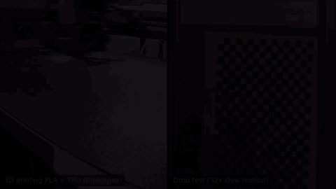

# Bayesian optimization of 3D-printed tensegrity structures for energy absorption

We print tensegrity-inspired structures in one piece from rigid PLA and flexible TPU on a dual-nozzle 3D printer, drop-test them on an instrumented drop tower, and let a Bayesian optimizer choose the next batch of designs. The paper, its figures, Marcus Madsen's IDETC-CIE 2026 talk, the videos, and the TMS 2027 abstracts are all on the project page:

<p align="center"><a href="https://vertical-cloud-lab.github.io/tensegrity-optimization/"><b>vertical-cloud-lab.github.io/tensegrity-optimization</b></a></p>

<p align="center">
  <a href="https://vertical-cloud-lab.github.io/tensegrity-optimization/"></a>
</p>

*Left: a T<sub>3</sub> prism printing on the Bambu Lab H2D, PLA struts and TPU tendons in one job (timelapse). Right: a prism dropped on the drop-tower carriage, filmed at 959 frames per second and shown 32 times slower than real time.*

The journal manuscript is drafted on [PR #76](https://github.com/vertical-cloud-lab/tensegrity-optimization/pull/76), and the talk's slides and clips are on [PR #84](https://github.com/vertical-cloud-lab/tensegrity-optimization/pull/84). Most of the working material sits on open pull requests rather than on `main`; see the [issues](https://github.com/vertical-cloud-lab/tensegrity-optimization/issues) and [pull requests](https://github.com/vertical-cloud-lab/tensegrity-optimization/pulls). The page's source is [`docs/index.html`](docs/index.html).

## Citation

Until the paper is out, please cite the repository:

```bibtex
@misc{madsen2026tensegrity,
  title        = {Experiment-Driven Bayesian Optimization of the Impact
                  Response of Multi-Material {3D}-Printed
                  Tensegrity-Inspired Structures},
  author       = {Madsen, Marcus E. and Christiansen, Audrey K. and
                  Han, Jinkwan and Hill, Jeffrey R. and Baird, Sterling G.},
  year         = {2026},
  note         = {Manuscript in preparation for the ASME Journal of
                  Mechanical Design},
  howpublished = {\url{https://github.com/vertical-cloud-lab/tensegrity-optimization}}
}
```
