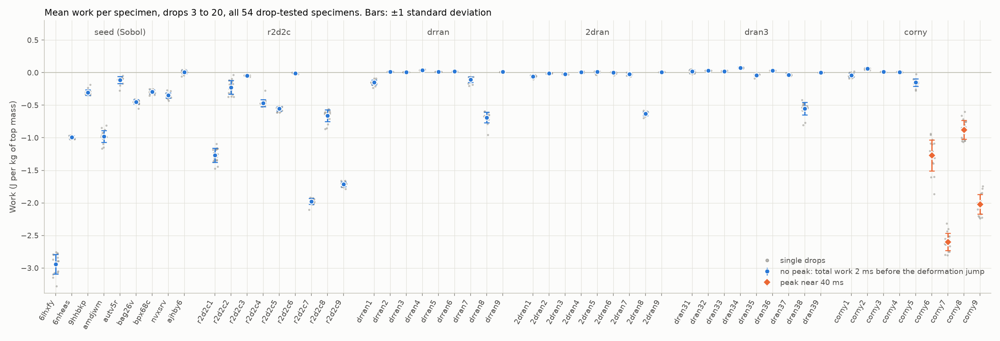
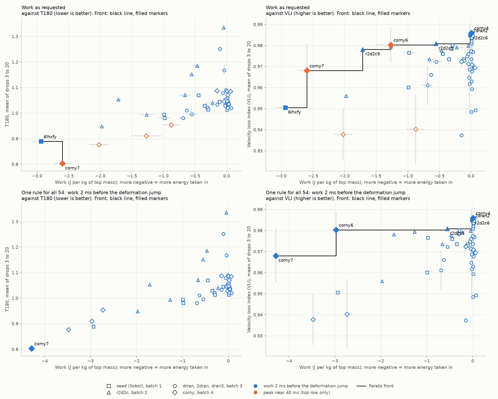

# Work, T180 and velocity loss index for every drop-tested specimen (issue #114)

Marcus asked on 2026-10-13 for two analyses to be run on every specimen that has
been drop tested, not just the corny batch:

1. the corny-batch analysis: the peak of Justin's total work near 40 ms
   ([`all-specimens`, commit `1aff9ff`](https://github.com/vertical-cloud-lab/tensegrity-optimization/tree/1aff9ff/analysis/issue-114-work/all-specimens)), and
2. Justin's request from the same day, run in parallel: for specimens with no
   peak, the total work 2 ms before the deformation jumps at lift-off
   ([`liftoff-work`, commit `a06be35`](https://github.com/vertical-cloud-lab/tensegrity-optimization/tree/a06be35/analysis/issue-114-work/liftoff-work)).

He also asked for Pareto fronts of work against transmissibility (T180) and
against the velocity loss index (VLI).

## Which specimens

All 54 sessions of the optimization campaign. Every one was dropped from 60 in
onto the 1/2 in PU mat (arrangement B), with the same four channels and 100 ms
captures:

| Batch | Specimens | Drops recorded |
|---|---|---|
| 1, Sobol seed | 6lhxfy, 6nheas, 9hhbkp, amdjwm, autv5r, bag26v, bpx68c, nvxsrv, ajhby6 | 101 each |
| 2 | r2d2c1 to r2d2c9 | 21 to 22 each |
| 3, three prints of one plate | drran1 to drran9, 2dran1 to 2dran9, dran31 to dran39 | 20 each |
| 4 | corny1 to corny9 | 20 each |

Every specimen is measured over drops 3 to 20, as in Justin's loop, so the
seed batch uses only the first 20 of its 101 drops. Drop k is the session's
k-th capture; 6lhxfy's captures start at Signal2, so its drop 20 is Signal21.

Not included: the tests from before the campaign (May to mid-August 2026, for
example prc1kn, 7xadt6, 9GMQYQ, RW5F61, the five print-defect prints and the
three abc123 blind-test specimens). Most of them were dropped onto felt and
cardboard stacks or from other heights, or were recorded as 20 ms captures,
which end before the 40 ms peak and the second contact. None of them is a
campaign design. The interrupted partial sessions 6lhxfy-s1 and amdjwm-s1 are
also left out; their full sessions are used.

## How each value is found

Nothing in either rule was changed. On the 36 specimens the two earlier runs
covered, this run reproduces both of them drop for drop: the same peak status in
648 of 648 drops, and identical peak values, jump times and pre-jump values.

- **Work.** Justin's `numaric_work`, compiled unchanged from
  [`justin/implimatation_or_work_2026-10-06.py`](justin/implimatation_or_work_2026-10-06.py)
  and called the way his loop calls it (CH4 top, CH5 bottom, m = 1,
  v0 = -5.46 m/s). Units are J per kg of top mass.
- **Peak rule** (`1aff9ff`). His pick `max(work_z[1250:2250])` (25 to 45 ms)
  counts only if it sits at least 0.5 ms inside the window and stands at least
  0.75 J/kg above the curve on both sides. If it doesn't, the most prominent
  peak between 15 and 70 ms is used if it clears 0.75 J/kg.
- **Lift-off rule** (`a06be35`). The deformation is the running sum of his
  `dx_top - dx_bottom` (CH4 minus CH5 integrated twice). The jump is the first
  time it stands 0.25 mm above its lowest so far. The value is the total work
  2 ms before the jump.
- **Which rule a specimen gets.** The peak rule if at least half of its drops
  have a peak, the lift-off rule otherwise. In practice this was all or
  nothing: every drop or no drop.
- **T180 and VLI.** Each capture goes through `analyze_capture(path,
  baseline="tail")` from the lab pipeline of PR #86
  (`scripts/analysis/drop_test_abc123_blind_analysis.py` on branch
  `copilot/add-drop-test-protocol-again`), the same call the campaign check-ins
  make. VLI = 1 - e_rebound, where e_rebound = g t_second / (2 dv), as defined in
  the manuscript. For batches 2 to 4 the means over drops 3 to 20 match the
  campaign tables to within 0.11 % (T180) and 0.0001 (VLI). For the seed batch
  the tables average all 101 drops; drops 3 to 20 land within -0.4 to +0.8 %
  (T180) and 0.007 (VLI) of them
  ([`figures/05_lab_metrics_vs_campaign_tables.png`](figures/05_lab_metrics_vs_campaign_tables.png)).
- **Pareto fronts.** More negative work (more energy taken in), lower T180 and
  higher VLI are better. A specimen is on a front if no other specimen is at
  least as good on both axes and better on one, using specimen means.

### One correction: r2d2c9 is read on CH3

On r2d2c9 the top sensor sits a quarter turn round. Over the first 15 ms CH3
gains +6.1 m/s, close to the base plate's +5.2, while CH4 gains only +0.5. On
the other 53 specimens CH4 gains 5.2 to 6.4 m/s, 1.00 to 1.19 times the base
plate. Read on CH4, r2d2c9's deformation runs to -240 mm on a 53 mm specimen,
so its work here uses CH3 as the vertical axis. T180 and VLI use all three axes
and are unaffected.

## Result

- **No new peaks.** None of the 18 specimens added here (seed and r2d2c) has a
  peak near 40 ms; the tallest bump is 0.57 J/kg (6lhxfy), under the 0.75
  cutoff. Across all 54, only corny6 to corny9 have one.
- **Batches 1 and 2 take in more energy before lift-off than batches 3 and 4.**
  Their values run from +0.01 to -2.94 J/kg, against +0.07 to -0.69 J/kg for
  the no-peak specimens of batches 3 and 4. In many seed and r2d2c curves the
  work drops during the impact and stays down for 20 to 40 ms, where most
  batch 3 and 4 curves start climbing right away
  ([`figures/03_work_curves_seed_r2d2c.png`](figures/03_work_curves_seed_r2d2c.png)).
- **6lhxfy and r2d2c7 squash like corny6 to corny9 but have no peak.** Their
  deformation goes down to -5.8 and -2.6 mm, and the jump comes 9.7 and 6.0 ms
  after the base-plate pulse ends. For them the jump is the spring-back, not
  lift-off, so their value is the work at the deepest squash. That is the same
  thing the lift-off rule gives on corny6 to corny9 (-2.7 to -4.3 J/kg), not
  the same thing as corny6 to corny9's peak values.



| Specimen | Rule | Work (J/kg) | Standard deviation (J/kg) | T180 | VLI |
|---|---|---|---|---|---|
| 6lhxfy (squash) | 2 ms before jump | -2.939 | 0.150 | 0.889 | 0.951 |
| 6nheas | 2 ms before jump | -0.991 | 0.022 | 0.995 | 0.960 |
| 9hhbkp | 2 ms before jump | -0.306 | 0.041 | 1.021 | 0.978 |
| amdjwm | 2 ms before jump | -0.980 | 0.091 | 0.981 | 0.977 |
| autv5r | 2 ms before jump | -0.113 | 0.054 | 1.044 | 0.974 |
| bag26v | 2 ms before jump | -0.447 | 0.032 | 1.070 | 0.976 |
| bpx68c | 2 ms before jump | -0.293 | 0.029 | 1.014 | 0.980 |
| nvxsrv | 2 ms before jump | -0.349 | 0.040 | 1.029 | 0.974 |
| ajhby6 | 2 ms before jump | 0.009 | 0.027 | 1.014 | 0.981 |
| r2d2c1 | 2 ms before jump | -1.268 | 0.106 | 0.994 | 0.980 |
| r2d2c2 | 2 ms before jump | -0.225 | 0.106 | 1.040 | 0.979 |
| r2d2c3 | 2 ms before jump | -0.046 | 0.006 | 1.335 | 0.980 |
| r2d2c4 | 2 ms before jump | -0.469 | 0.054 | 1.185 | 0.978 |
| r2d2c5 | 2 ms before jump | -0.554 | 0.033 | 1.152 | 0.981 |
| r2d2c6 | 2 ms before jump | -0.007 | 0.007 | 1.055 | 0.986 |
| r2d2c7 (squash) | 2 ms before jump | -1.977 | 0.045 | 0.948 | 0.956 |
| r2d2c8 | 2 ms before jump | -0.660 | 0.091 | 1.071 | 0.974 |
| r2d2c9 (CH3) | 2 ms before jump | -1.716 | 0.036 | 1.053 | 0.978 |
| drran1 | 2 ms before jump | -0.150 | 0.038 | 1.033 | 0.937 |
| drran2 | 2 ms before jump | 0.015 | 0.001 | 1.034 | 0.959 |
| drran3 | 2 ms before jump | 0.010 | 0.002 | 1.039 | 0.986 |
| drran4 | 2 ms before jump | 0.041 | 0.007 | 1.034 | 0.969 |
| drran5 | 2 ms before jump | 0.013 | 0.002 | 1.037 | 0.983 |
| drran6 | 2 ms before jump | 0.020 | 0.001 | 1.047 | 0.983 |
| drran7 | 2 ms before jump | -0.106 | 0.042 | 1.251 | 0.973 |
| drran8 | 2 ms before jump | -0.688 | 0.081 | 0.980 | 0.961 |
| drran9 | 2 ms before jump | 0.012 | 0.001 | 1.042 | 0.982 |
| 2dran1 | 2 ms before jump | -0.059 | 0.018 | 1.079 | 0.975 |
| 2dran2 | 2 ms before jump | -0.011 | 0.006 | 1.090 | 0.985 |
| 2dran3 | 2 ms before jump | -0.022 | 0.009 | 1.053 | 0.969 |
| 2dran4 | 2 ms before jump | 0.010 | 0.008 | 1.043 | 0.963 |
| 2dran5 | 2 ms before jump | 0.011 | 0.015 | 1.060 | 0.984 |
| 2dran6 | 2 ms before jump | 0.003 | 0.012 | 1.086 | 0.974 |
| 2dran7 | 2 ms before jump | -0.024 | 0.014 | 1.029 | 0.962 |
| 2dran8 | 2 ms before jump | -0.631 | 0.029 | 1.011 | 0.966 |
| 2dran9 | 2 ms before jump | 0.009 | 0.005 | 1.045 | 0.949 |
| dran31 | 2 ms before jump | 0.020 | 0.023 | 1.021 | 0.968 |
| dran32 | 2 ms before jump | 0.030 | 0.002 | 1.039 | 0.985 |
| dran33 | 2 ms before jump | 0.022 | 0.007 | 1.037 | 0.977 |
| dran34 | 2 ms before jump | 0.073 | 0.008 | 1.020 | 0.949 |
| dran35 | 2 ms before jump | -0.040 | 0.015 | 1.168 | 0.976 |
| dran36 | 2 ms before jump | 0.033 | 0.002 | 1.035 | 0.977 |
| dran37 | 2 ms before jump | -0.032 | 0.017 | 1.045 | 0.965 |
| dran38 | 2 ms before jump | -0.549 | 0.096 | 0.996 | 0.972 |
| dran39 | 2 ms before jump | 0.001 | 0.003 | 1.044 | 0.977 |
| corny1 | 2 ms before jump | -0.040 | 0.033 | 1.046 | 0.971 |
| corny2 | 2 ms before jump | 0.060 | 0.011 | 1.085 | 0.970 |
| corny3 | 2 ms before jump | 0.016 | 0.004 | 1.071 | 0.971 |
| corny4 | 2 ms before jump | 0.008 | 0.006 | 1.048 | 0.986 |
| corny5 | 2 ms before jump | -0.151 | 0.055 | 1.088 | 0.972 |
| corny6 | peak near 40 ms | -1.270 | 0.240 | 0.911 | 0.980 |
| corny7 | peak near 40 ms | -2.599 | 0.133 | 0.803 | 0.968 |
| corny8 | peak near 40 ms | -0.875 | 0.145 | 0.954 | 0.940 |
| corny9 | peak near 40 ms | -2.022 | 0.152 | 0.877 | 0.938 |

Each value is the mean of drops 3 to 20 (n = 18), and the standard deviation
divides by n - 1. T180 and VLI are means over the same drops.

## Pareto fronts



The top row uses the values asked for (the table above). The bottom row applies
the lift-off rule to all 54, so every point is the same measurement.

| Front | Values as asked for (top row) | One rule for all 54 (bottom row) |
|---|---|---|
| Work and T180 | 6lhxfy, corny7 | corny7 |
| Work and VLI | 6lhxfy, corny7, r2d2c9, corny6, r2d2c5, 2dran2, r2d2c6, corny4 | corny7, corny6, r2d2c5, 2dran2, r2d2c6, corny4 |

- **Work and T180 mostly agree.** Specimens that take in more energy tend to
  transmit less (Spearman rank correlation 0.35 over the 54, p = 0.009), so the
  front is short. With one rule for all, corny7 takes in the most energy
  (-4.29 J/kg) and has the lowest T180 (0.803), so it is the whole front.
  6lhxfy joins only in the top row, because its squash value (-2.94) sits next
  to corny7's peak value (-2.60).
- **Work and VLI do not agree** (rank correlation 0.21, p = 0.12). corny8 and
  corny9 take in a lot of energy but have the two lowest VLIs of batch 4 (0.940
  and 0.938). The front runs from the specimens that take in the most energy
  (6lhxfy and corny7, VLI 0.951 and 0.968) to corny4 and r2d2c6 (VLI 0.986,
  work about zero).
- **The near-zero end of the VLI front is within the scatter.** 2dran2, r2d2c6
  and corny4 are separated by hundredths of a J/kg and by less than 0.002 in
  VLI.

## Things to keep in mind

- **The two rules measure different things.** The peak value is the energy left
  over after the specimen springs back; the lift-off value is the energy taken
  in before the base plate leaves the mat. The top row of the Pareto figure
  mixes them because that is what was asked for; the bottom row is the
  like-for-like check.
- **The 2 ms cutoff matters on five specimens.** Their work dips sharply inside
  the base-plate pulse, just before the jump, and the 2 ms cutoff lands before
  the dip. At 1 ms before the jump they give r2d2c3 -2.10, r2d2c4 -1.08,
  r2d2c5 -0.87, drran7 -1.28 and dran35 -0.67 J/kg instead of -0.05, -0.47,
  -0.55, -0.11 and -0.04. These five have the five highest T180 values of the
  54 (1.15 to 1.33), so the dip may be a part rattling rather than the
  specimen squashing. The 1 and 3 ms
  values are in [`results/specimen_details.csv`](results/specimen_details.csv).
- **The sensors still disagree.** CH4 picks up 6 to 19 % more velocity than
  CH5 over the first 15 ms on 49 of the 54 specimens (corny6 to corny9: 0 to
  3 %; r2d2c9 is read on CH3). The
  lift-off values are taken before most of that builds up, but they carry the
  same caveats as the earlier runs.
- **VLI can flip between two bursts.** t_second is the largest top-vertex burst
  15 to 70 ms after impact, and on some specimens it switches between two
  bursts from drop to drop (corny7: about 15 and 42 ms). Those specimens have
  VLI standard deviations up to 0.021 (the error bars in the figure).

## Files

| File | What it is |
|---|---|
| [`results/work_summary.csv`](results/work_summary.csv) | The table above, with which front each specimen is on |
| [`results/specimen_details.csv`](results/specimen_details.csv) | Per specimen: both rules, the 1, 2 and 3 ms values, peak counts, jump timing, deformation, T180 and VLI (this run and the campaign tables), and all four fronts |
| [`results/per_drop_work.csv`](results/per_drop_work.csv) | Every drop: peak status, value, prominence, jump time, base-pulse end, the 1, 2 and 3 ms values, T180 and VLI |
| [`results/per_drop_lab_metrics.csv`](results/per_drop_lab_metrics.csv) | Every drop 1 to 20 of all 54 sessions through the lab pipeline: T180, T1000, peaks, dv, t_second, e_rebound, VLI |
| [`figures/`](figures/) | The figures above, the work and deformation curves of the 18 new specimens (03, 04) and the lab-metric check (05) |
| [`work_every_specimen.py`](work_every_specimen.py) | Both rules, the fronts, the tables and the figures |
| [`lab_metrics.py`](lab_metrics.py) | Runs the PR #86 pipeline's `analyze_capture` on every capture |
| [`fetch_waveforms.py`](fetch_waveforms.py) | Downloads drops 1 to 20 of the 54 sessions from Box (about 10 GB) and writes one 50 kHz CSV per specimen in the corny7 export format; corny7 comes out byte-identical to the issue #110 export |
| [`box-ids/`](box-ids/) | Box file ids per session. Batches 3 and 4 come from the PR #86 check-ins; the seed and r2d2c ids from `box-session-manifest.json` on branch `claude/cv-signal-audit-20260922` |
| [`campaign/`](campaign/) | The campaign's per-session tables, copied from `manuscript/data/` on branch `copilot/vertical-cloud-labtensegrity-optimization` (commit `e8eb193`), for the T180 and VLI check |
| [`justin/`](justin/) | Justin's script as uploaded on 2026-10-06, not edited |

## Reproduce

```bash
pip install numpy scipy pandas matplotlib
python fetch_waveforms.py --raw /tmp/drop-raw          # writes waveforms/
python lab_metrics.py --raw /tmp/drop-raw --pipeline-dir <PR #86 checkout>/scripts/analysis
python work_every_specimen.py
```

The waveform CSVs (54 x 3.5 MB) are not committed. The pipeline directory must
sit at `scripts/analysis/` inside a checkout of
`copilot/add-drop-test-protocol-again`, because the pipeline writes into the
checkout's `data/` folder when imported.
