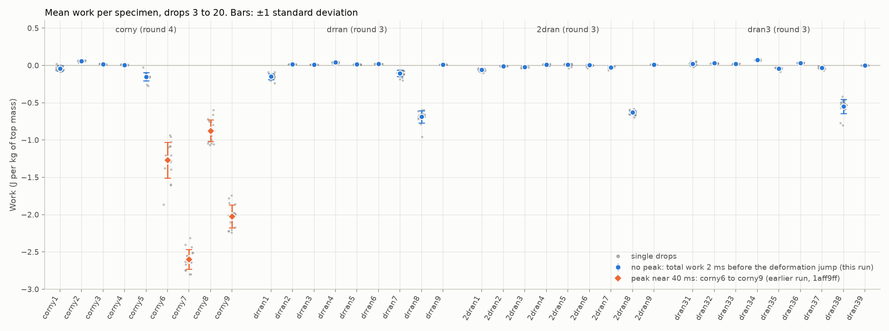
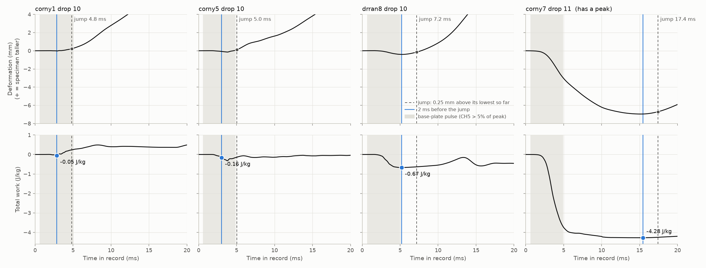
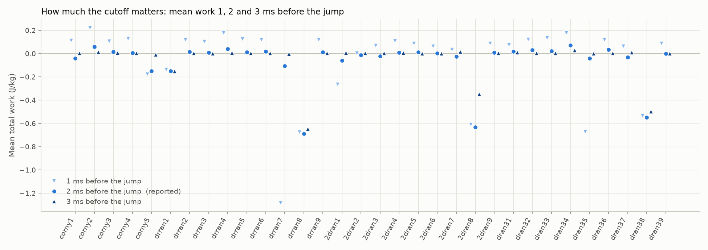

# Work before lift-off for the specimens with no peak (issue #114)

Justin asked on 2026-10-13 for an approximate work value for the specimens that
have no significant negative deformation and no peak near 40 ms. His idea: the
deformation graph should jump when the specimen lifts off the table, so take the
total work a few milliseconds before the deformation jumps in the positive
direction. He asked for these values to be plotted with the peak values of the
well-behaved specimens, and for a table of each specimen's work and standard
deviation.

The 32 specimens are the ones the all-specimens run left out
([`all-specimens`, commit `1aff9ff`](https://github.com/vertical-cloud-lab/tensegrity-optimization/tree/1aff9ff/analysis/issue-114-work/all-specimens)):
corny1 to corny5, and the three round-3 prints drran1 to drran9, 2dran1 to
2dran9 and dran31 to dran39 (drranN, 2dranN and dran3N are three prints of the
same design N). All were dropped 20 times from 60 in onto the 1/2 in PU mat.

## Result

Every drop of all 32 specimens has the jump, so no drop or specimen was left
out. The work 2 ms before the jump is small, as Justin expected:

- **29 of the 32 come out between -0.15 and +0.07 J/kg**, so close to zero. That
  matches the videos of corny1 to corny5, where the specimen height stays
  within about 2 mm, the tracking noise, for the whole record
  ([`corny1-6-videos`](https://github.com/vertical-cloud-lab/tensegrity-optimization/tree/0cd50a0/analysis/issue-114-work/corny1-6-videos)).
- **Round-3 design 8 is the exception.** All three prints agree: drran8 -0.69,
  2dran8 -0.63 and dran38 -0.55 J/kg. Their deformation sags by 0.3 to 0.4 mm
  during the impact before it jumps, so they do take in a little energy. They
  also have the three lowest T180 values of the 32 (0.98 to 1.01).
- **corny6 to corny9 still sit well below the rest**, at -0.88 to -2.60 J/kg.



| Specimen | Work (J/kg) | Standard deviation (J/kg) |
|---|---|---|
| corny1 | -0.040 | 0.033 |
| corny2 | 0.060 | 0.011 |
| corny3 | 0.016 | 0.004 |
| corny4 | 0.008 | 0.006 |
| corny5 | -0.151 | 0.055 |
| corny6 (peak near 40 ms) | -1.270 | 0.240 |
| corny7 (peak near 40 ms) | -2.599 | 0.133 |
| corny8 (peak near 40 ms) | -0.875 | 0.145 |
| corny9 (peak near 40 ms) | -2.022 | 0.152 |
| drran1 | -0.150 | 0.038 |
| drran2 | 0.015 | 0.001 |
| drran3 | 0.010 | 0.001 |
| drran4 | 0.041 | 0.007 |
| drran5 | 0.013 | 0.002 |
| drran6 | 0.020 | 0.001 |
| drran7 | -0.106 | 0.042 |
| drran8 | -0.688 | 0.081 |
| drran9 | 0.012 | 0.001 |
| 2dran1 | -0.059 | 0.018 |
| 2dran2 | -0.011 | 0.007 |
| 2dran3 | -0.022 | 0.009 |
| 2dran4 | 0.010 | 0.008 |
| 2dran5 | 0.011 | 0.015 |
| 2dran6 | 0.003 | 0.012 |
| 2dran7 | -0.024 | 0.014 |
| 2dran8 | -0.631 | 0.029 |
| 2dran9 | 0.009 | 0.006 |
| dran31 | 0.020 | 0.023 |
| dran32 | 0.030 | 0.002 |
| dran33 | 0.022 | 0.007 |
| dran34 | 0.073 | 0.008 |
| dran35 | -0.040 | 0.015 |
| dran36 | 0.033 | 0.002 |
| dran37 | -0.032 | 0.017 |
| dran38 | -0.549 | 0.096 |
| dran39 | 0.001 | 0.003 |

Each row is the mean of drops 3 to 20 (n = 18), the drops Justin's loop uses.
The standard deviation divides by n - 1. Units are J per kg of top mass, since
his code sets m = 1. The four rows marked "peak near 40 ms" are the values from
the all-specimens run, unchanged; the script recomputes them and gets the same
numbers.

## How the value is found

1. **Work.** Justin's `numaric_work`, compiled unchanged from his 2026-10-06
   upload ([`justin/implimatation_or_work_2026-10-06.py`](justin/implimatation_or_work_2026-10-06.py))
   and called the way his loop calls it: CH4 as the top, CH5 as the bottom,
   m = 1, v0 = -5.46 m/s.
2. **Deformation.** The running sum of his `dx_top - dx_bottom`, with the same
   trapezoids his loop uses. This is CH4 minus CH5 integrated twice (v0
   cancels). Positive means the specimen is taller. It is the red line in the
   lower panel of the corny1 to corny6 videos.
3. **The jump.** The first time the deformation stands 0.25 mm above the lowest
   it has been so far. 0.25 mm is about one pixel in the drop videos, the
   smallest height change they can show.
4. **The value.** The total work 2 ms before the jump, as the reading of "a few
   milliseconds". 1 and 3 ms are kept as a check (see below).



**Where the jump falls.** On 27 of the 32 specimens the jump starts 3.8 to
5.0 ms into the record (specimen means), while the base-plate pulse is dying
away: CH5 is down to 5 to 51% of its peak, and the pulse ends (CH5 under 5% of
its peak) up to 1.4 ms later. So the jump does line up with lift-off, to within
about a millisecond. The cutoff 2 ms earlier then lands 1.7 to 3.4 ms into the
record, around the peak of the base-plate pulse (2.6 to 3.4 ms). On the other
five (drran1, drran8, 2dran8, dran31 and dran38) the deformation first sags a
little or rises slowly, and the jump comes 5.6 to 7.2 ms in, 0.6 to 2.2 ms
after the pulse ends.

Every drop's curves, with the jump and the value marked:
[`03_work_curves_32_specimens.png`](figures/03_work_curves_32_specimens.png)
and [`04_deformation_curves_32_specimens.png`](figures/04_deformation_curves_32_specimens.png).

## Two things to keep in mind

**The cutoff matters for a few specimens.** Moving the cutoff from 2 ms to 1 ms
before the jump raises most values by about 0.1 J/kg, because the start of the
jump gets included. Moving it to 3 ms brings them to about zero, because the
cutoff then lands before most of the impact (0.7 to 2.4 ms into the record).
Three specimens have a sharp dip at about 2.5 ms, just before their jump, that
the 2 ms cutoff skips: with 1 ms, drran7 gives -1.28, dran35 -0.67 and 2dran1
-0.27 J/kg instead of -0.11, -0.04 and -0.06. drran7 and dran35 also have the
two highest T180 values of the 36 (1.25 and 1.17), so that dip may be a part
rattling rather than the specimen squashing. Design 8 stays clearly negative
at every cutoff (-0.35 to -0.69 J/kg).



**The orange points in the first figure are a different measurement.** As
asked, corny6 to corny9 keep their peak value near 40 ms. The same 2 ms rule
applied to them gives -2.7 to -4.3 J/kg instead, because their deformation
keeps going down after lift-off and only turns up at 14 to 18 ms, as the
specimen springs back. For them the jump is not lift-off. Those values are in
the `mean_2ms_before_jump` column of
[`results/specimen_details.csv`](results/specimen_details.csv).

## Files

| File | What it is |
|---|---|
| [`liftoff_work.py`](liftoff_work.py) | The analysis: finds the jump, takes the work, writes the tables and figures |
| [`fetch_waveforms.py`](fetch_waveforms.py) | Downloads the 720 captures from Box and writes one 50 kHz CSV per specimen in the corny7 export format (copied from the all-specimens run) |
| [`results/work_summary.csv`](results/work_summary.csv) | The table above |
| [`results/per_drop_liftoff_work.csv`](results/per_drop_liftoff_work.csv) | Every drop: jump time, base-plate pulse peak and end, work 1, 2 and 3 ms before the jump, and Justin's 25 to 45 ms maximum |
| [`results/specimen_details.csv`](results/specimen_details.csv) | Per specimen: the reported value, the 1 and 3 ms values, jump timing, and the 2 ms rule on corny6 to corny9 |
| [`figures/`](figures/) | The five figures above |
| [`justin/implimatation_or_work_2026-10-06.py`](justin/implimatation_or_work_2026-10-06.py) | Justin's script as uploaded, not edited |

## Reproduce

```bash
pip install numpy scipy matplotlib
python fetch_waveforms.py --raw /tmp/drop-raw   # 6.5 GB of captures; writes waveforms/
python liftoff_work.py
```

The waveform CSVs are not committed here (36 x 3.5 MB). corny1 to corny9 are
also committed on the all-specimens branch, and the rebuilt copies match them
byte for byte. To change the rule, edit `JUMP_MM` or `MARGIN_MS` at the top of
`liftoff_work.py`.
