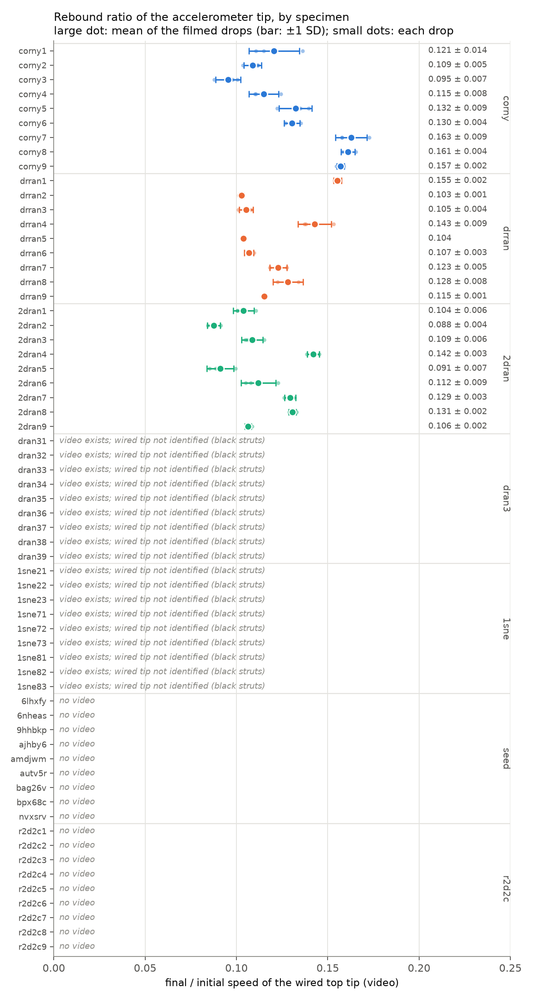
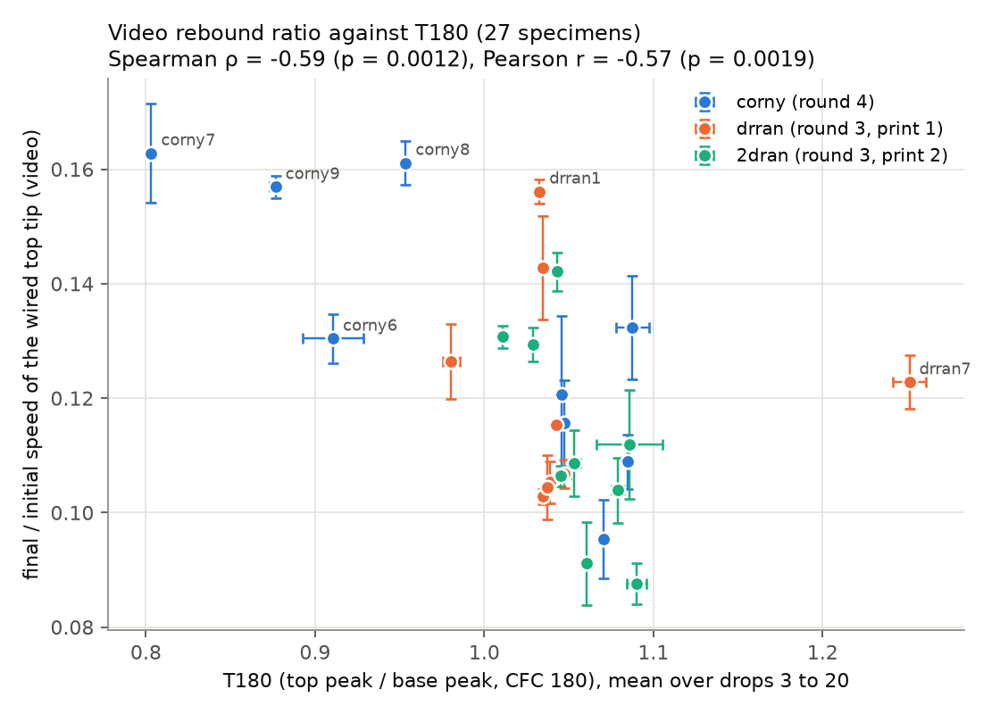
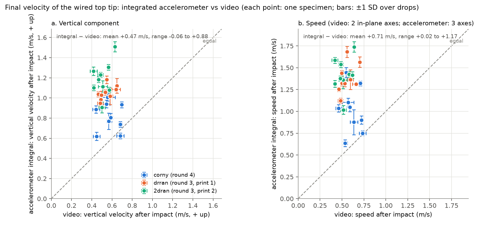
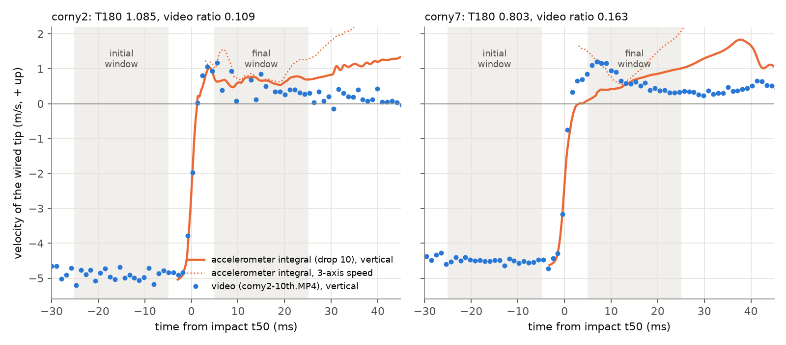

# Issue #134: velocity of the accelerometer tip from the drop videos

Justin asked on [issue #134](https://github.com/vertical-cloud-lab/tensegrity-optimization/issues/134)
(2026-11-16) for three things:

- Track the top tip that houses the accelerometer (the one the black cable
  leaves from) in the slow-motion drop videos.
- Turn its motion into velocity before and after the impact, and compare the
  final/initial ratio with T180.
- Use the video velocities to test whether integrating the accelerometer gives
  the right final velocity.

## Results in short

- **27 specimens tracked, 81 filmed drops:** corny1 to corny9, drran1 to
  drran9 and 2dran1 to 2dran9, 3 filmed drops each.
- **Initial speed of the tip: 4.48 to 4.92 m/s** (mean 4.64, SD 0.13 across
  specimens).
  - All drops are from 60 in, so the true impact speed should be the same for
    every specimen. The ±3 % spread is mostly the scale error from the
    hand-marked heights.
  - A frictionless 60 in fall would give 5.47 m/s. An independent fit on the
    1sne branch (carriage path against CH5) found arrival speeds of 4.60 to
    4.88 m/s.
- **Final speed: 0.42 to 0.73 m/s, moving up.** Final/initial ratio: 0.088 to
  0.163.
  - Repeat drops of one specimen agree closely: the largest SD within a
    specimen is 0.014.
- **Ratio against T180: negative.** Spearman ρ = −0.59 (p = 0.001), Pearson
  r = −0.57 (p = 0.002), n = 27.
  - The four attenuators corny6 to corny9 (T180 0.80 to 0.95) give
    0.13 to 0.16.
  - Most of the rest (T180 1.01 to 1.09) give 0.09 to 0.14.
  - drran1 (0.156 at T180 1.03) and drran7 (0.123 at T180 1.25) are off
    the trend.
- **Integrating the accelerometer overshoots the final velocity.**
  - The integrated final vertical velocity is higher than the video's by
    0.47 m/s on average (SD 0.23, range −0.06 to +0.88 m/s). That is about
    twice the true value (median ratio 1.96).
  - Measured against the velocity change through the impact (5.18 m/s on
    average), the error is +9 %.
  - With all three axes the overshoot grows to +0.71 m/s on average, because
    the two sideways axes add 0.1 to 1.2 m/s that the video does not show.









## Table

Mean ± SD over the filmed drops (video) and over drops 1 to 20
(accelerometer). T180 is the mean ± SD over drops 3 to 20 from the issue #114
every-specimen tables (branch `claude/issue-114-20261013-1726`, commit
`4874229`, copied to [`inputs/issue114_specimen_details.csv`](inputs/issue114_specimen_details.csv)).
The full tables are:
- [`results/specimen_summary.csv`](results/specimen_summary.csv): per specimen,
  including vertical and sideways components and the within-window SD.
- [`results/video_per_clip.csv`](results/video_per_clip.csv): per filmed drop.
- [`results/accel_integration_per_drop.csv`](results/accel_integration_per_drop.csv):
  per accelerometer drop.

| specimen | clips | initial speed (m/s) | final speed (m/s) | final vertical (m/s, + up) | ratio final/initial | T180 | integral, final vertical (m/s) | integral, final 3-axis speed (m/s) |
|---|---|---|---|---|---|---|---|---|
| corny1 | 3 | 4.73 ± 0.01 | 0.570 ± 0.066 | 0.557 ± 0.076 | 0.121 ± 0.014 | 1.046 ± 0.003 | 1.006 ± 0.037 | 1.102 ± 0.050 |
| corny2 | 3 | 4.92 ± 0.01 | 0.536 ± 0.024 | 0.449 ± 0.033 | 0.109 ± 0.005 | 1.085 ± 0.003 | 0.619 ± 0.041 | 0.636 ± 0.037 |
| corny3 | 3 | 4.84 ± 0.00 | 0.462 ± 0.033 | 0.443 ± 0.035 | 0.095 ± 0.007 | 1.071 ± 0.001 | 0.886 ± 0.036 | 1.036 ± 0.043 |
| corny4 | 3 | 4.74 ± 0.03 | 0.547 ± 0.033 | 0.545 ± 0.034 | 0.116 ± 0.008 | 1.048 ± 0.003 | 0.940 ± 0.037 | 1.446 ± 0.058 |
| corny5 | 3 | 4.81 ± 0.00 | 0.636 ± 0.044 | 0.567 ± 0.019 | 0.132 ± 0.009 | 1.088 ± 0.010 | 0.768 ± 0.081 | 0.877 ± 0.144 |
| corny6 | 3 | 4.52 ± 0.01 | 0.589 ± 0.020 | 0.587 ± 0.019 | 0.130 ± 0.004 | 0.911 ± 0.018 | 0.805 ± 0.042 | 1.050 ± 0.053 |
| corny7 | 3 | 4.51 ± 0.01 | 0.734 ± 0.039 | 0.682 ± 0.037 | 0.163 ± 0.009 | 0.803 ± 0.003 | 0.624 ± 0.027 | 0.750 ± 0.028 |
| corny8 | 3 | 4.48 ± 0.01 | 0.722 ± 0.019 | 0.682 ± 0.019 | 0.161 ± 0.004 | 0.954 ± 0.003 | 0.738 ± 0.028 | 0.901 ± 0.047 |
| corny9 | 3 | 4.51 ± 0.01 | 0.708 ± 0.010 | 0.696 ± 0.005 | 0.157 ± 0.002 | 0.877 ± 0.004 | 0.932 ± 0.028 | 1.321 ± 0.027 |
| drran1 | 3 | 4.51 ± 0.02 | 0.704 ± 0.012 | 0.649 ± 0.008 | 0.156 ± 0.002 | 1.033 ± 0.002 | 1.121 ± 0.074 | 1.565 ± 0.060 |
| drran2 | 3 | 4.53 ± 0.02 | 0.465 ± 0.007 | 0.465 ± 0.006 | 0.103 ± 0.001 | 1.034 ± 0.001 | 1.038 ± 0.025 | 1.253 ± 0.023 |
| drran3 | 3 | 4.73 ± 0.00 | 0.498 ± 0.017 | 0.489 ± 0.017 | 0.105 ± 0.004 | 1.039 ± 0.001 | 0.983 ± 0.027 | 1.321 ± 0.028 |
| drran4 | 3 | 4.63 ± 0.03 | 0.662 ± 0.041 | 0.640 ± 0.042 | 0.143 ± 0.009 | 1.034 ± 0.002 | 1.083 ± 0.019 | 1.313 ± 0.018 |
| drran5 | 3 | 4.63 ± 0.02 | 0.483 ± 0.028 | 0.483 ± 0.028 | 0.104 ± 0.006 | 1.037 ± 0.002 | 0.946 ± 0.023 | 1.123 ± 0.028 |
| drran6 | 3 | 4.64 ± 0.02 | 0.495 ± 0.011 | 0.495 ± 0.011 | 0.107 ± 0.003 | 1.047 ± 0.004 | 1.028 ± 0.040 | 1.437 ± 0.029 |
| drran7 | 3 | 4.55 ± 0.09 | 0.558 ± 0.011 | 0.548 ± 0.007 | 0.123 ± 0.005 | 1.251 ± 0.010 | 1.182 ± 0.037 | 1.682 ± 0.063 |
| drran8 | 3 | 4.72 ± 0.01 | 0.597 ± 0.030 | 0.582 ± 0.026 | 0.126 ± 0.007 | 0.980 ± 0.005 | 1.016 ± 0.081 | 1.363 ± 0.113 |
| drran9 | 3 | 4.63 ± 0.01 | 0.533 ± 0.004 | 0.533 ± 0.004 | 0.115 ± 0.001 | 1.042 ± 0.001 | 1.056 ± 0.026 | 1.318 ± 0.035 |
| 2dran1 | 3 | 4.68 ± 0.01 | 0.486 ± 0.026 | 0.485 ± 0.026 | 0.104 ± 0.006 | 1.079 ± 0.004 | 1.230 ± 0.024 | 1.537 ± 0.034 |
| 2dran2 | 3 | 4.78 ± 0.02 | 0.418 ± 0.018 | 0.418 ± 0.018 | 0.088 ± 0.004 | 1.090 ± 0.006 | 1.101 ± 0.029 | 1.316 ± 0.038 |
| 2dran3 | 3 | 4.76 ± 0.04 | 0.517 ± 0.032 | 0.502 ± 0.031 | 0.109 ± 0.006 | 1.053 ± 0.004 | 0.907 ± 0.053 | 1.018 ± 0.049 |
| 2dran4 | 3 | 4.49 ± 0.03 | 0.638 ± 0.012 | 0.630 ± 0.007 | 0.142 ± 0.003 | 1.043 ± 0.003 | 1.509 ± 0.050 | 1.739 ± 0.060 |
| 2dran5 | 3 | 4.58 ± 0.01 | 0.418 ± 0.034 | 0.418 ± 0.034 | 0.091 ± 0.007 | 1.060 ± 0.001 | 1.266 ± 0.043 | 1.585 ± 0.033 |
| 2dran6 | 3 | 4.57 ± 0.04 | 0.511 ± 0.048 | 0.509 ± 0.045 | 0.112 ± 0.009 | 1.086 ± 0.020 | 1.113 ± 0.059 | 1.360 ± 0.097 |
| 2dran7 | 3 | 4.48 ± 0.03 | 0.579 ± 0.014 | 0.566 ± 0.018 | 0.129 ± 0.003 | 1.029 ± 0.002 | 1.305 ± 0.027 | 1.427 ± 0.033 |
| 2dran8 | 3 | 4.74 ± 0.01 | 0.619 ± 0.010 | 0.573 ± 0.015 | 0.131 ± 0.002 | 1.011 ± 0.001 | 1.080 ± 0.027 | 1.415 ± 0.037 |
| 2dran9 | 3 | 4.53 ± 0.01 | 0.482 ± 0.008 | 0.467 ± 0.004 | 0.106 ± 0.002 | 1.045 ± 0.002 | 1.183 ± 0.029 | 1.378 ± 0.027 |

## Specimens without results

- **No video at all (18):** the seed batch (6lhxfy, 6nheas, 9hhbkp, ajhby6,
  amdjwm, autv5r, bag26v, bpx68c, nvxsrv) and r2d2c1 to r2d2c9. Their Box
  manifests and check-in notes list no clips.
- **Video, but the wired tip is not identified (18): dran31 to dran39 and the
  1sne replicate batch.** Both batches were printed with black struts, and the
  camera was zoomed out. The black cable cannot be followed to a tip against
  the dark backdrop (see [`annotation/untracked_*.jpg`](annotation/)). On the
  white batches the cable always runs to the upper tip, so the same choice
  would probably be right here, but I did not want to report a tip I could
  not see. If someone marks the wired tip on those frames, `run_tracking.py`
  and `velocity_analysis.py` run on them unchanged.

## What I think of integrating the accelerometer

**For the velocity after impact, integration is not accurate enough.** Its
error (0.5 m/s on average) is as large as the quantity (0.4 to 0.7 m/s). Three
reasons, in order of size:

1. **The final velocity is a small difference of two large numbers.** It is
   −4.6 m/s plus a change of +5.2 m/s through the pulse. A 1 % error in either
   moves the result by 0.05 m/s, which is 10 % of the answer. The overshoot
   seen here is a 9 % error in the change. The top sensor's integrated change
   comes out larger than the video's on every specimen but one (corny7, −0.06 m/s).
2. **The top channel does not return to the right zero after the shock.** The
   integral keeps climbing after the pulse while the video shows the tip
   slowing down (figure 4: corny2 reaches 1.3 m/s by 45 ms against 0.1 m/s in
   the video). The issue #114 corny videos found the same thing: CH4 reads
   +2.3 to +3.2 G on average from 15 to 100 ms while the tip barely moves
   relative to the carriage.
3. **The sideways axes (CH2, CH3) add velocity the video does not see.** They
   contribute 0.1 to 1.2 m/s by the final window. The camera sees only one of
   the two sideways directions, but in that one the tip moves at most 0.33 m/s.

**What integration does get right.** The shape and timing of the velocity
change through the first 2 to 3 ms of the pulse agree with the video
(figure 4), and so does the size of that change to within about 10 %. So it is
usable for the change in velocity over the pulse, not for what is left after
it.

**This verdict depends on the video scale, and the scale is the weakest link
here.** The final velocity from integration is v0 + Δv, with v0 from the video.
The overshoot would disappear if every video velocity were about 10 % too low.
Two things argue against that:

- The hand-marked heights give initial speeds that scatter by only 3 % across
  specimens.
- The independent CH5-based calibration on the 1sne branch gives 4.60 to
  4.88 m/s, the same as here.

A direct check would settle it: film one drop with a ruler in the plane of
the specimen.

If integration has to be used, I would:

- Remove the post-impact offset measured over a quiet stretch of the record.
- Calibrate the gain per session against a filmed drop.
- Integrate only the vertical axis, over the shortest window that answers the
  question.
- Record a longer pre-trigger, so the free-fall baseline is in the record. At
  present the record starts after the pulse has begun.

## How the tip is tracked

- **Clips.** Sony RX100 IV high-frame-rate clips at 959.04 frames/s (one frame
  every 1.043 ms), stored as 59.94 frame/s MP4s on the lab's Box share
  ([`box-ids/video/`](box-ids/video/)). The camera is turned a quarter turn, so
  "down" points to the right of the frame and the top of the specimen to the
  left.
- **Which tip.** On the last frame of one clip per specimen (specimen at rest
  on the carriage), I marked the top tip that the black accelerometer cable
  leaves from ([`annotations.json`](annotations.json); the marked frames are in
  [`annotation/`](annotation/)). On the 40° twist designs, two top tips show
  and the cable runs to the upper one. On the 80° designs, three show and it
  runs to the top one. On drran8 and 2dran8 (design t35) the cable ends
  between the top two tips; I took the top one, so treat those two specimens
  as less certain. The other two clips of each specimen are matched to the
  marked one by cross-correlating the specimen region of their last frames
  (correlation 0.98 to 0.99, shifts of a few pixels).
- **Tracking** ([`track_tip.py`](track_tip.py), [`run_tracking.py`](run_tracking.py)).
  The key frames (every ~30th frame) locate the impact to within 30 frames.
  About 260 full-size frames around it are then read. The tip is followed
  backward in time from the end of that window with normalized
  cross-correlation template matching and a sub-pixel peak fit. The template is
  a 64 × 64 px patch around the marked tip in the rest frame. When that matches
  poorly, a patch cut from the previous tracked frame is used instead (motion
  blur, or a tip that has twisted). Positions for every frame are in
  [`results/tracks/`](results/tracks/).
- **Check.** [`figures/05_tracking_check_1.jpg`](figures/05_tracking_check_1.jpg)
  and [`_2`](figures/05_tracking_check_2.jpg) show the tracked point on each
  specimen's reference clip 15 ms before impact, at impact and 15 ms after.
  It stays on the same tip housing in all 27.
- **Finding the impact in the key frames.** The impact is placed at the first
  key frame where the tip is at its rest position (correlation above 0.75
  with the rest frame) and stays there for the next two key frames. A clip
  that opens with the carriage already at rest from the previous drop
  (four of the longer drran clips do) is handled because key frame 0 does not
  count as an arrival.

## How velocity is computed

The formula from the request:

v = (pixel displacement × true height [m]) / (frame interval [s] × perceived height [px])

- **Frame interval:** 1/959.04 s, from `captureFps` in the Sony XML sidecars.
- **Pixel displacement:** the tracked tip's movement from one frame to the
  next. The vertical part (along the drop) and the in-plane sideways part are
  kept separately; "speed" is the length of the two together.
- **True height:** the overall printed height of the design, from the bottom
  of the bottom joints to the top of the accelerometer housings, taken from
  the design's STL files (branch `claude/issue-98-20260821-0103`,
  `bo/per-specimen-stls/`; [`inputs/design_heights_from_stl.json`](inputs/design_heights_from_stl.json)).
  The design key's `H_mm` is the distance between the top and bottom node
  planes and leaves out 20 to 22 mm of joints and housings, so it does not
  match what the camera sees. Using `H_mm` would make every velocity 19 to
  25 % lower; the ratio would not change.
- **Perceived height:** in the rest frame, from the outer end of the top tips
  to the outer edge of the bottom joints where they meet the carriage, marked
  by hand to about ±5 px on 300 to 420 px (±2 to 3 %). This gives 0.24 to
  0.29 mm per pixel.

## How the impact and the two windows are placed

- **Impact time (t50):** the moment the tip's downward velocity has dropped to
  half of its free-fall value, interpolated between frames. Only frames within
  120 px of the tip's rest position are searched, so a tracking glitch higher
  up in the frame is never taken for the impact.
- **Initial velocity:** mean over t50 − 25 ms to t50 − 5 ms (19 to 20 frames).
  Frames more than 25 % away from the window median are dropped first. They
  are tracking glitches where the tip passes the edge of the backdrop.
- **Final velocity:** mean over t50 + 5 ms to t50 + 25 ms. Single-frame
  spikes more than 1 m/s from their neighbours are dropped first. These are
  template switches; at most a few frames per clip, counted in
  `n_post_glitches`.
- **The 5 ms gaps** keep the sharp change itself out of both averages: the
  tip's velocity goes from −4.6 to about 0 m/s within about 3 ms of t50.
- **Ratio:** final speed / initial speed, using the speeds of the
  window-averaged velocities. The vertical-only version, −(final vertical) /
  (initial vertical), is also in the tables (`ratio_z`). It is within 0.01 of
  the speed ratio everywhere.

## How the accelerometer is integrated

[`velocity_analysis.py`](velocity_analysis.py), function `accel_drop`.

- **Data.** Every drop (1 to 20) of each tracked specimen: the 50 kHz
  waveforms rebuilt from the TP4 captures on Box
  ([`fetch_waveforms.py`](fetch_waveforms.py), the issue #114 recipe). The
  three axes of the top sensor are CH2, CH3 and CH4, with CH4 along the drop.
- **Integration.** v(t) = v0 + ∫ a dt, trapezoidal, on all three axes from the
  first sample of the record.
- **Gravity.** An accelerometer reads 0 g in free fall, so g is taken off the
  vertical axis.
- **Initial value.** v0 points straight down. Its size is the specimen's mean
  initial velocity from the video, carried forward in free fall from the
  middle of the video's initial window to the first sample of the record. The
  TP4 record starts about 2.5 ms before t50, when the pulse has already
  begun: CH4 reads about 6 G at t = 0.
- **Windows.** t50 and the final window are found on the integrated vertical
  velocity exactly as on the video. The final velocity is the mean over
  t50 + 5 to t50 + 25 ms.
- **Comparison.** Per specimen: the mean of the 20 integrated drops against
  the mean of the 3 filmed drops. drran and 2dran clips were filmed at random
  drops, so a drop-by-drop pairing is not available for every clip; the corny
  `-10th` clips are paired with drops 10 and 11 in
  [`figures/04_example_velocity_traces.png`](figures/04_example_velocity_traces.png).

## Caveats

- **Scale.**
  - The perceived height is hand-marked (±2 to 3 %), and the true height is
    the design value from the STL, not a caliper measurement of the printed
    part.
  - Lens distortion and depth are not corrected. The tip and the carriage
    edge are at slightly different distances from the camera.
  - The ratio does not depend on any of this.
- **Free fall in the video.** A parabola fitted to the tip's path over the
  20 ms window before impact gives a median acceleration of 0.43 g (middle
  half of the clips: 0.18 to 0.84 g), not 1 g. Over such a short window the
  fit is noisy. Lens distortion and a drop-tower carriage that is not in free
  fall are both possible causes. I did not correct for it. The mean over the
  window is the velocity at its middle, 15 ms before impact, whatever the
  acceleration.
- **The tracked point is the outside of the housing, not the sensor.** On the
  soft 80° designs (corny6 to corny9) the top tilts as it folds, so the
  housing's edge and the sensor inside it move a little differently.
- **Video and accelerometer comparisons are per specimen, not per drop.** The
  integrated drops (1 to 20) are not the same drops as the 3 filmed ones. The
  integrated values vary little from drop to drop (SD 0.02 to 0.08 m/s), so
  this matters less than the bias.

## Reproduce

```bash
pip install numpy scipy pandas matplotlib opencv-python-headless imageio-ffmpeg
python fetch_waveforms.py --raw /tmp/drop-raw --batches corny drran 2dran   # accelerometer CSVs -> _cache/
# clips: download the MP4s listed in box-ids/video/*.json into /tmp/vid/<batch>/
python run_tracking.py --videos /tmp/vid          # tracks -> results/tracks/
python velocity_analysis.py                       # tables -> results/
python make_figures.py                            # figures -> figures/
python qa_montage.py --videos /tmp/vid            # tracking check sheets
```
