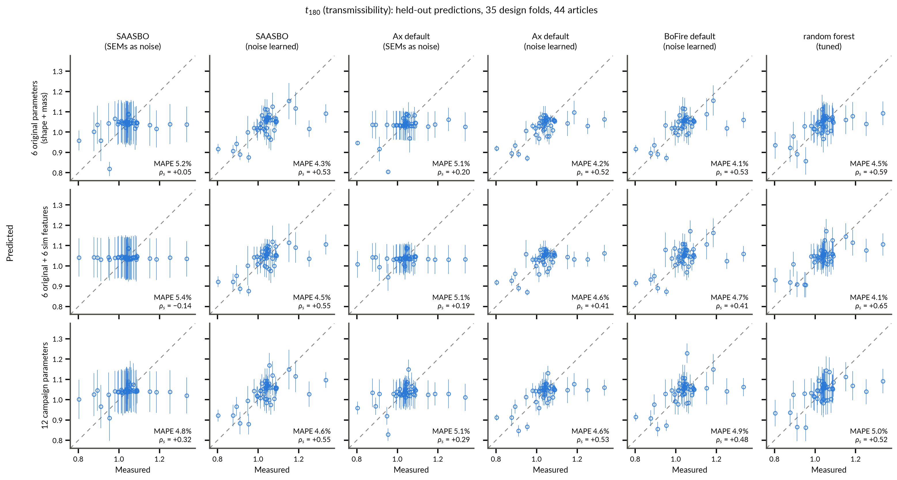
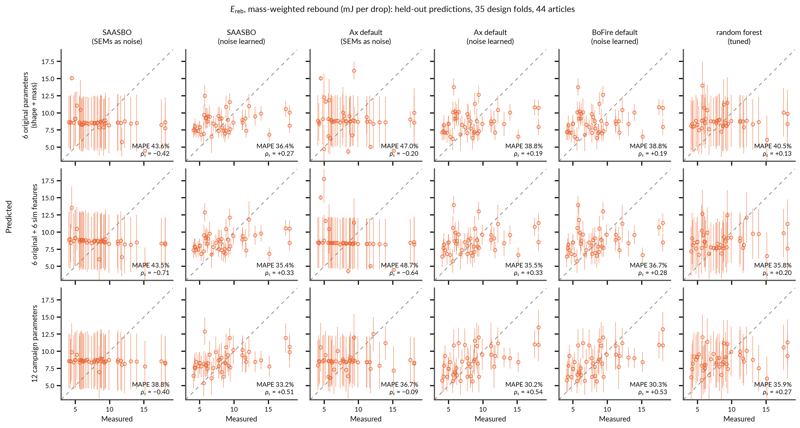
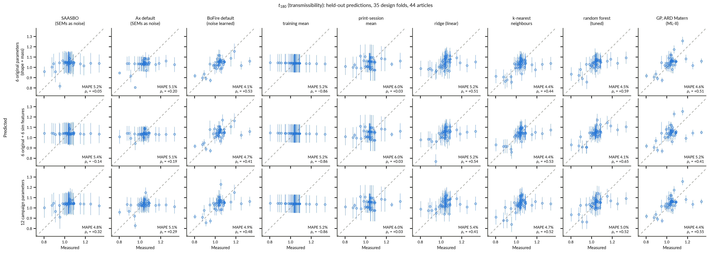
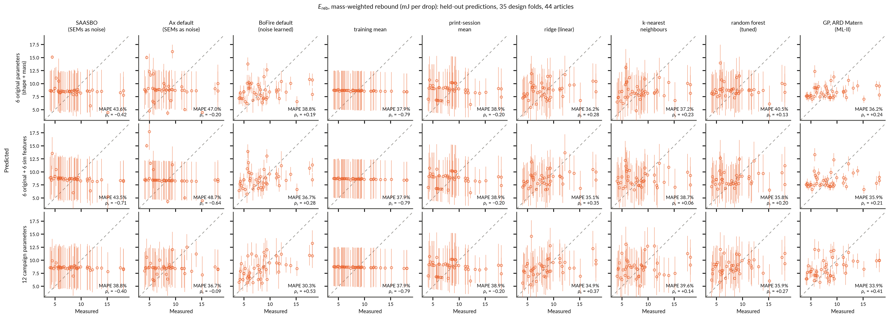

# LOGO-CV in the original six-parameter space, with and without simulation features, against dummy and off-the-shelf baselines and the Ax and BoFire defaults

**The ask ([PR #121, 2026-11-05](https://github.com/vertical-cloud-lab/tensegrity-optimization/pull/121)):**
"Perform LOGO-CV with 256/512, with only the 6 (?) original parameters, not
the additional print parameters, and both with and without the simulations as
contextual features, and for both objectives. Show the same figures for the
dummy cases of: 'predict everything as the mean', using a hyperparameter-tuned
RFR or similar model, etc. I.e., some baselines for comparison."

Everything here is recomputed from the committed campaign record under the
one held-out protocol the manuscript's SI figure uses (leave-one-design-out,
35 design folds over 44 articles, reprint pairs held out together), by the
two scripts in this directory. Inputs and their provenance are in
[`data/README.md`](data/README.md); every number below is in
[`scores.json`](scores.json) / [`scores.csv`](scores.csv), and the full
scorecard tables are in [`scores.md`](scores.md).

## Follow-up: the Ax and BoFire defaults, and why the BO surrogates fail

**The ask ([PR #121,
2026-11-05](https://github.com/vertical-cloud-lab/tensegrity-optimization/pull/121)):**
"what about default Ax and also BoFire?", then "try also with Ax default and
separately also BoFire".

**Short version.** Both framework defaults find the held-out signal that
SAASBO misses, but only when they learn the noise level. Ax's default GP
given the archived per-article SEMs as known noise (what Ax does whenever
SEMs are reported, and what the campaign did) fails much as SAASBO does. The
same model with the SEMs blanked, and BoFire's default surrogate (which
always learns its noise), rank held-out designs about as well as the tuned
random forest on t180, and in the campaign's twelve-parameter space they
reach the highest E_reb scores in this directory (rho_s +0.53 and +0.54,
R2_oos +0.34). SAASBO itself, refitted at the same 256/512 budget with the
noise learned, recovers too: held-out t180 rho_s +0.53 / +0.55 / +0.55 (six
/ six + sim / twelve) against +0.05 / -0.14 / +0.32 with the SEMs, and E_reb
+0.27 / +0.33 / +0.51 against -0.42 / -0.71 / -0.40. The failure in the
first half of this README therefore comes from the likelihood, not from Ax,
the SAAS prior or the data.

**Why: the SEMs are not the noise a held-out design sees.** The t180 SEM is
the drop-to-drop scatter of one printed article (about twenty drops); the
E_reb SEM adds the print-to-print scatter of the weighed mass (0.457 g sd)
in quadrature (`bo/t3_prism_bo_campaign.py` at `bbf7a62`). Neither carries
the article-to-article scatter of the response itself, which is what a
held-out design faces. Across the nine reprint pairs (one design, two
prints) the pooled within-design sd is 0.057 for t180 and 4.2 mJ for E_reb,
about 100 and 21 times the median SEM (0.00055 and 0.20 mJ). The twins
differ by a median 26 (t180) and 6 (E_reb) combined SEMs. A GP told that the
noise is the SEM has to pass through both twins, and the only inputs that
differ between twins are the weighed mass and, in the twelve-parameter
space, the print settings. That is what the known-noise fits do: the mass
lengthscale sits at BoTorch's lower bound (0.025 of the unit cube, 0.16 g
over the 17.5 to 24 g range) in 94 to 100% of the folds in the six and
six-plus-sim spaces for both objectives, and in 97% for E_reb in the
twelve-parameter space, where the t180 fit shares the job with the strut
infill instead (median lengthscales 0.047 for mass, 0.15 for strut infill).
With the noise learned the mass lengthscale is never at the bound (median
0.7 to 2.5 on the unit cube, smooth over the whole mass range). The learned
noise sd is 0.034 to 0.040 for t180 and 2.4 to 3.0 mJ for E_reb
(`data/map-gp-lengthscales.json`), about two thirds of the pooled reprint sd
and far above the SEMs. The audit's reading, "weighed mass acts as a
print-session label and the surrogate leans on it", describes the symptom.
The cause is the noise model, and every GP given these SEMs shares it. The
campaign code expected otherwise: its round-3 reprint ingestion says
"repeated designs are exactly how Ax infers the noise floor the per-drop SEM
understates", and the comment beside its SEM construction notes that "the ~2
percent t180 print floor remains unmodeled". With SEMs supplied, neither
SAASBO (`SaasFullyBayesianSingleTaskGP` with `train_Yvar`) nor Ax's default
GP (`FixedNoiseGaussianLikelihood`) infers any noise floor, so the repeated
designs push the fit through both twins instead.

### What "default" means

| | Ax 0.5.0 (the campaign's version) | BoFire 0.5.0 |
|---|---|---|
| how it is chosen | `AxClient` with no generation strategy calls `choose_generation_strategy`: Sobol, then `Models.BOTORCH_MODULAR` with that step's kwargs, used verbatim here | a strategy (`SoboStrategy`, `MoboStrategy`) with no `surrogate_specs` builds one `SingleTaskGPSurrogate` per output, data-model defaults |
| model | `SingleTaskGP`: RBF, one lengthscale per input, the dimension-scaled lognormal lengthscale prior (Hvarfner et al. 2024), lengthscale at least 0.025, MAP fit | the same kernel and prior, no lengthscale floor, MAP fit |
| noise | the reported SEMs, as fixed noise (`FixedNoiseGaussianLikelihood`); learned (LogNormal(-4, 1)) only if no SEMs are given | always learned: LogNormal(-4, 1), at least 1e-4; there is no per-point noise option |
| transforms | `Winsorize`, then the SAASBO stack (input normalization to the search space, `StandardizeY`). With two minimized objectives and no objective thresholds, `Winsorize` clips each objective's upper tail at Q3 + 1.5 IQR | `Normalize` to the declared bounds (set equal to Ax's search space, `data/fit-space-bounds.json`), `Standardize` |
| stack | BoTorch 0.13.0, GPyTorch 1.14 | BoTorch 0.18.1, GPyTorch 1.15.2 |

Everything else is the protocol of the SAASBO runs: the same snapshot,
articles, observed values, fit spaces, 35 folds in the same order, the same
per-fold seeds, `refit_on_cv=True`. Two details. The MAP refits start from
the prior, not from the full-data optimum (`warm_start_refit=False`; Ax's
default warm start carries information about the held-out design into the
fold, though a check with it changed rho_s by at most 0.04). Ax's transforms
(the `StandardizeY` constants, the `Winsorize` cutoffs) are fitted once on
all 44 articles, as in every Ax run here, while BoFire learns everything
inside the fold.

Three diagnostic runs isolate the differences: the Ax GP without `Winsorize`
(only the model class differs from the SAASBO run), Ax default with the SEMs
blanked (noise learned), and SAASBO at 256/512 with the SEMs blanked.

### Results

Held out over the same 35 design folds (44 articles) as every run in this
directory, generated by `logocv_baselines.py --score` (the top of
[`scores.md`](scores.md); every other statistic is in the full scorecard
below it). Spaces: the six original parameters, the six plus the six
simulation features, and the campaign's twelve.

#### Spearman rho_s, held-out prediction vs measurement (two-sided permutation p in brackets)

| model | noise | t180, 6 orig. | t180, 6 orig. + sim | t180, 12 campaign | E_reb, 6 orig. | E_reb, 6 orig. + sim | E_reb, 12 campaign |
|---|---|--:|--:|--:|--:|--:|--:|
| SAASBO (Ax, 256/512) | SEMs as known noise (campaign) | +0.05 (0.731) | -0.14 (0.370) | +0.32 (0.036) | -0.42 (0.005) | -0.71 (<0.001) | -0.40 (0.008) |
| SAASBO, noise learned (256/512) | learned | +0.53 (<0.001) | +0.55 (<0.001) | +0.55 (<0.001) | +0.27 (0.071) | +0.33 (0.029) | +0.51 (<0.001) |
| Ax default (GP, MAP, SEMs as noise) | SEMs as known noise | +0.20 (0.204) | +0.19 (0.223) | +0.29 (0.055) | -0.20 (0.193) | -0.64 (<0.001) | -0.09 (0.570) |
| Ax default, noise learned | learned | +0.52 (<0.001) | +0.41 (0.007) | +0.53 (<0.001) | +0.19 (0.214) | +0.33 (0.027) | +0.54 (<0.001) |
| Ax GP without Winsorize (SEMs as noise) | SEMs as known noise | +0.02 (0.921) | -0.01 (0.936) | +0.39 (0.008) | -0.26 (0.084) | -0.64 (<0.001) | -0.09 (0.570) |
| BoFire default (GP, MAP, noise learned) | learned | +0.53 (<0.001) | +0.41 (0.006) | +0.48 (0.001) | +0.19 (0.227) | +0.28 (0.063) | +0.53 (<0.001) |
| GP, ARD Matern (ML-II) | learned (white-noise term) | +0.51 (<0.001) | +0.41 (0.006) | +0.55 (<0.001) | +0.24 (0.123) | +0.21 (0.172) | +0.41 (0.006) |
| random forest (tuned) | n/a | +0.59 (<0.001) | +0.65 (<0.001) | +0.52 (<0.001) | +0.13 (0.390) | +0.20 (0.191) | +0.27 (0.082) |
| training mean | n/a | mechanical | mechanical | mechanical | mechanical | mechanical | mechanical |

#### R2_oos (1 - SSE / SSE of the per-fold training mean; 0 = the mean predictor)

| model | noise | t180, 6 orig. | t180, 6 orig. + sim | t180, 12 campaign | E_reb, 6 orig. | E_reb, 6 orig. + sim | E_reb, 12 campaign |
|---|---|--:|--:|--:|--:|--:|--:|
| SAASBO (Ax, 256/512) | SEMs as known noise (campaign) | +0.12 | +0.02 | +0.12 | -0.37 | -0.30 | -0.05 |
| SAASBO, noise learned (256/512) | learned | +0.41 | +0.44 | +0.40 | +0.09 | +0.12 | +0.23 |
| Ax default (GP, MAP, SEMs as noise) | SEMs as known noise | +0.12 | +0.08 | +0.08 | -0.48 | -0.66 | -0.01 |
| Ax default, noise learned | learned | +0.39 | +0.30 | +0.36 | -0.01 | +0.08 | +0.34 |
| Ax GP without Winsorize (SEMs as noise) | SEMs as known noise | +0.11 | +0.13 | -0.04 | -0.51 | -0.66 | -0.01 |
| BoFire default (GP, MAP, noise learned) | learned | +0.40 | +0.31 | +0.29 | -0.01 | +0.03 | +0.34 |
| GP, ARD Matern (ML-II) | learned (white-noise term) | +0.31 | +0.16 | +0.34 | +0.05 | -0.02 | +0.18 |
| random forest (tuned) | n/a | +0.40 | +0.49 | +0.33 | -0.08 | +0.04 | +0.08 |
| training mean | n/a | +0.00 | +0.00 | +0.00 | +0.00 | +0.00 | +0.00 |

#### MAPE

| model | noise | t180, 6 orig. | t180, 6 orig. + sim | t180, 12 campaign | E_reb, 6 orig. | E_reb, 6 orig. + sim | E_reb, 12 campaign |
|---|---|--:|--:|--:|--:|--:|--:|
| SAASBO (Ax, 256/512) | SEMs as known noise (campaign) | 5.2% | 5.4% | 4.8% | 43.6% | 43.5% | 38.8% |
| SAASBO, noise learned (256/512) | learned | 4.3% | 4.5% | 4.6% | 36.4% | 35.4% | 33.2% |
| Ax default (GP, MAP, SEMs as noise) | SEMs as known noise | 5.1% | 5.1% | 5.1% | 47.0% | 48.7% | 36.7% |
| Ax default, noise learned | learned | 4.2% | 4.6% | 4.6% | 38.8% | 35.5% | 30.2% |
| Ax GP without Winsorize (SEMs as noise) | SEMs as known noise | 5.3% | 5.2% | 5.4% | 48.8% | 48.7% | 36.7% |
| BoFire default (GP, MAP, noise learned) | learned | 4.1% | 4.7% | 4.9% | 38.8% | 36.7% | 30.3% |
| GP, ARD Matern (ML-II) | learned (white-noise term) | 4.6% | 5.2% | 4.4% | 36.2% | 35.9% | 33.9% |
| random forest (tuned) | n/a | 4.5% | 4.1% | 5.0% | 40.5% | 35.8% | 35.9% |
| training mean | n/a | 5.2% | 5.2% | 5.2% | 37.9% | 37.9% | 37.9% |

### Figures

Framework comparison (rows: feature space; columns: SAASBO and Ax default
with the SEMs as noise and with the noise learned, BoFire default, and the
tuned random forest for reference; error bars are the reported latent sd):





The two main grids further down now carry Ax default and BoFire default
columns as well. The SI-style figure for each new run is
`figures/logocv-<model>-<space>.png` with `<model>` one of `ax-default`,
`bofire`, `ax-registry`, `ax-default-learned`, `saasbo-learned` (for example
[`logocv-bofire-six.png`](figures/logocv-bofire-six.png),
[`logocv-ax-default-six.png`](figures/logocv-ax-default-six.png),
[`logocv-saasbo-learned-twelve.png`](figures/logocv-saasbo-learned-twelve.png)).

### Reading

- **SAASBO recovers once the noise is learned.** In the six-parameter space
  SAASBO goes from +0.05 to +0.53 on t180 (R2_oos +0.41, MAPE 4.3%, coverage
  91%) and from -0.42 to +0.27 on E_reb. In the twelve-parameter space it
  goes from +0.32 to +0.55 (t180) and from -0.40 to +0.51 (E_reb). With the
  simulation features it goes from -0.14 to +0.55 (t180) and from -0.71 to
  +0.33 (E_reb). Same folds, seeds and NUTS budget; only the SEMs are
  blanked. The SAAS prior is not what failed.
- **Ax default with the SEMs fails like SAASBO.** It ranks held-out t180 at
  +0.20 / +0.19 / +0.29 (six / six + sim / twelve) and E_reb at -0.20 /
  -0.64 / -0.09. On E_reb in the two six-parameter spaces it is worse than
  predicting the mean (R2_oos -0.48 and -0.66), and it is most inverted
  where SAASBO is (with the simulation features).
- **Winsorize is not the issue.** It clips three t180 values (r2d2c3, drran7
  and r2d2c4, 1.18 to 1.33, down to 1.16) and no E_reb value. Without it
  (`ax-registry`) t180 rho_s moves by up to 0.2 either way (+0.02 / -0.01 /
  +0.39) and E_reb hardly moves. Either way the known-noise fits fail.
- **Ax with learned noise and BoFire agree.** They are the same model in two
  stacks (BoTorch 0.13 against 0.18.1; Ax standardizes on all 44 articles,
  BoFire inside the fold), and their rho_s differ by at most 0.051 (median
  0.009) across the six cells. The result is not an implementation artefact,
  and Ax's all-data standardization is not what helps.
- **Against the baselines, t180.** With the noise learned, the three BO GPs
  (SAASBO, Ax default, BoFire default, in that order) match the tuned random
  forest in the six-parameter space (R2_oos +0.41, +0.39, +0.40 against
  +0.40) and in the twelve-parameter space (+0.40, +0.36, +0.29 against
  +0.33). With the simulation features, where the forest gains most from
  them, SAASBO comes close (+0.44 against +0.49) and the two MAP GPs trail
  it (+0.30, +0.31).
- **Against the baselines, E_reb.** In the twelve-parameter space the two
  MAP GPs with learned noise reach rho_s +0.54 and +0.53, R2_oos +0.34 and
  MAPE 30.2%, and SAASBO with learned noise +0.51 (R2_oos +0.23). These are
  the best E_reb numbers in this directory; the ML-II GP gives +0.41 and
  +0.18, ridge +0.37 and +0.10. E_reb is the objective the print settings
  help: in the six-parameter space the same MAP GPs give +0.19 and R2_oos
  -0.01, SAASBO +0.27 and +0.09. The earlier reading "E_reb has no real
  held-out skill in any model" holds for the six-parameter spaces, not for
  the twelve-parameter space.
- **Uncertainty.** With learned noise, the latent sd of the MAP GPs covers
  73 to 89% of t180 and 52 to 77% of E_reb at 1.96 sd, because the noise is
  left out, as for the ML-II GP. BoFire's own `predict()` sd adds the
  learned noise and covers 89 to 93% for both objectives, so it is
  calibrated for a new article. SAASBO with learned noise covers 91% / 91% /
  93% of t180.

### Caveats

- The caveats above still hold: 44 articles, one realization per row,
  differences under about 0.2 in rho_s are not resolved, and the table now
  has 72 model-by-space-by-objective cells, so its best cell is optimistic.
  The conclusion rests on a consistent sign more than on any one cell: going
  from known to learned noise raises rho_s in all twelve
  model-by-space-by-objective cells (SAASBO and Ax default, three spaces,
  two objectives), by +0.22 to +1.03 (median +0.55).
- Ax 0.5.0 is the campaign's pinned version; later Ax releases were not
  tried. The problem is the SEMs entering as fixed noise, so it applies to
  any version or framework that uses them that way.
- Blanking the SEMs is the simplest fix, not necessarily the best. The
  learned noise level is one number per objective, while the reprint
  differences range from 0.003 to 0.22 in t180 and from 0.01 to 10.7 mJ in
  E_reb, and four articles carry T-DRIFT flags (r2d2c2, drran8, 2dran6,
  corny5). A heteroscedastic noise model, or one that adds a learned or
  reprint-based variance to each SEM, was not tried.

### What this suggests for the manuscript (not edited here)

- Section 4.3 and SI `fig:si-logocv` report the held-out skill of the
  campaign surrogate (rho_s +0.32 for t180, -0.40 for E_reb, twelve
  parameters). That number belongs to the noise specification, not to SAASBO
  or to the data: the same SAASBO with the noise learned gives +0.55 for
  t180 and +0.51 for E_reb on the same folds, and the framework defaults
  with learned noise give about +0.5 for both. "Weak but above chance"
  understates what the record supports for t180, and "absent" understates it
  for E_reb.
- Every model-generated batch came from a surrogate with the SEMs as known
  noise. Its acquisition values therefore came from a model that explained
  print-to-print scatter through the weighed mass and, from round 3 on, the
  print settings. That deserves a sentence in the Limitations, and any
  further round should learn the noise (or add the reprint variance to each
  SEM) before generating.

## What "the original six parameters" are, and what was already on record

The fit space of rounds 1 and 2 was six parameters: the five shape
coordinates (`R_mm`, `H_mm`, `twist_deg`, `strut_d_mm`, `cable_d_mm`) plus
the article's weighed printed mass (`mass_printed_g`). Round 3 added six
print-process settings (two infill densities that vary per article, four
filament settings that take one value per batch), giving the twelve-parameter
space of the manuscript's figure. The audit branch
(`claude/cv-signal-audit-20260922`, PR #111) had already re-run the
leave-one-design-out CV at 256 NUTS samples / 512 warmup steps in the
six-parameter space (and in several other spaces, including the five shape
coordinates with and without the six #33 simulation features). Those runs
are vendored verbatim under `data/ax-runs/`. The one combination the request
needed that did not exist, **the six original parameters plus the six
simulation features**, was run here
([`rerun_logocv_six_param_sim.py`](rerun_logocv_six_param_sim.py), the
audit's featurization driver with a six-parameter base space; output in
`data/ax-six-sim/`, 35/35 folds, median 146 s per fold on one torch
thread, four workers). Before it ran, the same driver re-ran one archived
fold with no features and matched the committed predictions and covariances
exactly (maximum difference 0.0), so the stack installed here (Ax 0.5.0,
BoTorch 0.13.0, torch 2.15 CPU) reproduces the archived runs.

The simulation features are the six `sim_*` columns the audit chose before
looking at any held-out number: the Tier C and Tier B transmissibility
analogues, Tier C peak tendon energy and stroke, Tier B ringdown frequency
and damping, computed by the #33 simulators at the design's print geometry
with the design-mean weighed mass, so reprint twins share identical
features. They enter Ax as range parameters with bounds equal to the
observed range padded by ten percent, exactly as in the audit.

## The baselines

[`logocv_baselines.py`](logocv_baselines.py) fits scikit-learn models under
the identical protocol: the same 35 folds, the same 44 articles, the same
observed objective values (asserted equal to
`manuscript/data/t3-prism-bo-round5-logocv.csv`), the same feature values
Ax fitted (read from the full-NUTS checkpoint). Every hyperparameter is
chosen inside the fold by a 5-fold GroupKFold over the training designs, so
the held-out design never touches the choice.

| model | what it is | reported uncertainty |
|---|---|---|
| training mean | the mean of the training articles ("predict everything as the mean") | the training sd |
| print-session mean | the training mean of the held-out article's own print session (seed, r2d2c, drran, 2dran, corny). An oracle for the between-session offsets, not something a fitted model had access to | the within-session training sd |
| ridge (linear) | standardized inputs, ridge regression, alpha tuned over 10^-3 to 10^3 | inner-CV RMSE of the chosen alpha |
| k-nearest neighbours | standardized inputs, k in {1, 2, 3, 5, 7, 10}, uniform or distance weights | inner-CV RMSE |
| random forest (tuned) | 200 trees; max_features {0.33, 0.67, 1.0}, min_samples_leaf {1, 3}, max_depth {None, 4} | inner-CV RMSE |
| GP, ARD Matern (ML-II) | Matern-5/2 with one lengthscale per input plus a white-noise term, hyperparameters by marginal likelihood with restarts: the plain, non-sparse, non-Bayesian cousin of SAASBO | its own predictive sd, noise removed (what Ax reports for SAASBO) |

Two reading notes. The training-mean baseline's rank correlation is
mechanically negative under a leave-one-out protocol (removing a high
article lowers the training mean), so its rho_s carries no information;
what it provides is the MAPE floor and the R2_oos zero. R2_oos is
1 - SSE(model) / SSE(per-fold training mean), so a negative value means the
model is worse than predicting the mean.

## Results

Held out over 35 design folds (44 articles). rho_s is Spearman's rank
correlation between held-out prediction and measurement, with a two-sided
permutation p (20,000 shuffles); "design" is the same statistic over the 35
design means; R2_oos is against the per-fold training mean; "spread" is the
sd of the predictions over the sd of the measurements; "95% cov" is the share
of articles within 1.96 reported sd of the measurement. SAASBO rows are the
Ax runs at 256/512; the twelve-parameter SAASBO row is the manuscript's SI
figure.

**t180 (transmissibility)**

| feature space | model | MAPE | R2_oos | rho_s (p) | design rho_s | spread | 95% cov |
|---|---|--:|--:|--:|--:|--:|--:|
| 6 original (shape + mass) | SAASBO | 5.2% | +0.12 | +0.05 (0.73) | +0.06 | 0.47 | 84% |
| 6 original | training mean | 5.2% | 0 | mechanical | | 0.03 | 91% |
| 6 original | print-session mean | 6.0% | +0.02 | +0.03 (0.86) | +0.06 | 0.45 | 89% |
| 6 original | ridge | 5.2% | +0.17 | +0.51 (<0.001) | +0.53 | 0.55 | 93% |
| 6 original | k-nearest neighbours | 4.4% | +0.22 | +0.44 (0.003) | +0.49 | 0.69 | 93% |
| 6 original | random forest (tuned) | 4.5% | +0.40 | **+0.59 (<0.001)** | +0.63 | 0.60 | 93% |
| 6 original | GP, ARD Matern (ML-II) | 4.6% | +0.31 | +0.51 (<0.001) | +0.56 | 0.77 | 75% |
| 6 original + 6 sim | **SAASBO (new run)** | 5.4% | +0.02 | **-0.14 (0.37)** | -0.14 | 0.13 | 86% |
| 6 original + 6 sim | ridge | 5.2% | +0.19 | +0.54 (<0.001) | +0.58 | 0.65 | 89% |
| 6 original + 6 sim | k-nearest neighbours | 4.4% | +0.36 | +0.53 (<0.001) | +0.54 | 0.67 | 93% |
| 6 original + 6 sim | random forest (tuned) | 4.1% | +0.49 | **+0.65 (<0.001)** | +0.71 | 0.66 | 91% |
| 6 original + 6 sim | GP, ARD Matern (ML-II) | 5.2% | +0.16 | +0.41 (0.006) | +0.44 | 0.81 | 70% |
| 12 campaign | SAASBO (manuscript) | 4.8% | +0.12 | +0.32 (0.036) | +0.37 | 0.32 | 89% |
| 12 campaign | ridge | 5.4% | +0.09 | +0.41 (0.005) | +0.43 | 0.53 | 93% |
| 12 campaign | k-nearest neighbours | 4.7% | +0.25 | +0.52 (<0.001) | +0.58 | 0.71 | 95% |
| 12 campaign | random forest (tuned) | 5.0% | +0.33 | +0.52 (<0.001) | +0.58 | 0.67 | 93% |
| 12 campaign | GP, ARD Matern (ML-II) | 4.4% | +0.34 | +0.55 (<0.001) | +0.61 | 0.77 | 77% |

**E_reb (mass-weighted rebound, mJ per drop)**

| feature space | model | MAPE | R2_oos | rho_s (p) | design rho_s | spread | 95% cov |
|---|---|--:|--:|--:|--:|--:|--:|
| 6 original (shape + mass) | SAASBO | 43.6% | -0.37 | -0.42 (0.005) | -0.31 | 0.37 | 84% |
| 6 original | training mean | 37.9% | 0 | mechanical | | 0.03 | 93% |
| 6 original | print-session mean | 38.9% | -0.11 | -0.20 (0.18) | -0.07 | 0.32 | 86% |
| 6 original | ridge | 36.2% | +0.10 | +0.28 (0.064) | +0.25 | 0.41 | 91% |
| 6 original | k-nearest neighbours | 37.2% | 0.00 | +0.23 (0.14) | +0.14 | 0.41 | 89% |
| 6 original | random forest (tuned) | 40.5% | -0.08 | +0.13 (0.39) | +0.10 | 0.34 | 89% |
| 6 original | GP, ARD Matern (ML-II) | 36.2% | +0.05 | +0.24 (0.12) | +0.17 | 0.32 | 36% |
| 6 original + 6 sim | **SAASBO (new run)** | 43.5% | -0.30 | **-0.71 (<0.001)** | -0.67 | 0.30 | 89% |
| 6 original + 6 sim | ridge | 35.1% | +0.13 | +0.35 (0.021) | +0.33 | 0.38 | 91% |
| 6 original + 6 sim | k-nearest neighbours | 38.7% | -0.06 | +0.06 (0.72) | -0.07 | 0.38 | 91% |
| 6 original + 6 sim | random forest (tuned) | 35.8% | +0.04 | +0.20 (0.19) | +0.18 | 0.39 | 91% |
| 6 original + 6 sim | GP, ARD Matern (ML-II) | 35.9% | -0.02 | +0.21 (0.17) | +0.12 | 0.39 | 34% |
| 12 campaign | SAASBO (manuscript) | 38.8% | -0.05 | -0.40 (0.008) | -0.30 | 0.11 | 93% |
| 12 campaign | ridge | 34.9% | +0.10 | +0.37 (0.014) | +0.41 | 0.47 | 91% |
| 12 campaign | k-nearest neighbours | 39.6% | -0.05 | +0.14 (0.36) | +0.09 | 0.49 | 89% |
| 12 campaign | random forest (tuned) | 35.9% | +0.08 | +0.27 (0.082) | +0.41 | 0.39 | 91% |
| 12 campaign | GP, ARD Matern (ML-II) | 33.9% | +0.18 | +0.41 (0.006) | +0.46 | 0.47 | 57% |





The SI-style figure for each run is `figures/logocv-<model>-<space>.png`
(for example [`logocv-saasbo-six-sim.png`](figures/logocv-saasbo-six-sim.png),
[`logocv-rf-six.png`](figures/logocv-rf-six.png),
[`logocv-mean-six.png`](figures/logocv-mean-six.png)).

### Reading

- **In the six-parameter space the inputs carry a usable t180 signal, and
  SAASBO is the one model that does not use it.** On identical folds, inputs
  and targets, SAASBO ranks held-out t180 at +0.05 while ridge, k-nearest
  neighbours, the tuned random forest and a plain ARD GP rank it at +0.44 to
  +0.59 (random forest: R2_oos +0.40, MAPE 4.5%, design-level rho_s +0.63).
  The audit's explanation, that the weighed-mass input acts as a
  print-session label and the SAAS sparsity prior leans on it, describes the
  symptom. The follow-up section above finds the cause: the SEMs enter as
  known noise. SAASBO with the noise learned reaches +0.53 here. The
  marginal-likelihood GP in the same space switches mass nearly off (median
  ARD lengthscale 6.3 on standardized inputs, against 0.1 for cable
  diameter) and rides the cable-diameter gradient instead
  (`data/baselines/gp-lengthscales.json`).
- **Appending the six simulation features hurts SAASBO and helps the
  forest.** SAASBO goes from +0.05 to -0.14 on t180 and from -0.42 to -0.71
  on E_reb, the inversion the audit saw in the shape-only space (relevance
  diluted across six proxies of the same coordinates). The random forest
  goes from +0.59 to +0.65 (R2_oos +0.49, MAPE 4.1%), ridge from +0.51 to
  +0.54, the ARD GP falls to +0.41. For a tree ensemble the features act as
  pre-computed nonlinear transforms of the geometry; for a sparse GP they
  are collinear competitors. With the noise learned, SAASBO goes from +0.53
  to +0.55 on t180 and from +0.27 to +0.33 on E_reb when the features are
  added (follow-up section).
- **The manuscript's twelve-parameter SAASBO (+0.32) is not the ceiling of
  the record.** In that same space the GP (ML-II) reaches +0.55, the forest
  and k-nearest neighbours +0.52, ridge +0.41. The gain over the twelve
  parameters is between-session calibration (the four filament settings are
  batch labels), which the shape-only baselines reach without it. SAASBO
  itself reaches +0.55 in this space once the noise is learned (follow-up
  section).
- **E_reb has no real held-out skill in any model of this section.** (The
  follow-up section above finds some: the learned-noise GPs in the
  twelve-parameter space.) The best R2_oos is +0.18 (GP, twelve parameters)
  and the best ranking +0.41 (same run, p 0.006) with ridge at +0.35 to
  +0.37; the random forest and k-nearest neighbours are at or below the mean
  in R2_oos. SAASBO is anti-correlated in every space and worse than
  predicting the mean (R2_oos -0.05 to -0.37), with the six-plus-sim run the
  most inverted of the set (-0.71). The MAPE floor of the mean predictor is
  37.9%; the best model reaches 33.9%. This is the metric the reprint pairs
  already showed to be noise-floored.
- **Dummies.** Predicting the mean gives t180 MAPE 5.2% and E_reb MAPE
  37.9%, which the SAASBO runs beat by at most 0.4 points and the forest by
  1.1 points. The print-session mean adds nothing (R2_oos +0.02 and -0.11),
  so the session offsets alone are not what the baselines are exploiting.
- **Uncertainty.** SAASBO's posterior sd covers 84 to 93% of articles at
  1.96 sd, honest but with a prediction spread of only a tenth to a half
  of the data sd. The ML-II GP's noise-free predictive sd is overconfident
  (70 to 77% on t180, 34 to 57% on E_reb). The inner-CV RMSE bars of the
  point models cover 89 to 95%, as a correctly sized constant error should.

### Caveats

- 44 articles and 35 designs. Every row is one realization: the audit's
  NUTS-budget experiment moved SAASBO's t180 rho_s by 0.24 with nothing but
  the sampler budget changed, and the forest and GP would move with their
  seeds and inner folds too. Differences under about 0.2 in rho_s between
  rows should not be ranked; the gap between SAASBO (+0.05, -0.14) and the
  baselines (+0.44 to +0.65) in the six-parameter spaces is larger than
  that, the differences among the baselines are not.
- This table holds 36 held-out model-by-space-by-objective numbers; quoting
  its best cell is optimistic in the usual way.
- The baselines fit the per-article objective means unweighted; SAASBO uses
  the per-article SEMs as known noise. An earlier version of this note said
  this "changes little" because the SEMs (0.0004 to 0.003 for t180) are far
  below the between-print scatter. That was wrong. The gap between the two
  is what makes SAASBO fail (follow-up section above).
- The simulation features of a held-out design are computed from its
  geometry and design-mean weighed mass, which is what a candidate could
  provide before printing (the audit found the four non-ringdown channels
  insensitive to the within-design mass choice).
- The print-session mean uses session labels no fitted model had; it is a
  reference line, not a candidate model.

What this suggests for the manuscript: see the end of the follow-up section
above, which replaces the first version of this paragraph. That version put
the gap down to the SAASBO surrogate with weighed mass as an input; the
cause is the SEMs entering as known noise. Whether any of this belongs in
the SI next to the LOGO figure is the authors' call; the grid figures are
drawn to drop in.

## Files

- [`rerun_logocv_six_param_sim.py`](rerun_logocv_six_param_sim.py): the Ax
  driver (variant `six-sim`; `six-param` and the audit's variants are
  available for reproduction checks). `--model ax-default | ax-registry`
  swaps the surrogate for Ax's default GP, `--noise inferred` blanks the
  SEMs, and the variants `six` and `twelve` give the spaces without
  features.
- [`logocv_bofire.py`](logocv_bofire.py): the BoFire driver (its own
  environment, see below).
- [`logocv_baselines.py`](logocv_baselines.py): the article table, the
  baselines, the scorecard and the figures.
- [`scores.json`](scores.json), [`scores.csv`](scores.csv),
  [`scores.md`](scores.md): the scorecard for every run.
- [`data/`](data/README.md): vendored Ax runs, the new runs (SAASBO
  six-sim, Ax default and its diagnostics, SAASBO with learned noise,
  BoFire), the article feature table, the input bounds, the baseline
  predictions (campaign CSV layout), the hyperparameters each fold chose,
  and the MAP GP lengthscale summary.
- [`figures/`](figures/): `logocv-<model>-<space>.png`, the SI figure for
  each run; `logocv-grid-t180.png` / `logocv-grid-e_reb_mJ.png`, the
  comparison grids; `logocv-grid-bo-t180.png` / `logocv-grid-bo-e_reb_mJ.png`,
  the BO-framework grids.

## Reproduce

```bash
pip install torch --index-url https://download.pytorch.org/whl/cpu
pip install "ax-platform==0.5.0" scikit-learn matplotlib pandas scipy
git archive bbf7a62 bo | tar -x -C /tmp/campaign        # campaign code and snapshot
for i in 0 1 2 3; do
  python analysis/logocv-baselines/rerun_logocv_six_param_sim.py \
      --campaign-bo /tmp/campaign/bo --variant six-sim --queue --threads 1 &
done; wait
python analysis/logocv-baselines/rerun_logocv_six_param_sim.py \
    --campaign-bo /tmp/campaign/bo --variant six-sim --assemble
python analysis/logocv-baselines/logocv_baselines.py --build-table --fit --score --plot

# Ax default and its diagnostics (MAP fits, about a second per fold)
for mn in "ax-default known" "ax-default inferred" "ax-registry known"; do
  set -- $mn
  for v in six six-sim twelve; do
    python analysis/logocv-baselines/rerun_logocv_six_param_sim.py \
        --campaign-bo /tmp/campaign/bo --model $1 --noise $2 --variant $v
    python analysis/logocv-baselines/rerun_logocv_six_param_sim.py \
        --campaign-bo /tmp/campaign/bo --model $1 --noise $2 --variant $v --assemble
  done
done
# SAASBO with the noise learned (256/512, about 90 s per fold per worker)
for v in six twelve six-sim; do
  for i in 1 2 3; do
    python analysis/logocv-baselines/rerun_logocv_six_param_sim.py \
        --campaign-bo /tmp/campaign/bo --model saasbo --noise inferred \
        --variant $v --queue --threads 1 &
  done; wait
  python analysis/logocv-baselines/rerun_logocv_six_param_sim.py \
      --campaign-bo /tmp/campaign/bo --model saasbo --noise inferred \
      --variant $v --assemble
done
# BoFire default, in its own environment (BoFire 0.5.0 needs BoTorch 0.18)
python -m venv /tmp/venv-bofire
/tmp/venv-bofire/bin/pip install torch --index-url https://download.pytorch.org/whl/cpu
/tmp/venv-bofire/bin/pip install "bofire[optimization]==0.5.0" matplotlib
/tmp/venv-bofire/bin/python analysis/logocv-baselines/logocv_bofire.py \
    --spaces six six-sim twelve
python analysis/logocv-baselines/logocv_baselines.py --score --plot
```
