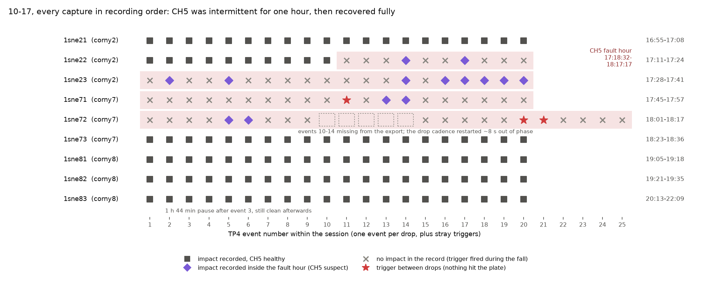
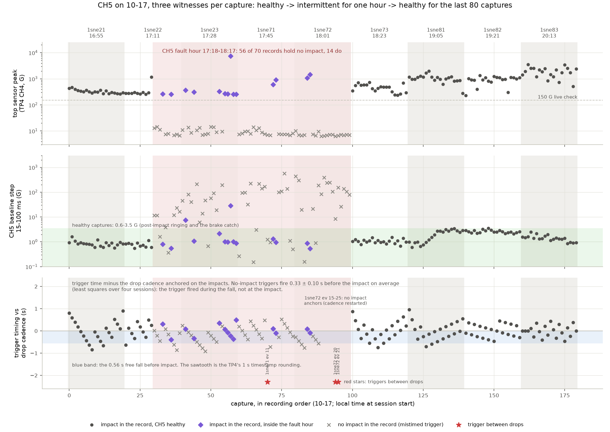
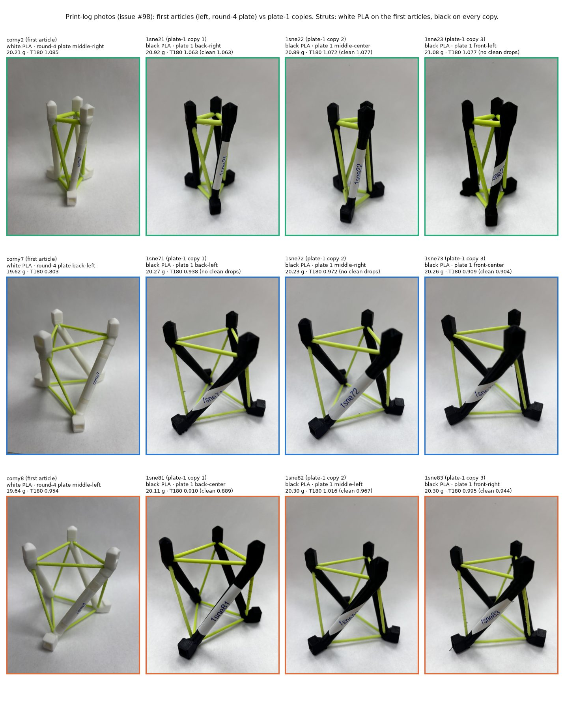
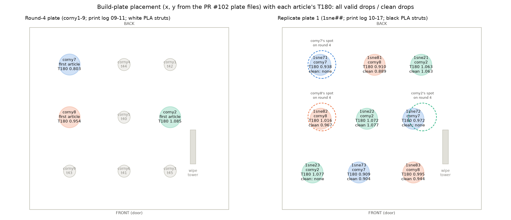
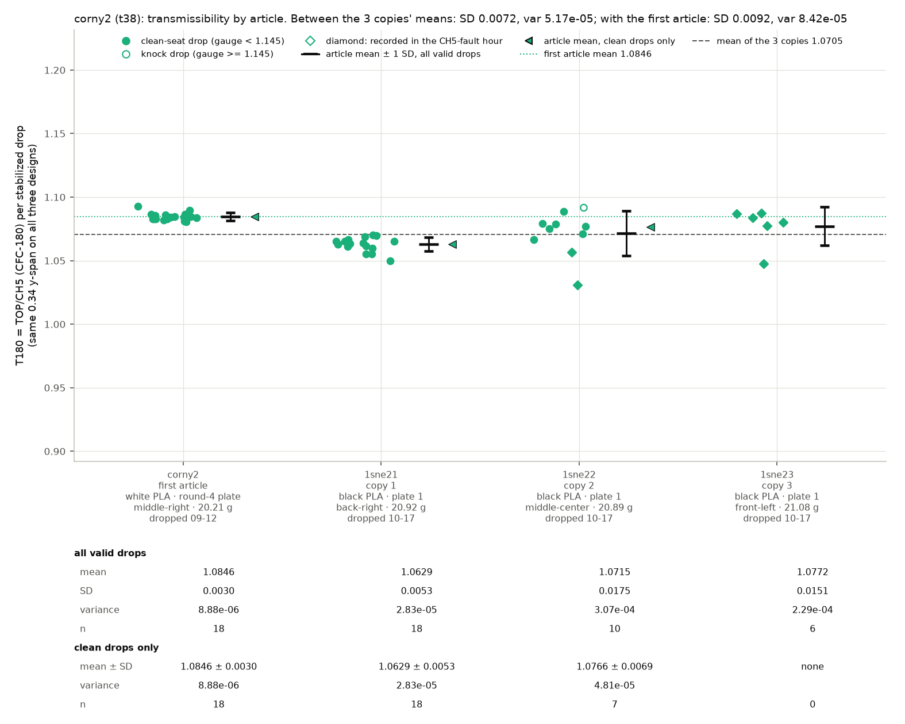
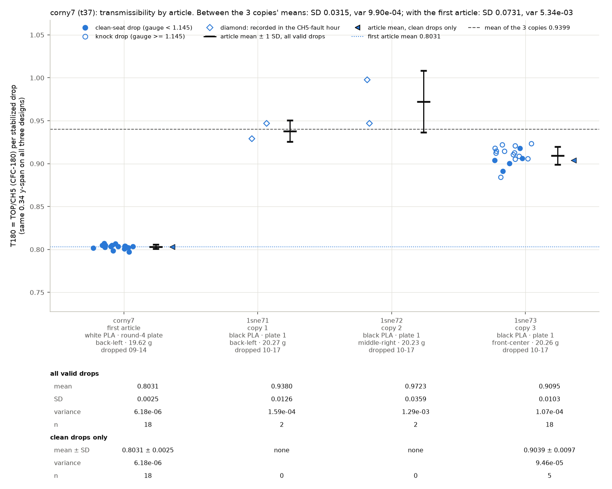
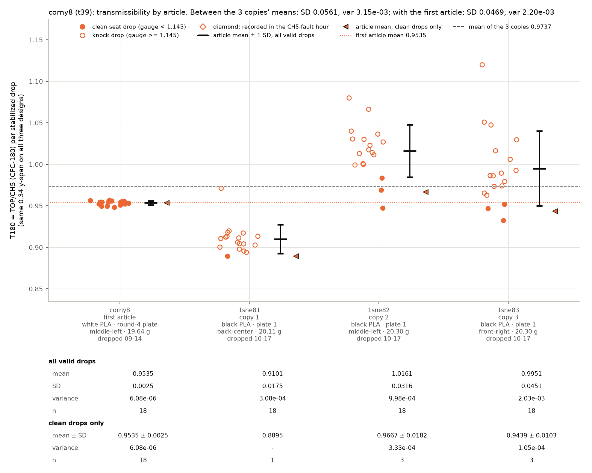

# 1sne plate 1 follow-up: the CH5 cable fault drop by drop, and the corny2/7/8 article spread

Two questions from @me-madsen on PR #86 (10-19), after the check-in in
[`README.md`](README.md):

1. **The CH5 cable has since broken.** By the fault hour (17:18 → 18:17 on
   10-17), was it already disconnected, or was it loose and working some of
   the time?
2. **How much do the specimens on these plates deviate?** This covers
   photos of every corny2, corny7 and corny8 article, the reported print
   temperature and plate placement, a T graph per design, and the SD and
   variance per design and per article ("version").

Script: [`scripts/analysis/drop_test_1sne_ch5_replicates_analysis.py`](../../../scripts/analysis/drop_test_1sne_ch5_replicates_analysis.py).
It reads the 180 raw captures from Box (ids in `raw/<id>/box-ids.json`),
the committed census and campaign metrics, the original corny sessions'
metrics, and the two slicer projects on the PR #102 branch. It also fetches
the issue #98 print-log photos. Outputs are in
[`figures/ch5-replicates/`](figures/ch5-replicates/), with every number in
`ch5_replicates.json`.

## 1. CH5: intermittent for one hour, then fully healthy

**The data support "loose and sometimes working", not "disconnected at some
point".** On 10-17 the cable was damaged but still conducting. It opened
and closed as the cable moved, and it failed for good later.

The evening, in recording order:

| phase | time (10-17) | captures | impact in the record | CH5 vs the TP4's own peak (median / max) | CH5 baseline step after the impact | CH5 full-pulse Δv |
|---|---|--:|--:|--:|--:|--:|
| before | 16:55:15 → 17:17:51 (`1sne21`, `1sne22` drops 1–10) | 30 | **30** | 0.07 % / 1.5 % | ≤ 1.6 G | 5.07–5.64 m/s |
| fault hour | 17:18:32 → 18:17:17 (`1sne22` drop 11 → end of `1sne72`) | 70 | **14** (56 none) | 0.65 % / 9.4 % | ≤ 28 G on impact captures; median 46 G, max 569 G on the 56 others | 3.4–9.6 m/s |
| after | 18:23:51 → 22:09:41 (`1sne73`, `1sne81`–`1sne83`) | 80 | **80** | 0.11 % / 0.95 % | ≤ 3.5 G | 4.92–5.38 m/s |

The evidence for intermittent rather than disconnected:

- **Good captures kept appearing inside the bad hour.** In capture order the
  hour reads
  `xxxvxxvxxxxvxxvxxxxxxxxvxvvvvvxxxxxxxxxxxxvvxxxxxxxxxxvvxxxxxxxxxxxxxx`,
  where `v` is an impact in the record and `x` is none. That is 8 separate
  working stretches between 9 failing ones. The longest working stretch
  was 5 captures (`1sne23`, 17:38–17:41). The failing stretches grew
  longer toward the end (12, 10 and 14 captures), so the fault was getting
  worse through `1sne71`/`1sne72`.
- **The channel came back completely and stayed back.** All 80 captures
  after 18:23 hold their impact. CH5 matches the TP4's own peak to 0.11 %
  median, as it did before the fault, and its baseline sits flat after the
  impact. The only post-impact activity is mechanical ringing and the brake
  catch at ~76–80 ms, with no electrical steps. It stayed healthy through
  the 1 h 44 min pause in `1sne83`. A disconnected conductor cannot do
  that.
- **During the hour CH5 still carried a signal, just the wrong one.** On 41
  of the 56 bad captures the CH5 baseline jumps by more than 10 G after the
  trigger, up to 569 G. These are steps and plateaus, the signature of a
  contact making and breaking under a live sensor. The TP4's own table reads
  CH5 Δv from −5,396 to +12,487 in/s on those captures, against
  ~210 in/s for a real drop. The top sensor never sees more than 15 G on
  them, against ≥ 230 G on every real impact.
- **The bad triggers fired during the fall, not at the impact.** They land
  on the hoist's 41 s drop cadence. A least-squares fit of the TP4 event
  times (1 s resolution), with the impact captures as anchors, puts them
  **0.33 ± 0.10 s before the impact** on average (four sessions). Refitting
  on the impact captures alone gives a median of 0.25 s before, with 33 of
  44 before. The carriage falls for ~0.56 s from 60 in.
  - The most consistent reading: as the cable moved with the falling
    carriage, the damaged spot glitched and tripped the 150 G trigger. The
    TP4 recorded 100 ms of free fall, and it was still storing that record
    when the real impact arrived.
  - Three more triggers fired between drops, when nothing hit the plate:
    `1sne71` event 11 (14 s before a drop) and `1sne72` events 20 and 21.
    Only an electrical fault does that.
- **Something happened at 18:07–18:11.** `1sne72` events 10–14 are missing
  from the export. After them the drop cadence restarted about 8 s out of
  phase, so the hoist cycle was stopped and restarted.
- **The fault cleared between 18:17:17 and 18:23:51**, during the change
  from `1sne72` to `1sne73`. That is consistent with the cable being moved
  or re-seated while the specimen was swapped, which closed the
  intermittent contact.

Questions for the lab that would pin the mechanism down:

- Where did the cable break: at a connector, or along the run that flexes
  when the carriage falls?
- Was anything touched at 18:07 (the missing events) and at 18:17–18:23?

**What it means for the data.** Every capture outside 17:18–18:17 has a
healthy CH5, so everything from 1sne73 on is unaffected. The 14 impact
captures inside the hour are kept but flagged:

- `1sne22` drops 14 and 17;
- `1sne23` drops 2, 5, 14, 16–20;
- `1sne71` drops 13–14;
- `1sne72` drops 5–6.

Two of them (`1sne23` S5 and S19) sat on a ~−20 G CH5 offset at the moment
of impact, and the TP4 reads their peaks 7–9 % off. The pipeline's tail
baseline absorbs a constant offset, so their T180 values look normal, but
the readings below report them separately.

One TP4 quirk to keep apart from the fault: on four `1sne82` knock drops,
the TP4's CH5 Δv reads only 20–48 in/s. The TP4 integrated just the knock's
0.2 ms spike there. The CH5 peak still matches to < 1 %, and the full-pulse
Δv is a normal 5.05–5.16 m/s.

**For the replacement cable:**

- replace it rather than repair it;
- strain-relieve it so the run that moves with the carriage does not flex
  at a connector;
- keep the standing live check after the first drops of every session:
  TP4 CH4 ≥ 150 G, CH5 Δv ≈ 205–225 in/s.

## 2. The corny2 / corny7 / corny8 articles

### Photos

Photos are from the issue #98 print logs: the first articles from
@ctrhjk's 09-11 log, the plate-1 copies from the 10-17 log. **Every first
article has white PLA struts, and every plate-1 copy has black.**

The batch photos on #98 date the change:

| batch | print log | strut PLA |
|---|---|---|
| drran | 09-02 | white |
| 2dran | 09-05 | white |
| corny (the first articles) | 09-11 | white |
| dran3 | 09-29 | black |
| 1sne, 2sne, 3sne (the replicate plates) | 10-17 | black |

Nothing in any print file or log records the colour. Both logs report RH
~7 % and no defects. The photos show minor TPU stringing on several
articles of both prints, none of it logged as a defect.

### Print temperature: no difference

The repo has no measured temperature for either plate. Neither print log
reports one. The two slicer projects are identical on all **556**
project-settings keys:

- the round-4 project the first articles were printed from (`9fba359`);
- the replicate plate-1 project (`bo/replicate-study/…plate1…3mf`, PR #102).

| setting | first articles (round-4 plate) | plate-1 copies |
|---|---|---|
| PLA nozzle (struts), first layer and other layers | 226 °C | 226 °C |
| TPU nozzle (cables), first layer and other layers | 236 °C | 236 °C |
| bed (textured PEI), PLA / TPU | 55 / 35 °C | 55 / 35 °C |
| volumetric speed, PLA / TPU | 29.5 / 2.6 mm³/s | 29.5 / 2.6 mm³/s |
| per-part sparse infill (struts / cables) | corny7 22/21 %, corny8 21/34 %, corny2 18/34 % | identical |
| process | 0.30 mm layers, 2 walls, H2D 0.6 mm | identical |

The lab's support-painted working copies are not in the repo for either
plate. If anything was changed at the printer, no record of it exists.

The physical differences between the first articles and the copies are:

- the PLA spool (white vs black);
- the copies' mass, 0.47–0.87 g heavier (+2.4 to +4.3 %);
- the print job and plate neighbours;
- the drop day: 09-12/09-14 on healthy seats, against 10-17 with the CH5
  fault and the knocking top seat.

The dran3 reprint is the one existing white-vs-black comparison (same
designs, same settings as drran/2dran). On healthy seats it sits −0.003 from
the first, white print, inside the 0.0087 article sd. So the colour change
alone did not move T on the round-3 designs. The thin-cable corny7/corny8
family was never checked that way.

### Plate placement

Positions come from the PR #102 plate files (x, y in mm; y is the back of
the bed):

| design | first article (round-4 plate) | copy 1 | copy 2 | copy 3 |
|---|---|---|---|---|
| corny7 | back-left (70, 255) | `1sne71` back-left, **3 mm** from it | `1sne72` middle-right, 187 mm | `1sne73` front-center, 200 mm |
| corny8 | middle-left (70, 163) | `1sne81` back-center, 130 mm | `1sne82` middle-left, **4 mm** | `1sne83` front-right, 188 mm |
| corny2 | middle-right (247, 163) | `1sne21` back-right, 92 mm | `1sne22` middle-center, 98 mm | `1sne23` front-left, 217 mm |

Two copies printed on their first article's own spot. Neither reads like
its first article:

- `1sne71` reads 0.938 against 0.803, though only on 2 knock drops inside
  the fault hour;
- `1sne82` reads 0.967 on its clean drops against 0.954.

There is no consistent back-to-front or left-to-right pattern across plate 1.

### Transmissibility by article: three graphs

All three graphs use the same 0.34 y-span, so the spreads compare directly.
They show:

- every stabilized drop: filled = clean seat, hollow = knock, diamond =
  recorded in the CH5-fault hour;
- the article mean ± 1 SD;
- the clean-drop mean;
- a stats table under each graph.

### SD and variance per version (article)

T180 over the stabilized drops. "Clean" means seat gauge T1000/T180 < 1.145
and recorded outside the CH5-fault hour. SD and variance use ddof = 1.

| design | version | all valid: n | mean | SD | variance | clean: n | mean | SD | variance |
|---|---|--:|--:|--:|--:|--:|--:|--:|--:|
| corny2 | first article (`corny2`) | 18 | 1.0846 | 0.0030 | 8.9e-6 | 18 | 1.0846 | 0.0030 | 8.9e-6 |
| corny2 | copy 1 `1sne21` | 18 | 1.0629 | 0.0053 | 2.8e-5 | 18 | 1.0629 | 0.0053 | 2.8e-5 |
| corny2 | copy 2 `1sne22` | 10 | 1.0715 | 0.0175 | 3.1e-4 | 7 | 1.0766 | 0.0069 | 4.8e-5 |
| corny2 | copy 3 `1sne23` | 6 | 1.0772 | 0.0151 | 2.3e-4 | 0 ¹ | – | – | – |
| corny7 | first article (`corny7`) | 18 | 0.8031 | 0.0025 | 6.2e-6 | 18 | 0.8031 | 0.0025 | 6.2e-6 |
| corny7 | copy 1 `1sne71` | 2 | 0.9380 | 0.0126 | 1.6e-4 | 0 | – | – | – |
| corny7 | copy 2 `1sne72` | 2 | 0.9723 | 0.0359 | 1.3e-3 | 0 | – | – | – |
| corny7 | copy 3 `1sne73` | 18 | 0.9095 | 0.0103 | 1.1e-4 | 5 | 0.9039 | 0.0097 | 9.5e-5 |
| corny8 | first article (`corny8`) | 18 | 0.9535 | 0.0025 | 6.1e-6 | 18 | 0.9535 | 0.0025 | 6.1e-6 |
| corny8 | copy 1 `1sne81` | 18 | 0.9101 | 0.0176 | 3.1e-4 | 1 | 0.8895 | – | – |
| corny8 | copy 2 `1sne82` | 18 | 1.0161 | 0.0316 | 1.0e-3 | 3 | 0.9667 | 0.0182 | 3.3e-4 |
| corny8 | copy 3 `1sne83` | 18 | 0.9951 | 0.0451 | 2.0e-3 | 3 | 0.9439 | 0.0103 | 1.1e-4 |

¹ All six `1sne23` drops are clean-seat (gauge ≤ 1.05) but fall inside the
fault hour. Including them gives 1.0772 ± 0.0151.

### SD and variance per specimen (design)

| design | reading | between the 3 copies' means: SD (var) | 3 copies + first article: SD (var) | all copy drops pooled: n, SD (var) | within-article SD (pooled) | copies vs first article |
|---|---|--:|--:|--:|--:|--:|
| corny2 | all valid | **0.0072** (5.2e-5) | 0.0092 (8.4e-5) | 34, 0.0129 (1.7e-4) | 0.0119 | −1.3 % |
| corny2 | clean | 0.0097 (9.4e-5), 2 copies | 0.0110 (1.2e-4) | 25, 0.0085 (7.2e-5) | 0.0058 | −1.4 % |
| corny7 | all valid | 0.0315 (9.9e-4) | **0.0731** (5.3e-3) | 22, 0.0232 (5.4e-4) | 0.0131 | **+17.0 %** |
| corny7 | clean | – (only `1sne73` has clean drops) | 0.0713 (5.1e-3), 2 articles | 5, 0.0097 (9.5e-5) | – | **+12.6 %** |
| corny8 | all valid | 0.0561 (3.1e-3) | 0.0469 (2.2e-3) | 54, 0.0567 (3.2e-3) | 0.0334 | +2.1 % |
| corny8 | clean | 0.0397 (1.6e-3) | 0.0339 (1.2e-3) | 7, 0.0299 (8.9e-4) | 0.0148 | −2.1 % |

### What the deviation is made of

1. **Most of the scatter inside each corny7/corny8 copy is the knocking top
   seat, not the print.**
   - The first articles repeat to SD 0.0025 on healthy seats.
   - The knocking copies scatter at 0.010–0.045. Their clean drops tighten
     (`1sne83` 0.045 → 0.010, `1sne82` 0.032 → 0.018), but there are only
     1–5 clean drops per copy.
2. **Where the seat was healthy, the copies agree.** corny2's three copies
   differ by SD 0.0072, the same scale as round 3's article+seat sd of
   0.0087. corny8's copies spread 0.04 even on clean drops, but on 1–3
   drops each, which can't separate print from seat.
3. **corny7's first article is the outlier.** The copies read 0.90–0.97,
   and the cleanest (`1sne73`, 5 clean drops) reads 0.904, 0.10 above
   0.803. That is more than 10 times corny2's article SD. For the other two
   designs, the first articles sit inside or next to the copies' spread
   (corny8 ±2 %, corny2 −1.4 %).
4. **None of the recorded differences explains the corny7 gap:**
   - the temperatures, speeds and infills are identical;
   - `1sne71` printed on the original spot and still reads 0.94;
   - white vs black PLA moved T by −0.3 % on the round-3 designs.

   Still open:
   - the original article itself (one print, one seat);
   - the PLA spool, on this thin-cable family specifically;
   - the 10-17 seats.

**The test that separates these**, per the replicate plan's artifact rule:
re-drop the original white `corny7` (and `corny8`) on a healthy seat, in
the same session as `1sne71`–`1sne73`, interleaved.

- If the original still reads ~0.80 next to black copies at ~0.90, the
  difference is in that article: its print, or its white PLA.
  - A single corny7 reprint in white PLA would then separate the two.
- If it reads ~0.90, the 0.803 was that seating.

**T-drift watch (standing instruction):** clean by the rule, as in the
check-in. No session breaks the envelope, but the knock scatter leaves the
watch little power on corny7/corny8. Nothing here changes the BO hand-off
rule in `CLAUDE.md`: only the corny2 rows are design-grade.

**To log from now on:** the PLA and TPU spool (colour/lot) per plate in the
#98 print-log template, next to RH. It is a print-batch variable that
changed mid-campaign without a record.
