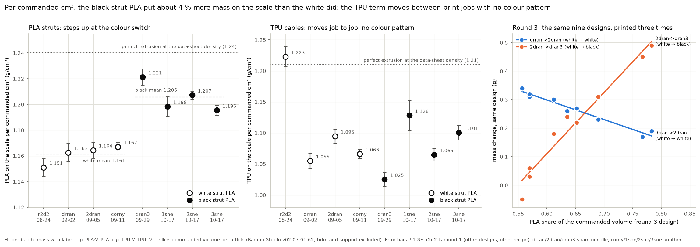

# Why the copies weigh more than the first articles: print files vs print batch, and white vs black PLA

Question from @me-madsen on PR #86 (10-19): every corny2, corny7 and
corny8 copy is 0.5–0.8 g heavier than its first article from the corny
batch.

- Do the print models differ (sizing, infill, anything else)?
- Black and white PLA were reported to differ slightly in material
  properties. Does that include density, or anything else that affects
  shock, and is any of it recorded as numbers?

Script: [`scripts/analysis/drop_test_print_mass_colour_analysis.py`](../../../scripts/analysis/drop_test_print_mass_colour_analysis.py).
Inputs and outputs:

- [`print-mass/`](print-mass/): `print_masses.csv` holds the 72 weighed
  articles, from the issue #98 print logs; the print keys record these
  masses with the label on. `commanded_volumes.json` holds what the slicer
  tells each article to extrude. `print_model_check.json` holds the
  project-file comparison.
- [`figures/print-mass/`](figures/print-mass/): the figure and
  `print_mass_colour.json`.

## Short answer

1. **The print models are identical.** The meshes are byte-identical, with
   no scale or rotation anywhere. The infill and all 556 project settings
   match. The lab's Bambu Studio (v02.07.01.62) slices both projects to the
   same PLA and TPU per article, within 0.03 %.
2. **The extra grams come from the print, mostly the strut PLA.** For each
   commanded cm³, black PLA put **3.8 % more mass on the scale than white
   PLA**:
   - four white batches agree at 1.151–1.167 g/cm³;
   - four black batches sit at 1.196–1.221;
   - this holds under both print recipes.

   The TPU term moves by up to ~7 % from one print job to the next, with
   no colour pattern. Of each copy's gain, 70–80 % is PLA and the rest is
   TPU.
3. **Density is not the explanation.** No density difference between the
   colours is measured anywhere. Bambu publishes a single 1.24 g/cm³ for
   every PLA Basic colour, and pigment chemistry would make white the
   *denser* one. The likely carriers are both properties of the spool, not
   of the files:
   - filament diameter, which sets the grams per metre fed;
   - the filament preset or feeding at print time.

   Weighing 1 m of each spool settles it.
4. **For shock, nothing in the material data points to a colour effect.**
   The modulus is colour-independent, and the one same-resin study puts
   strength within 2–3 %. No damping data exist. Our own drops agree:
   - the black reprint of round 3 sits −0.003 in T from the white first
     print;
   - corny7 and corny8 gained the same mass (+0.53 / +0.55 g, same PLA/TPU
     split), so the colour switch cannot explain why corny7's T moved
     about six times more than corny8's.

## 1. The print models

**First articles vs plate-1 copies.** The comparison covers the round-4
project at 9fba359 that the corny plate was printed from, and the replicate
plate-1 project. Plates 2 and 3 printed the plate-1 gcode.

| check | result |
|---|---|
| mesh of each strut and cable part (SHA-256 of the vertex + triangle arrays) | identical for t37, t38 and t39, all 9 copies (18 parts) |
| solid volume | t37 21,826 + 3,376 mm³, t38 19,171 + 5,920, t39 21,750 + 3,486 (struts + cables), identical |
| scale or rotation (component and build transforms) | none in either file: identity 3×3, translation only |
| per-part settings | identical (extruder, sparse infill: corny7 22/21 %, corny8 21/34 %, corny2 18/34 %) |
| `project_settings.config` | 556/556 keys identical (PLA 226 °C, TPU 236 °C, flow ratio 0.98 / 1.0, 0.30 mm layers, 2 walls, `filament_density` 1.26 / 1.18) |
| slicer output (headless v02.07.01.62) | per article PLA t37 13.77 cm³, t38 12.33, t39 13.69; TPU 3.30 / 5.48 / 3.43 cm³; brim 0.03 cm³ PLA (removed). Plate 1 matches round 4 to **≤ 0.03 %** on every article; bounding boxes match |

The round-3 project and the dran3 reprint file are also identical:
18/18 parts, 556/556 keys.

**What the files cannot show.** None of these is in any file:

- the lab's support painting (supports come off before weighing);
- any filament preset synced from the AMS at print time;
- the spool itself: colour, lot and diameter. The file's `filament_colour`
  is the generator's green/blue placeholder in both projects;
- the label.

**One file quirk, harmless here.** In the plate-1 project, all 18 part
`matrix` strings in `Metadata/model_settings.config` read
`1 0 0 np.float64(66.85…) …`. This is a NumPy-2 repr leaking from
`_matrix()` in PR #102's `bo/t3_prism_replicate_plates.py`. The slicer
places parts from the well-formed component transforms in
`3D/3dmodel.model`, so the copies sliced and printed correctly: the
volumes and bounding boxes match round 4. Cast to `float` before the next
plate file is generated.

## 2. Grams per commanded cm³, batch by batch

For each batch with at least two designs, the fit is

    mass_with_label = ρ_PLA · V_PLA + ρ_TPU · V_TPU

where V is the slicer-commanded volume of each material for that article
(the flow ratio is already inside it). If extrusion were perfect, at the
data-sheet density and nominal 1.75 mm filament, ρ would be 1.24 (PLA) and
1.21 (TPU).

| batch | print log | strut PLA | designs (file) | n | ρ_PLA (g/cm³) | ρ_TPU (g/cm³) | residual sd | mass ÷ perfect |
|---|---|---|---|--:|--:|--:|--:|--:|
| r2d2 | 08-24 | white | round 1, t10–t18 (the lab's support-painted file; PLA 220 °C, TPU flow ratio 1.1) | 9 | 1.151 ± 0.007 | 1.223 ± 0.016 | 0.095 g | 0.951 |
| drran | 09-02 | white | round 3, t28–t36 | 9 | 1.163 ± 0.007 | 1.055 ± 0.012 | 0.078 g | 0.915 |
| 2dran | 09-05 | white | round 3 (same file) | 9 | 1.164 ± 0.006 | 1.095 ± 0.011 | 0.071 g | 0.927 |
| corny | 09-11 | white | round 4, t37–t45 | 9 | 1.167 ± 0.003 | 1.066 ± 0.007 | 0.049 g | 0.924 |
| dran3 | 09-29 | black | round 3 (same file) | 9 | **1.221** ± 0.006 | 1.025 ± 0.011 | 0.072 g | 0.937 |
| 1sne | 10-17 | black | round 4 (same file), t37–t39 × 3 | 9 | **1.198** ± 0.008 | 1.128 ± 0.024 | 0.087 g | 0.959 |
| 2sne | 10-17 | black | same gcode as 1sne | 9 | **1.207** ± 0.003 | 1.065 ± 0.010 | 0.036 g | 0.952 |
| 3sne | 10-17 | black | same gcode as 1sne | 9 | **1.196** ± 0.004 | 1.101 ± 0.012 | 0.044 g | 0.952 |

- **The PLA term steps once, at the colour switch.**
  - The white mean is 1.161 (sd 0.007 over 4 batches) and the black mean
    is 1.206 (sd 0.012): **+0.044 g/cm³, +3.8 %**, Welch t = 6.5.
  - The white term is flat across three weeks and two recipes. Round 3
    runs PLA at 217 °C and 20.5 mm³/s, round 4 at 226 °C and 29.5 mm³/s.
  - So a print speed or temperature limit is not what holds the white
    batches down.
- **The TPU term is the noisy one** (1.025–1.095 within the round-3
  recipe, 1.065–1.128 within round 4), and it moves with the print job,
  not with the strut colour.
  - Round 3: drran → 2dran → dran3 gives 1.055 → 1.095 → 1.025.
  - Round 4: corny 1.066, copies 1.065–1.128.
  - r2d2's 1.223 belongs to a different TPU preset and flow ratio and is
    not comparable.
- **Every article weighs 4–9 % less than a perfect extrusion would give**
  (mass ÷ perfect 0.915–0.959). The repo's printed-mass model
  (`bo/t3_prism_mass_model.py`, PR #102) was calibrated on white articles,
  so it under-predicts black ones: the copies sit +0.2 to +0.35 g above
  `printed_g_est`, while corny sat −0.3 g below.

## 3. Round 3: the same nine designs, printed white, white, then black

The drran, 2dran and dran3 prints came from one file, with byte-identical
geometry and settings. Each design commands a different PLA/TPU split, from
56 % to 78 % PLA by volume, so a mass step carried by one material shows up
as a slope against the PLA share (right panel of the figure).

| step | strut PLA | mean gain | Δρ_PLA | Δρ_TPU | gain vs PLA share | residual sd |
|---|---|--:|--:|--:|--:|--:|
| drran → 2dran (3 days) | white → white | +0.27 g | +0.002 ± 0.001 (0 %) | +0.040 ± 0.002 (+3.8 %) | r = −0.98 | 0.013 g |
| 2dran → dran3 (24 days) | white → black | +0.21 g | **+0.057 ± 0.003 (+4.9 %)** | −0.070 ± 0.006 (−6.4 %) | r = **+0.98** | 0.037 g |

- **The white → white reprint changed only the TPU.** The TPU-heavy designs
  t28, t30 and t33 gained the most, +0.31 to +0.34 g.
- **The white → black reprint changed the PLA.** The PLA-heavy designs t35
  and t36 gained +0.45 / +0.49 g. The TPU-heavy clone trio gained
  −0.05 to +0.06 g.
- **The label does not change this.** The label style changed between
  batches:
  - drran / 2dran: black tape plus a paper label;
  - corny / dran3: a label-maker strip with two tape bands;
  - 1sne / 2sne / 3sne: a long handwritten wrap.

  Every design commands about the same total volume (16.9–17.8 cm³), so a
  label of fixed mass raises ρ_PLA and ρ_TPU together, by about 0.006 g/cm³
  per 0.1 g. Even if the dran3 labels weighed 0.2 g more, the PLA step is
  still +3.9 %. A label cannot create a step in the PLA alone.

## 4. First articles vs the 27 copies

Each gain is split into a PLA part and a TPU part using the corny-batch fit
and the pooled fit of the 27 copies (ρ_PLA 1.200 ± 0.005, ρ_TPU
1.098 ± 0.015).

| design | first article | 9 copies, mean ± sd | gain | from PLA | from TPU | first article vs its own batch fit |
|---|--:|--:|--:|--:|--:|--:|
| corny2 (t38) | 20.21 g | 20.82 ± 0.13 g | +0.61 g (+3.0 %) | +0.41 g | +0.17 g | −0.03 g |
| corny7 (t37) | 19.62 g | 20.15 ± 0.09 g | +0.53 g (+2.7 %) | +0.46 g | +0.11 g | +0.04 g |
| corny8 (t39) | 19.64 g | 20.19 ± 0.07 g | +0.55 g (+2.8 %) | +0.46 g | +0.11 g | +0.01 g |

- **The first articles are ordinary members of the white corny batch**, to
  within ±0.04 g. Nothing is special about them as prints.
- **The gain is a batch effect** that every black copy shares. Plates 1, 2
  and 3 printed the same gcode, and their means differ by only 0.15 g
  (20.48 / 20.34 / 20.33 g).

## 5. What is recorded numerically about white vs black PLA

**Sources.** The report is @me-madsen's question on PR #66 (08-21),
answered in [`cad/materials/README.md`](https://github.com/vertical-cloud-lab/tensegrity-optimization/blob/copilot/add-manual-supports/cad/materials/README.md)
on that branch (Edison task `59997d42`), plus issue #96 for flow:

| property | white | black | source |
|---|---|---|---|
| Young's modulus | one band for every colour: 2.78 ± 0.35 GPa | same | Wittbrodt & Pearce 2015 (five colours from one resin) |
| tensile strength (UTS) | 53.97 ± 0.26 MPa | 52.81 ± 1.18 MPa | same study; white +2.2 % |
| yield strength | 50.51 MPa | 49.23 MPa | white +2.6 % |
| strain at max load | 2.22 % | 2.02 % | |
| crystallinity | 5.05 % | 2.62 % | |
| specimen-to-specimen scatter | SD 0.82 MPa | SD 3.72 MPa | black least repeatable |
| Bambu PLA Basic data sheet | one sheet for all ~30 colours: E 2580 ± 220 MPa, UTS 35 ± 4 MPa, impact 26.6 ± 2.8 kJ/m², density 1.24 g/cm³ (not toleranced) | same | Bambu TDS V3.0 |
| bar-wave speed over Bambu's whole modulus band | 1380–1503 m/s (8.9 % spread); worst-case white/black joint reflects 0.18 % of the energy | | PR #66 derivation |
| damping (tan δ), restitution, impact or shock by colour | no study found | | Edison's largest evidence gap |
| dimensional accuracy (Verbatim PLA) | – | best: max volumetric deviation 1.96 % vs 5.50 % for *natural* | Frunzaverde 2022 |
| strength vs nozzle temperature (Verbatim) | – | stronger at 200–210 °C (52.41 MPa), weaker at 230–240 °C (43.23 MPa) | Frunzaverde 2022 |
| extrusion on one profile | – | black under-extruded, red over-extruded (Verbatim) | Frunzaverde 2023 |
| melt flow | TiO₂ white has higher melt viscosity; it is the most clog- and under-extrusion-prone colour (qualitative) | | issue #96 |

**Density by colour: no measurement exists**, in the repo or in what the
searches found.

- Bambu lists one value, 1.24 g/cm³ (ISO 1183), for every PLA Basic
  colour. The slicer preset uses 1.26, which only changes its weight
  estimate.
- Pigment loading works the wrong way for our data. Edison's loading
  heuristic is several wt% TiO₂ in white and ≤ ~1 wt% carbon black in
  black. By the rule of mixtures:
  - TiO₂ (4.2 g/cm³) at 2–4 wt% gives 1.258–1.276 g/cm³ (+1.4 to +2.9 %);
  - carbon black (~1.9 g/cm³) at 0.5–1 wt% gives 1.242–1.244 (+0.2 to +0.4 %).
- So pigment would make **white** the denser filament, and here the black
  articles are the heavier ones.

**What can produce +3.8 % PLA per commanded cm³:**

- **Grams per metre of filament.** The printer feeds a length, and the
  mass that arrives is ρ × the filament's cross-section.
  - PLA Basic's diameter tolerance is quoted as ±0.03 mm, which is
    ±3.4 % in mass per metre.
  - A white spool at about 1.735 mm and a black one at about 1.768 mm
    (both in tolerance) give the whole step.
- **The filament preset at print time.** If the lab's AMS sync or a saved
  preset carried a different flow ratio for one spool, that scales the
  extruded volume directly. The repo has no record of the printing-time
  preset.

**The test (5 minutes):**

- Cut 1.000 m from the black spool and from the white spool (or a white
  spool of the same product), and weigh each on the #98 scale.
- Caliper each filament at ~10 points.
- A ~3–4 % difference in g/m means the effect is in the spool. Equal g/m
  means it was the preset or the feeding.

## 6. Does it affect shock?

- **Round 3 measured the colour switch directly.**
  - The black reprint dran3 had a PLA term +4.9 % over 2dran.
  - Its screened print offset in T against the white first print is
    **−0.003**; print 2 (white) was +0.008, against an article+seat sd of
    0.0087 ([`../dran3-checkin/README.md`](../dran3-checkin/README.md),
    "Three-print comparison").
  - On those nine designs, the switch moved T by less than one article sd.
- **corny7 vs corny8.** The two designs command almost the same material
  (13.77 / 3.30 vs 13.69 / 3.43 cm³ PLA / TPU) and gained the same mass
  (+0.53 / +0.55 g). Their T moved very differently:
  - corny7 +12.6 % on clean drops;
  - corny8 −2.1 % on its few clean drops.

  A material or mass shift the two designs share cannot be what separates
  them. The open causes for corny7 stay as listed in
  [`ch5-fault-and-replicates.md`](ch5-fault-and-replicates.md): that one
  article, its seat, and the 10-17 seats. The test is still to re-drop the
  original white corny7 next to its black copies on a healthy seat.
- **The TPU is the material worth watching.** The cables are the compliant
  members, and TPU deposition varies by up to ~7 % between jobs at a fixed
  recipe. The copies carry ~3 % more TPU per commanded cm³ than corny did.
  These data cannot show whether that moves T.
- **BO bookkeeping (PR #102):**
  - per-gram objectives and the constant-printed-mass target (20.23 g)
    shift by ~3 % with the strut spool;
  - the mass model's PLA term was fitted on white articles;
  - either refit it on black batches or keep one spool colour per campaign,
    as PR #66 recommended.

T-drift watch and capture screen (standing instructions): this note adds
no drop sessions, so neither has anything new to screen.

## 7. To log from now on

- Strut colour and the spool's **grams per metre** (weigh 1 m) on every
  plate in the #98 template, next to RH. Do the same for the TPU spool.
- Weigh one label of each style once, or weigh one article before and
  after labelling.
- Post the support-painted project that was actually printed. The
  printing-time preset is the one input the repo cannot see.
