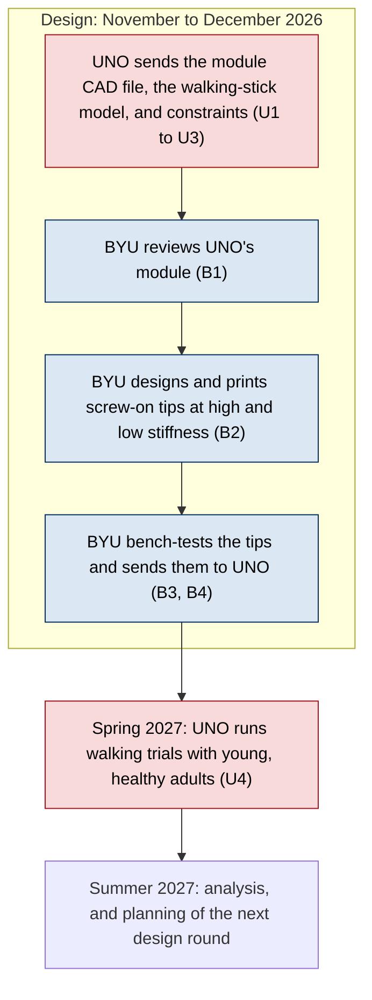

# Walking-stick tip collaboration with Dr. Dotov's lab: action items and responsibilities

**Brigham Young University (BYU):** Vertical Cloud Lab (Dr. Sterling Baird) and Smash Lab (Dr. Jeff Hill), Department of Mechanical Engineering

**University of Nebraska Omaha (UNO):** Dr. Dobromir Dotov's lab (Dr. Dotov and Jingxian Gu)

From the video meeting on November 6, 2026 ("RE: Potential Co-lab Collaboration (Tensegrity Crutch/Walking Stick Tips)", 37 min 35 s of transcript). The Status column reflects the end of that meeting; update it as items close. Discussion is tracked in [issue #135](https://github.com/vertical-cloud-lab/tensegrity-optimization/issues/135). Times in parentheses, such as (31:20), point to the meeting transcript. The transcript labels speakers by device rather than by person, so read [About the source](#about-the-source) before quoting anyone.

## Summary

BYU designs and 3D prints tensegrity tips that screw onto the bottom of a walking stick. UNO sets the requirements and tests the tips with people walking on different terrain.

The first round is passive tips at fixed stiffness, starting with one high and one low, for young, healthy adults using a hiking-style walking stick. Tips whose stiffness can be adjusted come after that.

Dr. Dotov's timeline, "if everything runs smoothly" (36:39): finish the design by December 31, 2026, collect walking data in spring 2027, and analyze it in summer 2027.

**Next step:** UNO sends BYU the computer-aided design (CAD) file of its current tensegrity module and the make and model of its walking stick (items U1 and U2 below). BYU's design work starts from those two.

## Action items

| ID | Owner | Action | Transcript | Status |
| --- | --- | --- | --- | --- |
| U1 | Dr. Dotov's lab | Send BYU the CAD file of UNO's current module, the untested design Dr. Dotov wants printed. If exporting it is a problem, BYU offered a screen-share call to help. | 8:02, 15:23, 31:20 | Open |
| U2 | Dr. Dotov's lab | Send BYU the make and model, or a product link, of the walking stick with the screw-off tip, so BYU can match the thread. If the specifications are not online, BYU will measure one. | 29:44-31:20 | Open |
| U3 | Dr. Dotov's lab | Send the design constraints for the tip, which Dr. Dotov offered at the start of the recording. Some were already given on August 3, 2026 (see [Carried over](#carried-over-from-the-august-3-2026-meeting)). | 1:00 | Open |
| U4 | Dr. Dotov | Arrange spring 2027 data collection with "the other Jeff", a psychology collaborator in Illinois who has a student who could run the study, and possibly with Jingxian Gu. Decide whether trials run at UNO, which has more varied terrain, or in Illinois. | 16:47-18:02, 36:39 | Open |
| B1 | BYU, both labs | Review UNO's module once it arrives and send feedback: changes to it, a different tensegrity geometry, and how to print it. Depends on U1. | 15:23-16:28, 29:35 | Waiting on U1 |
| B2 | Smash Lab (design), Vertical Cloud Lab (printing) | Design screw-on tips at two or more fixed stiffness levels, starting with one high and one low, threaded to fit UNO's walking stick. Check whether thermoplastic polyurethane (TPU) is stiff enough. Depends on U2. | 14:50-15:59, 29:35 | Waiting on U2 |
| B3 | BYU, both labs | Print the tips and bench-test them at whatever loads BYU can apply, to estimate how much stiffness change is needed and which geometry gives stable contact. | 24:56 | Open |
| B4 | BYU | Send the tested tips to UNO for the spring 2027 trials. | 18:02, 36:39 | Open |

The meeting did not assign BYU items to individual people. Add names here once they are assigned.

*Blue: BYU. Red: UNO.*

## Who does what

These are the roles the groups described for themselves in the meeting.

| Group | Responsible for | Transcript |
| --- | --- | --- |
| Vertical Cloud Lab, BYU (Dr. Sterling Baird) | 3D printing the tip prototypes, including supports that can be removed from inside a tensegrity after printing. | 0:16, 8:49 |
| Smash Lab, BYU (Dr. Jeff Hill) | Tensegrity design for the terrain UNO specifies. Later, adjustable stiffness, building on the lab's continuous-cable tensegrity work. | 0:16, 6:03 |
| Both BYU labs | Reviewing UNO's module, bench-testing printed tips, and supplying tips to UNO. Which lab runs the bench tests was not discussed. | 15:23-16:28, 24:56, 29:35 |
| Dr. Dotov's lab, UNO (Dr. Dobromir Dotov, Jingxian Gu) | Requirements, and the parts BYU has to match (the module CAD file and the walking-stick thread). The human-participant study: recruiting, terrain conditions, measurements, and arranging data collection with psychology collaborators. | 1:00, 18:28-21:10, 22:14, 31:20 |

## Decisions

1. **BYU builds, UNO specifies and tests** (0:16 to 1:00).
2. **The first use case is a hiking-style walking stick used by young, healthy adults**, because those participants are quick to recruit (22:14). A load-bearing cane or crutch for people with mobility needs is the harder, longer-term case. Dr. Dotov noted that Jingxian Gu, an occupational therapist, thinks about what people with mobility needs require, and said he was cautious about how quickly the project can get there (25:48). He said BYU can argue for starting with the load-bearing case if it thinks that is better (23:55). He also confirmed that "cane" in the meeting meant walking stick (31:04).
3. **The first prototypes are passive**: screw-on tips at fixed stiffness, starting with one high and one low, to find the right range before building adjustable tips. Dr. Dotov agreed to this (14:50 to 15:59).
4. **When stiffness becomes adjustable, a manual adjustment is enough to start with**: the user lifts the stick and turns a small knob, perhaps on the handle, to tighten it. It does not need to be automatic (5:32 to 5:52).
5. **The goal Dr. Dotov named for the tip is stability**, by conforming to small irregularities such as a stone or sloped pavement. BYU asked whether the aim was reducing shock, reducing vibration, or stability, and Dr. Dotov answered stability (10:05 to 11:09). BYU's drop-tower tests so far measure impact energy absorption, which is a different objective.

## How UNO plans to measure success

Dr. Dotov described three levels of measurement (18:28 to 20:44):

1. **Questionnaire:** how stable participants feel.
2. **Walking speed:** how fast participants choose to walk under each combination of terrain and tip, measured with motion capture.
3. **Stability of body motion:** upper-body sway, side-to-side (mediolateral) sway, and the Lyapunov exponent, which measures how fast small disturbances grow in the motion of a point near the body's center of mass. A larger value means less stable walking.

**Optional, not decided:** a load cell in the handle to measure the force going into the hand, suggested by Jingxian Gu (20:44 to 21:10).

More on these measures, how UNO ran them in its crutch study, and the other testing ideas from the meeting is in [testing-notes.md](testing-notes.md).

## Open questions

| Question | Who answers | Transcript |
| --- | --- | --- |
| Which recorded data would help BYU design the tip, for example acceleration at the tip during walking? BYU asked and it was not answered. | UNO | 10:05 |
| What stiffness range is needed? The plan is to start with high and low and narrow down. | BYU bench tests, then UNO trials | 15:23 |
| Is TPU, the flexible filament BYU prints tendons with, stiff enough for a tip? | BYU | 15:23 |
| Should the handle carry a load cell? | UNO | 20:44 |
| Do the trials run at UNO or in Illinois? | UNO | 17:26-18:02 |
| How much bending stiffness should a tip have? Neither side has measured this. | Both | 31:28-32:23 |

## Design notes from the meeting

- **UNO's crutch module carries internal forces above 1000 N from its pre-stress** (7:04). A walking-stick tip is less demanding, which allows faster prototyping (7:22).
- **UNO's module will be hard to print in one piece.** Its horizontal members overhang and would sag without supports (8:34). In BYU's experience, designing supports that come out easily from inside a tensegrity is one of the hardest parts of printing one (8:49).
- **Several contact points may help.** A tensegrity tip may touch the ground at several points, so if one misses, the others can still land (11:26). Dr. Dotov's idea, not yet tested: keep the load balanced across the contacts so none of them passes the friction limit, the way stability control in a car keeps the load on its wheels balanced (11:54 to 13:07).
- **Cables, if adjustable tips need them** (13:07 to 14:48): the Smash Lab's continuous-cable structures use roughly 300 lb fishing line, which stretches a lot. Braided steel is stronger and stiffer and may still slide. Kevlar is light and strong, but loops at the cable ends slip or weaken the cable, a problem both groups have run into.
- **Load depends on the user** (21:14 to 23:45). Someone hiking leans on the stick less than someone with balance problems leans on a cane, and the cane would need a stiffer tip. Swappable screw-on tips could cover both.
- **A paper may come from the manufacturing alone.** Dr. Dotov thinks a reliable way to make these tips could be enough for a paper, since making tensegrity structures is the hard part (9:23).

## Ideas set aside for later

- **Adjustable stiffness at crutch loads.** This needs a heavily engineered mechanism (6:26 to 7:22).
- **A crutch that shortens during the swing phase**, the part of each step when the crutch is off the ground and moving forward, so the user does not have to lift their shoulders. Jingxian Gu raised this. Dr. Dotov suggested pulling a cable to shorten it. BYU raised tensegrities with a negative Poisson's ratio (structures that get wider, not narrower, when stretched), but noted that the ones it has handled expand sideways when pulled, which is not the same as getting longer under a push. The 10 to 15% expansion figure mentioned was from memory. Both sides called the idea very complex (32:23 to 35:28).
- **Tensegrity shoe soles**, Jingxian Gu's idea from a 3D printing class. The cells would need to be smaller than BYU can currently print (27:42 to 29:34).

## Carried over from the August 3, 2026 meeting

These were not discussed on November 6, and their status is unknown. Source: [Marcus Madsen's notes on PR #41](https://github.com/vertical-cloud-lab/tensegrity-optimization/pull/41#issuecomment-5171640386).

- UNO asked for Dr. Hill's papers, particularly the one on the wearable tensegrity brace.
- UNO's requirements for a tip: durable (it should not break after about three months of use), allows some movement but not much, does not move only along one axis the way a spring does, and is light.

## Not covered in the transcript

None of these came up. They are suggestions for the next meeting.

- Whether the spring 2027 trials need a new or amended human-subjects protocol, and how long approval takes.
- How many tips, and how many spares, UNO needs, and who ships them.
- Authorship, and who leads the manufacturing paper Dr. Dotov suggested (9:23).
- When to meet next.

## About the source

The source is the Microsoft Teams auto-transcript of the November 6, 2026 meeting, attached to [this comment on issue #135](https://github.com/vertical-cloud-lab/tensegrity-optimization/issues/135#issuecomment-6830092359). It has three limits:

- **Speakers are labeled by device, not by person.** Every BYU voice appears as "Jinkwan Han" (the account that started the transcription) and every UNO voice as "Dobromir Dotov". Who said what in this document comes from context, for example "in my lab" for Dr. Hill (6:03) and "Jing's suggestion" for Jingxian Gu (20:44). Attendance was not recorded: the voices include Dr. Dotov, Jingxian Gu, Dr. Hill, and at least one BYU student. Attendees, please add the full list.
- **Transcription started partway into the meeting.** Its first line is Dr. Dotov finishing a suggestion whose subject was not recorded. Anything agreed before that point is missing here.
- **Names and some words are mis-heard.** For example, "Jing" appears as "Jane" and once as "Jinkwan". The Illinois collaborator's full name and university are not in the transcript.

## Background

- J. Gu, J. Spyra, A. Walski, L. Elsaesser, S. Bierner, D. Dotov, "Tensegrity crutches with compliance from a pre-stressed self-tensile module improve ground reaction force profiles, speed, effort, comfort, and perceived stability", preprint, [arXiv:2605.02710](https://arxiv.org/abs/2605.02710) (2026). UNO's crutch study.
- A. Brown, C. Swain, N. Usevitch, J. Hill, "Development of a Continuous Cable Tensegrity", ASME SMASIS 2024, [doi:10.1115/SMASIS2024-140185](https://doi.org/10.1115/SMASIS2024-140185). The Smash Lab's continuous-cable work mentioned at 6:03.
- H. Denning, A. Bullinger, J. Hill, "Tuning Tensegrity: Simplified Construction and Cable Tension Interactions", ASME SMASIS 2024, [doi:10.1115/SMASIS2024-140381](https://doi.org/10.1115/SMASIS2024-140381).
- [Issue #17](https://github.com/vertical-cloud-lab/tensegrity-optimization/issues/17) and [PR #18](https://github.com/vertical-cloud-lab/tensegrity-optimization/pull/18): BYU's earlier look at tensegrity crutch tips, including literature searches.
- [PR #41](https://github.com/vertical-cloud-lab/tensegrity-optimization/pull/41): first contact with UNO (July 14, 2026), the August 3, 2026 meeting notes, and the October 19, 2026 follow-up asking whether UNO was still interested in collaborating.
