# Audrey Christiansen's annotated manuscript PDF, first pass (2026-10-23)

Audrey's highlights and comments on the manuscript, posted to PR #76 on 2026-10-23
([comment](https://github.com/vertical-cloud-lab/tensegrity-optimization/pull/76#issuecomment-6372860104),
[annotated PDF](https://github.com/user-attachments/files/33887679/manuscript.pdf)), turned into a
list of items with what I would change for each.

**Which draft she annotated.** The committed [`manuscript/manuscript.pdf`](../../manuscript/manuscript.pdf),
built 2026-10-11 (commit `7320316`, unchanged through `99cdb87` and the current head). Its text matches
her copy on all 18 pages. All 15 highlights are on page 1: the author block, the abstract, and the first
paragraph of the Introduction. Thirteen carry a comment and two do not.

**The source has moved since.** Sterling's commit `95b331e` (2026-10-23, 17:30 UTC) rewrote part of the
abstract in `manuscript-body.tex` without rebuilding the PDF. Her copy and the source now differ at three of
the places she marked (items 6, 8 and 13), and the wording around a fourth (item 12) changed. Each item below
gives her text, the text at the branch head (`5f260c8`), and what I would change. Line numbers are into
[`manuscript-body.tex` at `5f260c8`](https://github.com/vertical-cloud-lab/tensegrity-optimization/blob/5f260c8/manuscript/manuscript-body.tex).

**Nothing in the manuscript has been changed.** As with Marcus's reviews, this is a list for the team to
approve first.

## Summary

- **14 items** from 15 highlights (the two Introduction highlights cover the same words).
- **Edits I would make as she wrote them:** 2 and 3 (PLA, TPU), 4 (scaled), 5 (3D printed), 7 (the
  transmissibility definition), 9, 10 and 12 (article to specimen), 14 (defining trait).
- **Questions answered:**
  - Item 1: yes, the addresses are standard. ASME asks for every author's department, mailing address and
    e-mail, and the `asmejour` template prints them.
  - Item 11: no batch after the fourth has been printed. Round 5 was generated on 2026-09-15 and staged, and
    the printer has gone to the third reprint of batch 3 and the replicate study since.
- **Three items need a decision first:**
  - **Item 8, the rebound objective.** Audrey's reading is right: the optimizer minimizes m·g·h·(v₂/v₁),
    which is not a velocity loss index. The head abstract now also contradicts the Methods. `95b331e` changed
    "high" to "low", while the parenthetical and Methods line 994 define the index so that higher is better.
    I would rename the optimized quantity rather than flip either direction (proposal below).
  - **Item 11, "fourth" or "final".** "Final" is accurate if the campaign stops at batch 4. Three other
    passages then need to change with it.
  - **Item 13, the three-prints sentence.** Audrey's rewrite and Sterling's `95b331e` rewrite of the same
    sentence crossed. I propose a merged version that keeps her result and his plainer framing.
- **One sweep implied by items 9, 10 and 12.** The paper calls a printed test piece both an "article" (about
  150 times in the body, 28 in the SI) and a "specimen" (on 27 lines of the body). Her comment shows why
  "article" misleads: she read "printed articles" as other people's papers. I would change every "article"
  that means a print to "specimen", in the body, the SI, and the one figure that prints the word.

## Page 1 of her copy, items numbered

Red boxes are her highlights; numbers are the items below, in reading order.

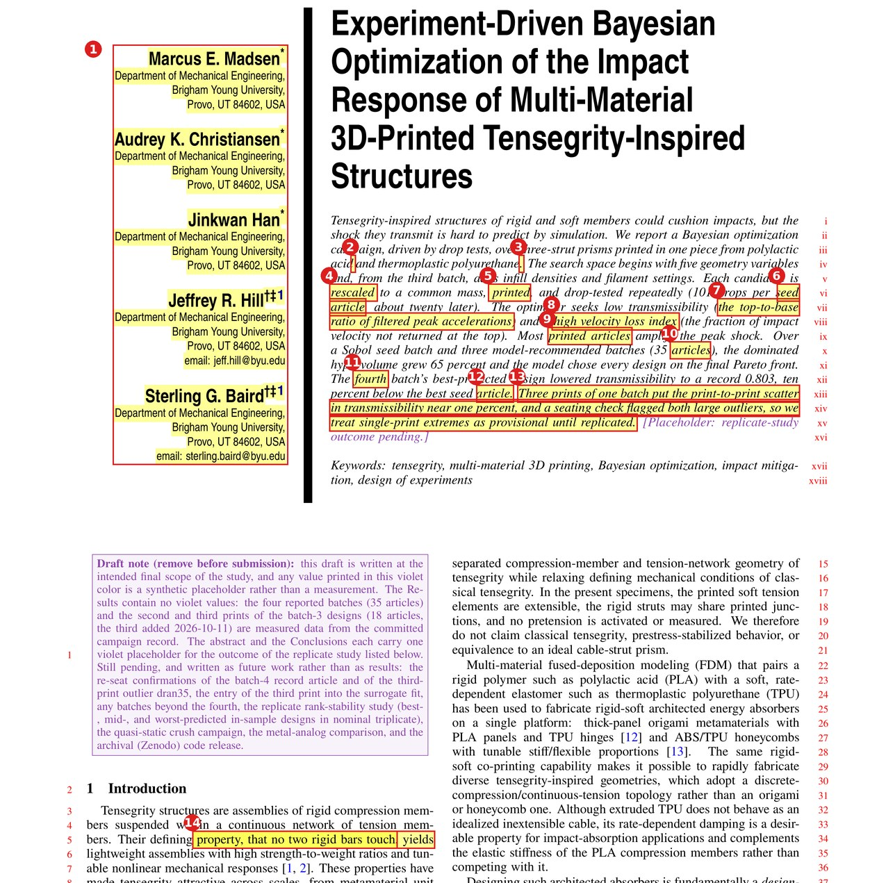

## Item index

| # | Where in her copy | Head source line | Her note, short | Kind | Touched by `95b331e`? |
|---|---|---|---|---|---|
| [1](#1-author-block-why-are-our-addresses-here) | Author block | 110 to 140 | Why are our addresses here? Is this standard? | Question (answered) | No |
| [2](#2-pla-after-polylactic-acid) | Abstract iv | 157 | (PLA) | Edit as written | No |
| [3](#3-tpu-after-thermoplastic-polyurethane) | Abstract iv | 158 | (TPU) | Edit as written | No |
| [4](#4-rescaled-to-scaled) | Abstract vi | 160 | "scaled", only scaled once | Edit as written, plus 3 more places | No |
| [5](#5-printed-to-3d-printed) | Abstract vi | 161 | "3D printed" | Edit as written | No |
| [6](#6-seed-article-highlight-only) | Abstract vi to vii | (deleted) | No comment | Covered by items 9 and 12 | Yes, text deleted |
| [7](#7-transmissibility-parenthetical) | Abstract vii to viii | 161 to 162 | "measured as a ratio of filtered top-to-base peak accelerations" | Edit as written | No |
| [8](#8-high-velocity-loss-index) | Abstract viii | 162 to 163 | m·g·h(v₂/v₁) is not a velocity loss index | Decision (@sgbaird) | Yes, "high" became "low" |
| [9](#9-printed-articles-to-3d-printed-specimens) | Abstract ix | 164 | "3D printed specimens" | Edit as written, plus sweep | No |
| [10](#10-35-articles-to-35-specimens) | Abstract x | 165 | specimen | Edit as written | No |
| [11](#11-fourth-batch-or-final-batch) | Abstract xii | 167 | Was there a batch after this? Change to "final" | Question (answered), then decision | No |
| [12](#12-best-seed-article) | Abstract xii to xiii | 168 to 169 | specimen | Edit as written, adjusted for `95b331e` | Context changed |
| [13](#13-the-three-prints-sentence) | Abstract xiii to xv | 169 | Rewrite supplied | Decision (crossed with `95b331e`) | Yes, sentence replaced |
| [14](#14-introduction-defining-trait) | Introduction, line 5 | 209 to 210 | "trait is no two rigid members contact one another, yielding" | Edit as written | No |

## The abstract with every item applied

Built from a scratch copy of the head source with items 2 to 13 applied, taking the recommended option where
there is a choice. It comes to 196 words, inside the 150 to 200 the source comment gives for JMD. The head
abstract is 174 words. The LaTeX is in [`proposed-abstract.tex`](proposed-abstract.tex).

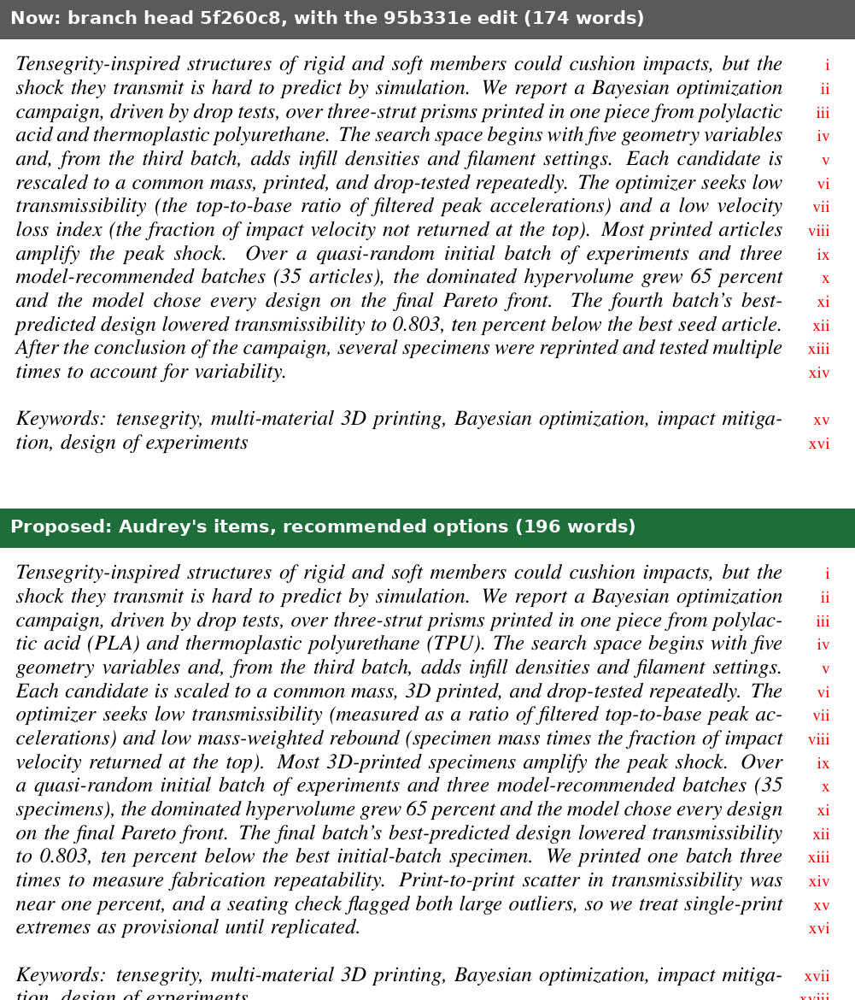

> Tensegrity-inspired structures of rigid and soft members could cushion impacts, but the shock they transmit
> is hard to predict by simulation. We report a Bayesian optimization campaign, driven by drop tests, over
> three-strut prisms printed in one piece from polylactic acid (PLA) and thermoplastic polyurethane (TPU).
> The search space begins with five geometry variables and, from the third batch, adds infill densities and
> filament settings. Each candidate is scaled to a common mass, 3D printed, and drop-tested repeatedly. The
> optimizer seeks low transmissibility (measured as a ratio of filtered top-to-base peak accelerations) and
> low mass-weighted rebound (specimen mass times the fraction of impact velocity returned at the top). Most
> 3D-printed specimens amplify the peak shock. Over a quasi-random initial batch of experiments and three
> model-recommended batches (35 specimens), the dominated hypervolume grew 65 percent and the model chose
> every design on the final Pareto front. The final batch's best-predicted design lowered transmissibility
> to 0.803, ten percent below the best initial-batch specimen. We printed one batch three times to measure
> fabrication repeatability. Print-to-print scatter in transmissibility was near one percent, and a seating
> check flagged both large outliers, so we treat single-print extremes as provisional until replicated.

## Items

### 1. Author block: "Why are our addresses here?"

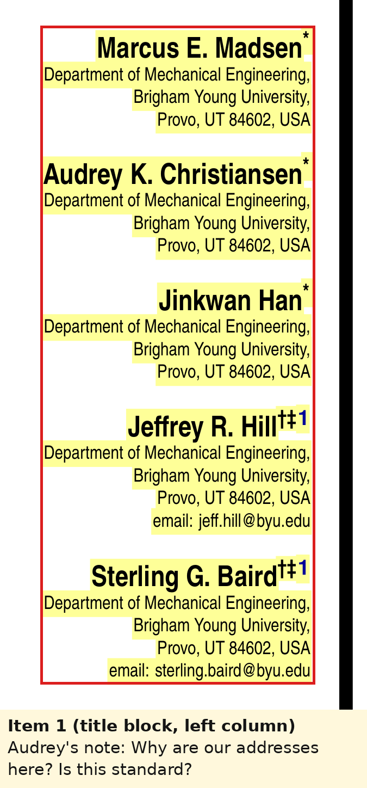

**Her note:** "Why are our addresses here? Is this standard?"

**Answer: yes, it is standard for ASME journals.** ASME's journal guidelines say the author affiliation
"should consist of the following, as applicable, in the order noted": university or company with department,
mailing address, city, state and ZIP code, country (if not the U.S.), and e-mail, using university or company
addresses where possible
([ASME, Writing a Research Paper or Technical Brief](https://www.asme.org/publications-submissions/journals/information-for-authors/journal-guidelines/writing-a-research-paper)).
ASME points authors to the `asmejour` LaTeX class, which this manuscript uses. Its template gives every author
a block of department, institution, street address, city, state, country, and e-mail
(`asmejour-template.tex`, [CTAN](https://ctan.org/pkg/asmejour)). JMD's production staff set the final
layout, but they expect this information.

**What I would change in the same block (not in her note, but it is what she was looking at):**

- **Add BYU e-mails for Marcus, Audrey and Jinkwan.** Sterling decided on 2026-09-15 that all five authors
  list BYU e-mails
  ([comment](https://github.com/vertical-cloud-lab/tensegrity-optimization/pull/76#issuecomment-5688746356)).
  This was never applied and is still the TODO at lines 193 to 200. I need the three addresses from you.
- **Print what the marks mean.** The clean PDF prints \*, † and ‡ after the names, but the only footnote is
  "1 Corresponding Author." The legend (\* and † equal contribution, ‡ corresponding author) is only in the
  review-copy TODO and a source comment (lines 106 to 109). Also, ‡ repeats what the class's numbered
  footnote already says.
- Optional, and fine to leave to production: ASME omits the country for U.S. addresses and lists a mailing
  (street or building) line before the city.

### 2. "(PLA)" after "polylactic acid"

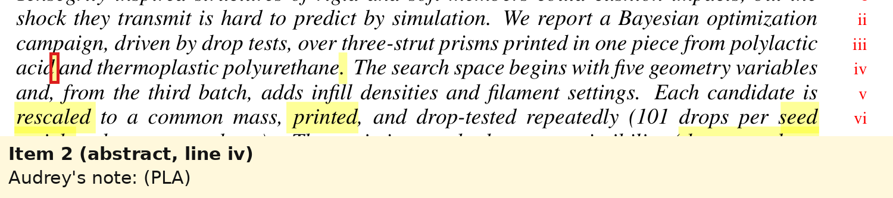

**Her note:** "(PLA)". **Head, line 157:** "printed in one piece from polylactic acid and".

**Change:** "polylactic acid (PLA)". The abstract does not use "PLA" again. ASME's rule is to spell an
acronym out at first use with the acronym in parentheses, and the Introduction defines it again at
lines 231 to 232. Abstracts are read on their own, so both definitions should stay.

### 3. "(TPU)" after "thermoplastic polyurethane"

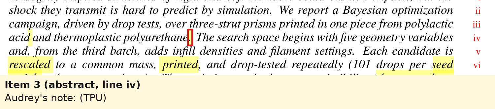

**Her note:** "(TPU)". **Head, line 158:** "thermoplastic polyurethane. The search space".

**Change:** "thermoplastic polyurethane (TPU)." Same reasoning as item 2.

### 4. "rescaled" to "scaled"

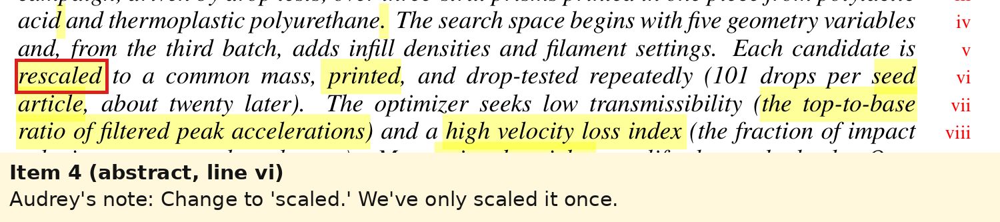

**Her note:** "Change to 'scaled.' We've only scaled it once." **Head, line 160:** "Each candidate is
rescaled to a common mass,".

**Change:** "scaled". She is right: Methods (lines 607 to 609) describe one uniform scaling per design,
solved until the mass target is met. The same word appears three more times, and I would change all four:

| Line | Now | Proposed |
|---|---|---|
| 160 | Each candidate is rescaled to a common mass | Each candidate is scaled to a common mass |
| 299 | a constant-mass projection that rescales every geometry | a constant-mass projection that scales every geometry |
| 607 | Each design is uniformly rescaled | Each design is uniformly scaled |
| 641 | Because the projection rescales the whole cell | Because the projection scales the whole cell |

The SI does not use the word.

**Related (Marcus's copy, page 1):** Marcus asks whether "common mass" holds when the printed specimens vary
in mass. Methods line 619 already concedes it: batches 1 and 2 held the solid CAD mass at 30.95 g, so printed
masses spanned 18.50 to 22.04 g and 17.91 to 23.47 g. Only from batch 3 was the target the printed mass
(20.23 g). If you want the abstract to say so itself, "scaled to a common target mass" costs one word. Line 619
quotes the abstract ("The abstract's 'common mass'"), so it would change too.

### 5. "printed" to "3D printed"

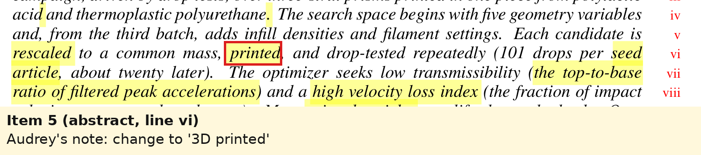

**Her note:** "change to '3D printed'". **Head, line 161:** "printed, and drop-tested repeatedly."

**Change:** "Each candidate is scaled to a common mass, 3D printed, and drop-tested repeatedly." No hyphen
here because it is a verb. Item 9 uses it as an adjective before a noun and takes the hyphen, as the title
does ("3D-Printed").

### 6. "seed article" (highlight only)

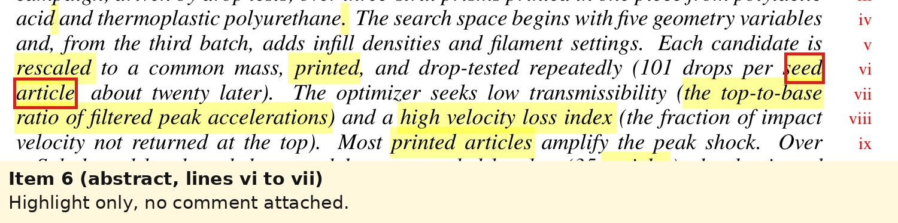

**No comment attached.** In her copy this was "(101 drops per seed article, about twenty later)". `95b331e`
deleted that whole parenthetical, so there is nothing left to edit here. Read with items 9, 10 and 12 it is
the same "article" point. The remaining "best seed article" is item 12.

### 7. Transmissibility parenthetical

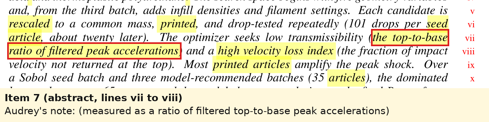

**Her note:** "(measured as a ratio of filtered top-to-base peak accelerations)". **Head, lines 161 to 162:**
"low transmissibility (the top-to-base ratio of filtered peak accelerations)".

**Change:** as she wrote it: "low transmissibility (measured as a ratio of filtered top-to-base peak
accelerations)".

### 8. "high velocity loss index"

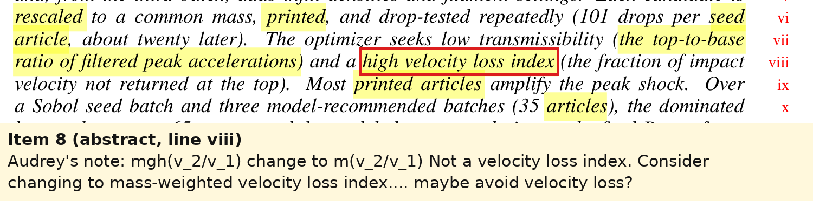

**Her note:** "mgh(v_2/v_1) change to m(v_2/v_1). Not a velocity loss index. Consider changing to
mass-weighted velocity loss index.... maybe avoid velocity loss?"

**Her copy:** "and a high velocity loss index (the fraction of impact velocity not returned at the top)".
**Head, lines 162 to 163, after `95b331e`:** "and a low velocity loss index (the fraction of impact velocity not
returned at the top)".

**What the code optimizes.** This was traced on issue #97 on 2026-10-23
([comment](https://github.com/vertical-cloud-lab/tensegrity-optimization/issues/97#issuecomment-6370296556)).
Both objectives are minimized
([`t3_prism_bo_campaign.py` L2668 to L2680 at `65ff978`](https://github.com/vertical-cloud-lab/tensegrity-optimization/blob/65ff978/bo/t3_prism_bo_campaign.py#L2668-L2680)).
The second one is e_reb·m·g·h, where e_reb = g·t_second/(2Δv) is the return speed divided by the arrival
speed, m is the weighed mass, and h = 1.524 m (60 in). So **Audrey's reading is exactly right**: the
optimizer minimizes m·g·h·(v₂/v₁). That is mass-weighted *rebound*. The velocity loss index is its
complement (VLI = 1 − e_reb), and the optimizer never sees it. Methods (lines 987 to 1016) already say the
index is a reporting name, "higher is better", and that E_reb "is not a measured energy".

**The head abstract now contradicts itself.** `95b331e` changed "high" to "low", but the parenthetical still
defines the index as the velocity *not* returned, so "low" asks for more rebound. Methods line 994 still says
"higher is better". This phrase has been flagged or edited three times in one week, each time with a different
reading:

- Audrey's note: it is not a velocity loss index.
- Marcus's notes on pages 1 and 7 of his copy: he asks whether lower is better.
- The `95b331e` edit: "high" became "low".

Figs. 6, 7 and 10 add a fourth form on their axes, "Mass-weighted 1 − velocity loss index" (Fig. 10 shortens
it to "Mass-weighted 1 − VLI"). That many readings of one phrase points to the name, so flipping one word back would not
fix it.

**Options:**

- **A, the abstract only (recommended now).** Describe what was optimized: "and low mass-weighted rebound
  (specimen mass times the fraction of impact velocity returned at the top)". Both objectives then read
  lower-is-better, and the abstract no longer depends on VLI. This is what the proposed abstract above uses.
- **B, the whole paper (her "maybe avoid velocity loss").** Also retire VLI in the body and report the
  rebound fraction e_reb directly. E_reb becomes the "mass-weighted rebound" everywhere. Scope:
  - about 15 places in the body and 4 in the SI, including the six "mass-weighted form of the velocity
    loss index" phrasings (lines 308, 412, 996, 1101, 1690, 1854);
  - Results values quoted as VLI (for example, "0.986" becomes "0.014");
  - the axis labels of Figs. 6, 7 and 10, which need regenerating.

  This reverses part of item 1 of PR #116, so it is Sterling's call. He proposed the VLI name on 2026-09-22
  ([comment](https://github.com/vertical-cloud-lab/tensegrity-optimization/pull/76#issuecomment-5784691710)).
- **Units: her "m(v₂/v₁)".** Dropping g·h changes nothing about the results, because g·h = 14.95 m²/s² is the
  same for every drop. On #97, m·e reproduces the current Pareto front exactly
  ([comment](https://github.com/vertical-cloud-lab/tensegrity-optimization/issues/97#issuecomment-6370736536)).
  It would move every E_reb value from millijoules to grams (4.1 to 18.1 mJ becomes 0.27 to 1.21 g) and every
  hypervolume by the same factor of 14.95, so tables and three figures change. The 65 percent hypervolume
  growth does not. Keeping mJ needs no new numbers, and lines 1012 to 1016 already say the score is not an
  energy. I would keep mJ and settle the name first.

**Related, not in her note:** Marcus also asks whether the index should use e² (energy) rather than e. That
changes the objective itself, not just its name. #97 found the m·e² front equals the current one minus r2d2c2,
and Sterling decided on 2026-10-11 that batch 5 keeps E_reb for comparability. I would keep that question
separate from this wording fix.

### 9. "printed articles" to "3D-printed specimens"

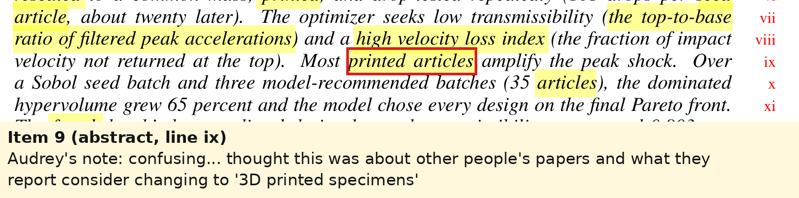

**Her note:** "confusing... thought this was about other people's papers and what they report. consider
changing to '3D printed specimens'". **Head, line 164:** "Most printed articles amplify the peak shock."

**Change:** "Most 3D-printed specimens amplify the peak shock."

**The same word is everywhere.** "Article" in the sense of one print appears about 150 times in the body,
including "per-article", "article's" and the "Article" table headers. It appears 28 times in the SI, not
counting `\documentclass{article}`. "Specimen" already appears on 27 lines of the body for the same thing
(lines 225, 596, 665, 771 and 893, among others), so readers currently meet two words for one object. I would change
every print-sense "article" to "specimen" in both files. Fig. 10's footnote ("each fold refits NUTS without
one design's articles") would be regenerated. Specimen IDs such as corny7 are unaffected.

### 10. "(35 articles)" to "(35 specimens)"

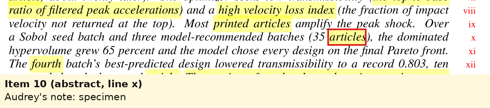

**Her note:** "specimen". **Head, line 165:** "three model-recommended batches (35 articles)".

**Change:** "(35 specimens)".

### 11. "fourth batch" or "final batch"

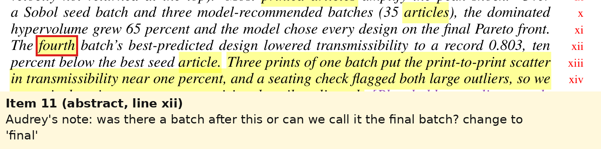

**Her note:** "was there a batch after this or can we call it the final batch? change to 'final'". **Head,
line 167:** "The fourth batch's best-predicted design".

**Answer: no batch after the fourth has been printed or tested.**

- Round 5's nine designs (trials 55 to 63) were generated on 2026-09-15 and staged
  ([`bo/README.md` at `65ff978`](https://github.com/vertical-cloud-lab/tensegrity-optimization/blob/65ff978/bo/README.md)).
- Since then, the print log on #98 shows only two kinds of print:
  - the third print of batch 3, dran31 to dran39
    ([2026-09-29](https://github.com/vertical-cloud-lab/tensegrity-optimization/issues/98#issuecomment-5881129656));
  - the replicate-study plates 1sne, 2sne and 3sne (corny7, corny8 and corny2 in triplicate)
    ([2026-10-17](https://github.com/vertical-cloud-lab/tensegrity-optimization/issues/98#issuecomment-6240858848)).
- Drop testing stopped on 2026-10-19 when the 10,000 g single-axis accelerometer broke
  ([#115](https://github.com/vertical-cloud-lab/tensegrity-optimization/issues/115#issuecomment-6277017048)).
  I found no later note that it has resumed.

**What I would change:** "final" is accurate if the team closes the campaign at batch 4. Sterling's `95b331e`
abstract already speaks of "the conclusion of the campaign". If you choose "final", three other passages must
change with it:

| Line | Now | Would become |
|---|---|---|
| 167 | The fourth batch's best-predicted design | The final batch's best-predicted design |
| 187 (draft note) | lists "any batches beyond the fourth" as pending | delete that entry |
| 1113 to 1115 (Methods) | "Until then, the next batch keeps E_reb as its second objective" | "Any later batch would keep E_reb as its second objective" |
| 1863 to 1865 (Studies pending) | "A fifth batch has been generated, regenerated once the second print entered the fit, and staged for printing" | "A fifth batch was generated, and regenerated once the second print entered the fit, but not printed" |

If batch 5 might still run, "fourth" stays correct and nothing else changes. **Decision: the team.**

### 12. "best seed article"

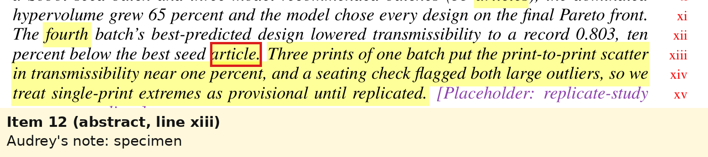

**Her note:** "specimen". **Head, lines 168 to 169:** "ten percent below the best seed article."

**Change:** "ten percent below the best initial-batch specimen." The head needs one more adjustment than her
note: since `95b331e`, the abstract calls the seed batch "a quasi-random initial batch of experiments" and
never introduces "seed", so "best seed specimen" would use an undefined term. The number checks out: corny7 at
0.803 is 10.1% below the best seed specimen, 6lhxfy at 0.893.

### 13. The three-prints sentence

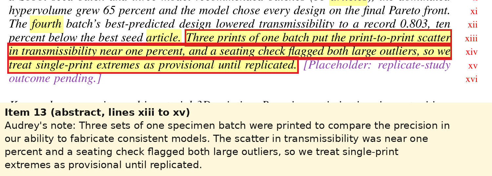

**Her copy:** "Three prints of one batch put the print-to-print scatter in transmissibility near one percent,
and a seating check flagged both large outliers, so we treat single-print extremes as provisional until
replicated." It was followed by a violet placeholder.

**Her rewrite:** "Three sets of one specimen batch were printed to compare the precision in our ability to
fabricate consistent models. The scatter in transmissibility was near one percent and a seating check flagged
both large outliers, so we treat single-print extremes as provisional until replicated."

**Head, line 169, after `95b331e`:** "After the conclusion of the campaign, several specimens were reprinted and
tested multiple times to account for variability."

The two rewrites crossed. What to weigh:

- **Sterling's version drops the finding.** The finding is that the scatter is near one percent and that the
  seat check caught both outliers. Audrey's keeps it, and the numbers hold up:
  - the screened print-to-print standard deviation is 0.0087 in t180 (lines 1587 to 1589), about 0.85% of a
    t180 near 1.03;
  - both gross outliers, drran7 at 1.251 and dran35 at 1.168, failed the seat gauge (lines 1572 to 1583).
- **"After the conclusion of the campaign" fits only part of the reprints.** It fits the third print
  (dran31 to dran39, logged 2026-09-29) and the replicate study (2026-10-17). It does not fit the second print:
  2dran was logged on
  [2026-09-05](https://github.com/vertical-cloud-lab/tensegrity-optimization/issues/98#issuecomment-5554276602),
  before batch 4 was printed
  ([2026-09-11](https://github.com/vertical-cloud-lab/tensegrity-optimization/issues/98#issuecomment-5637649574)).
- **Reprinting measures variability; it does not account for it.**

**Proposed (her content, his plainer framing, 35 words):** "We printed one batch three times to measure
fabrication repeatability. Print-to-print scatter in transmissibility was near one percent, and a seating
check flagged both large outliers, so we treat single-print extremes as provisional until replicated."

If the replicate study (corny2, corny7 and corny8, 27 specimens) should be in the abstract too, it needs its own
sentence once plates 2 and 3 are tested. Plate 1's results are interim: 58 of its 180 captures held no usable
impact, most likely because of an intermittent cable fault
([PR #86, 2026-10-19](https://github.com/vertical-cloud-lab/tensegrity-optimization/pull/86#issuecomment-6275768282)).

**A loose end from `95b331e`:** the draft-note box (lines 182 to 184) still says "The abstract and the
Conclusions each carry one violet placeholder". The abstract's placeholder is gone, so that should read "The
Conclusions carry one violet placeholder".

### 14. Introduction: defining trait

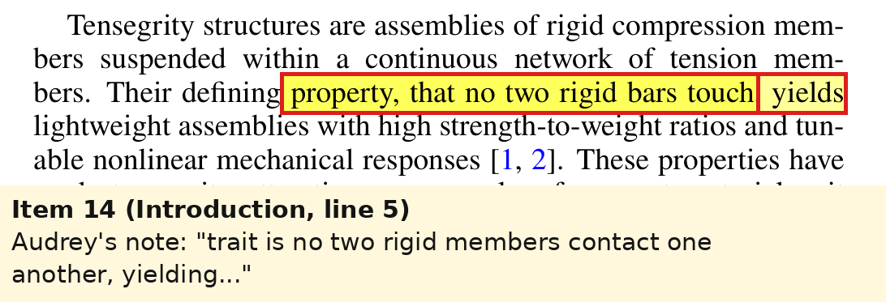

**Her note:** "trait is no two rigid members contact one another, yielding..." (a second highlight over the same
words has no comment). **Head, lines 209 to 210:** "Their defining property, that no two rigid bars touch,
yields lightweight assemblies with".

**Change:** "Their defining trait is that no two rigid members contact one another, yielding lightweight
assemblies with". "Members" also matches "rigid compression members" in the sentence before. The same phrase
("no two rigid bars touch") is in `proposal.tex` line 93, the earlier BYU proposal, which I would leave alone.

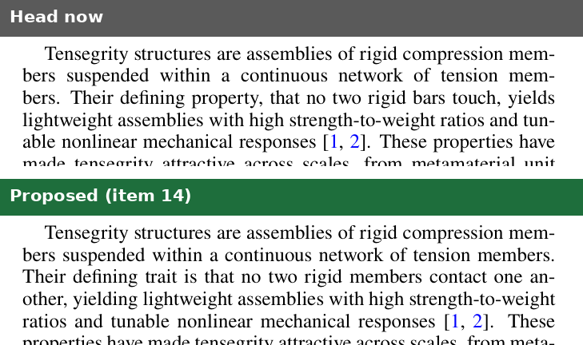

## Where Marcus's copy overlaps

Marcus posted his own annotated PDF to PR #76 on 2026-10-23
([comment](https://github.com/vertical-cloud-lab/tensegrity-optimization/pull/76#issuecomment-6371280517)). It
has 22 notes on pages 1 and 3 to 7. It was not addressed to me, so I have not worked through it. Three of his
points touch Audrey's items:

- Page 1, "rescaled" and "common mass": item 4.
- Page 1, "high velocity loss index", and page 7, three notes on Eq. (1) and the objectives paragraph: item 8.
  He also suggests "mass-weighted velocity loss index" and asks about e against e².

## Decisions needed

1. **@sgbaird:** item 8. Option A only, or A and B? Keep mJ or switch to grams?
2. **The team:** item 11. Is batch 4 the final batch?
3. **@sgbaird and @achris0520:** item 13. Accept the merged sentence, or keep one of the two versions?
4. **@me-madsen, @achris0520, Jinkwan:** the BYU e-mail addresses to add to the author block (item 1).

Everything else can be applied as listed once you give the go-ahead.

## How this was produced

- Downloaded the attachment and read its annotations with PyMuPDF
  ([`scripts/extract_annotations.py`](scripts/extract_annotations.py)). The highlighted words come from each
  highlight's quadrilaterals. All 15 annotations are in [`annotations.json`](annotations.json): type, page,
  position, comment, and the words under each highlight.
- Matched her copy to the committed build by comparing the text of all 18 pages, and by the PDF's creation date
  (2026-10-11 05:52 UTC).
- Rendered page 1 at 300 dpi with her annotations, outlined each item in red, and added a strip carrying her
  comment verbatim ([`scripts/make_crops.py`](scripts/make_crops.py)).
- Built the head source and a scratch copy with the proposed changes using pdflatex and bibtex (TeX Live 2023,
  `asmejour`). Both built without errors and without undefined references. The scratch copy was not committed
  ([`scripts/make_compare.py`](scripts/make_compare.py) draws the comparison images).
- Facts come from: the source at `5f260c8`, the print log on #98, the round-5 and replicate-study READMEs on the
  campaign branch at `65ff978`, the objective trace and m·e comparison on #97, #115, and ASME's author guidelines.
