# Group review of the manuscript, part 1 (Jinkwan Han, Audrey Christiansen, Marcus Madsen, up to 2026-11-05)

The group's annotated Word file, posted to PR #76 by Marcus on 2026-11-05
([comment](https://github.com/vertical-cloud-lab/tensegrity-optimization/pull/76#issuecomment-6670196820),
[file](https://github.com/user-attachments/files/34449460/manuscript.group.review.up.to.11-5-2026.docx)),
with what was changed for each note, the answers to the questions, and the reports Marcus asked for.
The review is not finished; it covers the abstract, the Introduction, and Methods Sections 3.3 and 3.4.

**Which draft they annotated.** The Word build committed at `ce6c4ec` (2026-10-25). Its text matches the
group's file in 510 of 515 paragraphs. The other five are the abstract (Audrey's tracked changes) and the
first three Introduction paragraphs, which were edited directly, without track changes. The file holds
**23 comments** (Audrey 6, Jinkwan 7, Marcus 10) and **15 tracked changes**, all by Audrey and all in the
abstract.

**The source had moved since.** Five request PRs (#119 to #123) were merged on 2026-11-05, so several notes
were already handled ("article" to "specimen", "fourth" to "final", PLA/TPU in the abstract). Each entry
below says what the current text does. Locations are given by section and paragraph heading because the
active-voice pass (item C0) moved every line number.

**Unlike the earlier review sheets, the changes here are applied.** Marcus asked for the suggestions to be
incorporated, so the manuscript and SI on the branch already contain everything marked *Applied*.

## Contents

1. [The second objective is now m·e² (merged from PRs #125 to #127)](#1-the-second-objective-is-now-me2)
2. [Direct edits (untracked) in the Introduction](#2-direct-edits-untracked-in-the-introduction)
3. [Tracked changes in the abstract](#3-tracked-changes-in-the-abstract)
4. [Comments, one by one](#4-comments-one-by-one)
5. [Reports requested](#5-reports-requested)
6. [Still open](#6-still-open)

## 1. The second objective is now m·e²

Audrey (C11, "index now is calculated by m(v₂/v₁)²") and Marcus (C41, "our optimized units won't be in
energy but in mass (m·e²)") both read the paper as if the second objective were already m·e². It was not.
Marcus made that decision on 2026-10-29 on
[PR #97](https://github.com/vertical-cloud-lab/tensegrity-optimization/pull/97#issuecomment-6510766502),
and a session that night prepared the manuscript side as PRs #125 (text), #126 (figures) and #127
(batch-results table). Those PRs were stacked on the request branches rather than on this one, so the
2026-11-05 reconciliation did not see them, and they sat unmerged.

To make the paper match the group's comments, this session merged all three:

| Commit | What it brings in |
|---|---|
| `a02af3d` | PR #126: front-evolution figure in I_reb (mg), hypervolume at the (1.35, 50 mg) reference; three-print figure panel (b) in I_reb |
| `5a76d8d` | PR #127: generated batch-results table in I_reb |
| `efe8fa7` | PR #125: Eq. (1), Methods, abstract, Results numbers, SI tables in I_reb; four conflicts with the 11-05 reconciliation resolved (listed in the commit message) |

**This reverses Sterling's 2026-10-27 decision** (Request A kept E_reb = e·m·g·h and argued for e over e²).
The 10-29 session flagged that and asked for it to be settled; nobody replied on either side. If Sterling
wants m·e·g·h back, reverting these three merge commits restores it. Two things to know:

- The name is **"mass-weighted rebound index", I_reb = m·e²**, not "mass-weighted velocity loss index"
  (Marcus's 10-29 wording and Audrey's abstract edit). The paper defines the velocity loss index as
  VLI = 1 − e, where higher is better, while I_reb is minimized and grows with rebound. Calling the minimized
  quantity a velocity loss index would say the optimizer minimizes velocity loss, the opposite of the intent.
- Batches 2 to 4 were recommended under E_reb. The batch-4 predictions figure and the cross-validation
  numbers stay in E_reb because those predictions were made in that form, and the text says so.

## 2. Direct edits (untracked) in the Introduction

Found by diffing the group's file against the `ce6c4ec` build. All three paragraphs are applied as written,
with the small exceptions in the right-hand column.

| Paragraph | Group's edit | In the manuscript now |
|---|---|---|
| Intro ¶1 | "Their defining property, that no two rigid bars touch, yields" → "Their defining trait is no two rigid members contact one another, yielding" | Kept Request A's "Their defining trait **is that** no two rigid members contact one another, yielding" (Audrey's 2026-10-23 item 14). |
| Intro ¶1 | "attractive across scales, from" → "attractive from" | Applied. |
| Intro ¶1 | "Throughout, we use tensegrity-inspired for printable cells that borrow the separated compression-member and tension-network geometry of tensegrity while relaxing defining mechanical conditions of classical tensegrity." → "Throughout this paper, we use tensegrity-inspired to refer to printable cells that borrow the geometry of traditional tensegrity structures without the defining mechanical conditions of pretensioned members, or cables, associated with classical tensegrity." | Applied. |
| Intro ¶1 | "In the present specimens, the printed soft tension elements are extensible, the rigid struts may share printed junctions, and no pretension is activated or measured. We therefore do not claim classical tensegrity, prestress-stabilized behavior, or equivalence to an ideal cable-strut prism." → "In our specimens, the 3D printed cables are not tensioned as a true tensegrity structure. Additionally, the flexible cables share a junction within the vertex of each rigid strut. Therefore, we do not claim our specimens to be classical tensegrity structures." | Applied, with two grammar fixes: "not tensioned **as in** a true tensegrity structure", and "within **the vertices** of each rigid strut" (each strut has a junction at both ends). This also settles the "rigid struts may share printed junctions" problem raised on 2026-11-05. |
| Intro ¶2 | Rewritten: "can be used to pair a rigid polymer and a soft elastomer within the same part", "energy absorbers which consist of both soft and rigid portions", "origami composites composed of PLA panels and TPU hinges", "honeycombs of ABS interspersed in layers with TPU", "as well", and the last clause cut after "applications". | Applied. Your edit removed the body's only definitions of PLA and TPU, so the first use now spells them out: "polylactic acid (PLA) panels and thermoplastic polyurethane (TPU) hinges". ASME asks for abbreviations to be defined again in the text even when the abstract defines them. |
| Intro ¶3 | "Designing such architected absorbers is a design-of-experiments problem" → "Designing such structures capable of energy absorption is a Design of Experiments problem"; "tension-element" → "cable"; "printed and tested, and the relevant" → "printed and tested. The relevant" | Applied; the sentence after it was then rewritten for C22. |
| Eq. (1) | "1 − VLI" shows as "1-VLI" | A Word conversion artifact, not an edit. Nothing to apply. |

## 3. Tracked changes in the abstract

All 15 are Audrey's. Request A had already applied most of them on 2026-11-05.

| Audrey's change | Current abstract |
|---|---|
| "polylactic acid **(PLA)**", "thermoplastic polyurethane **(TPU)**" | Present. |
| "~~re~~scaled" | "We scale each candidate to a common mass target before printing" (now active voice, C0). |
| "**3D** printed" | "then 3D print and drop-test it repeatedly". |
| "(~~the top-to-base ratio of filtered peak accelerations~~ **measured as a ratio of filtered top-to-base peak accelerations**)" | Present as written. |
| "a ~~low~~ **mass-weighted** velocity loss index" | "We score designs by transmissibility (...) and a mass-weighted rebound index (specimen mass times the squared fraction of impact velocity returned at the top), both minimized". Mass-weighted as you wrote; the name is explained in Section 1. |
| "~~articles~~ **specimen**" (twice) | "specimens". |

## 4. Comments, one by one

Each entry: the highlighted text (red box in the screenshot, taken from the group's file), the comment, and
what happened.

### C0, Audrey: "The whole document should be in active voice."

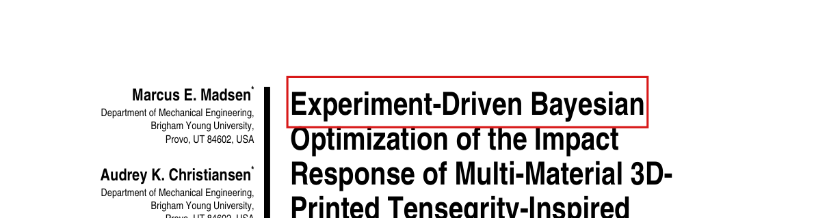

**Applied** across the main text. See [Report R6](#r6-active-voice-pass-c0) for how, and what was left passive.

### C1, Audrey: "Does this need to be 18 pages long?"

**Answered** in [Report R5](#r5-length-c1). Short version: no. JMD's limit is about 12 typeset pages, and the
draft is about 4 to 6 pages over. Two of the group's own notes (C44, C49) removed text this session; the
larger cuts are listed for the team.

### C11, Audrey: "index now is calculated by: m(v₂/v₁)²"

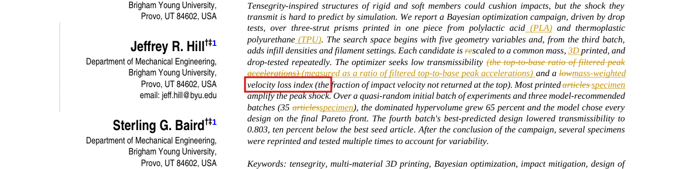

**Applied** by the merge in Section 1. Eq. (1) now defines I_reb = m·e_reb², with e_reb = g·t_second/(2Δv),
which is v₂/v₁ with the hop speed v₂ = g·t_second/2 and v₁ = Δv.

### C15, Audrey: "'printed articles' was confusing to read. It made me think we were talking about other people's papers"

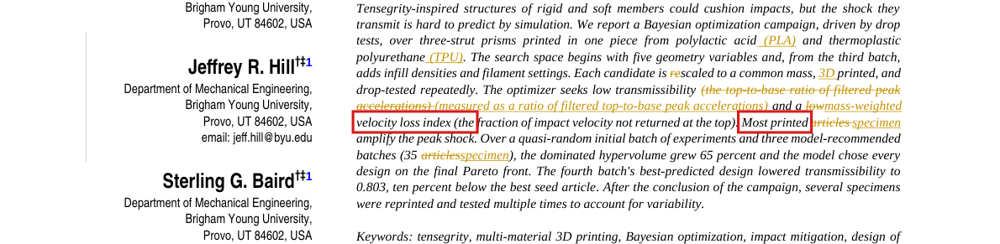

**Already applied** by Request A: "article" is now "specimen" for every printed or tested object in the body,
SI, captions and tables.

### C19, Audrey: "consider changing to 'final'. Did we do any batches after this?"

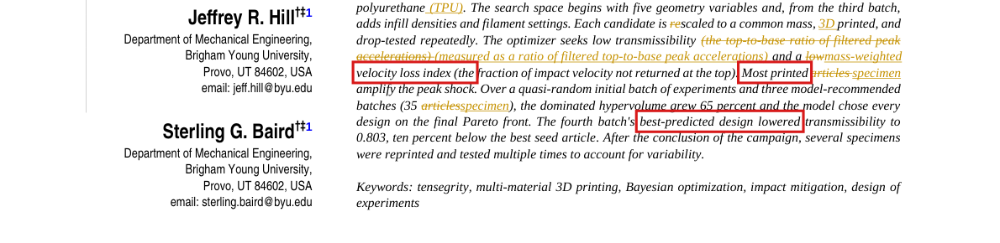

**Already applied** ("The final batch's best-predicted design"). **No batch after the fourth has been
printed.** A fifth batch was generated (and regenerated under I_reb on 2026-10-29 as run 6) but not printed.
Since then the printer has made the third print of batch 3 and the three plates of the replicate study, and
drop testing stopped on 2026-10-19 when the input-channel instrumentation failed (#115).

### C20, Audrey: "specimen"

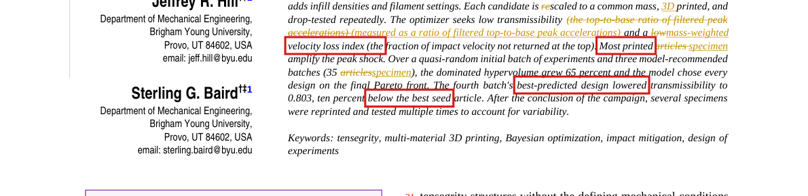

**Already applied** ("10 percent below the best initial-batch specimen").

### C22, Audrey: "all measurements are noisy; also how does it help to say they are partially correlated?"

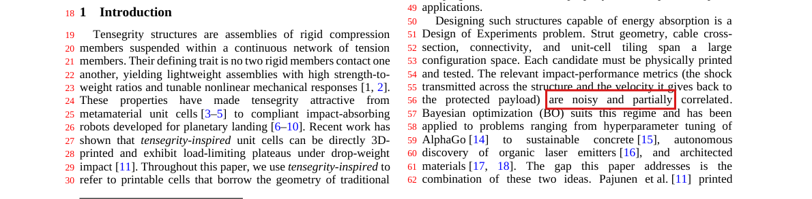

**Applied.** Agreed on both counts. The sentence now says what each property means for the search:

> Its performance has to be estimated from repeated drops, because the scatter between drops and between
> prints can be as large as the differences between designs. The two relevant impact-performance metrics
> (the shock transmitted across the structure and the velocity it gives back to the protected payload)
> also partly conflict, so a design that improves one can worsen the other.

The data back "partly conflict": across the 35 first-print specimens, the transmissibility and I_reb have
Spearman ρ = −0.39 (p = 0.02). Designs that pass less shock tend to send more motion back. That is why the
paper optimizes both and reports a Pareto front instead of a single best design.

### C23, Jinkwan: "These examples are so random, and I think these should have more natural flow or consistency"

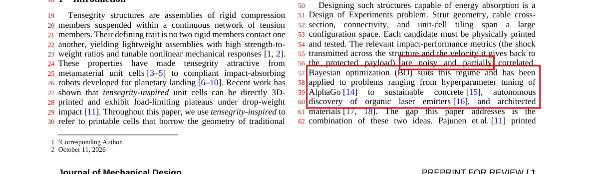

**Applied.** The examples now run from general to specific, ending at the closest work:

> Bayesian optimization (BO) suits this regime. It chooses each next experiment from a probabilistic model
> fitted to every result so far, it accounts for measurement noise, and it can trade off two objectives. BO
> is widely used to tune machine-learning models, including AlphaGo [14], and increasingly to guide physical
> experiments in materials research, from sustainable concrete [15] to organic laser emitters [16]. Closest
> to this work, it has been applied to the design of architected materials [17, 18].

### C24, Jinkwan: "What are the two ideas?"

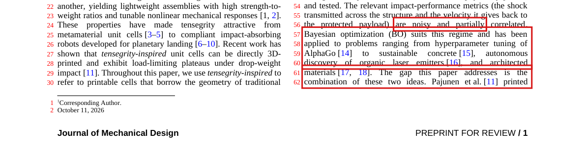

**Applied.** "The gap this paper addresses is the combination of these two ideas: multi-material printing of
tensegrity-inspired structures, and BO driven by physical experiments." The next sentence (Pajunen printed
cells with no optimization loop; Mo closed a BO loop only in simulation) now reads as one example of each.

### C25, Jinkwan: "not flight hardware ... This part confused me a lot. Maybe bring the planetary lander before this sentence."

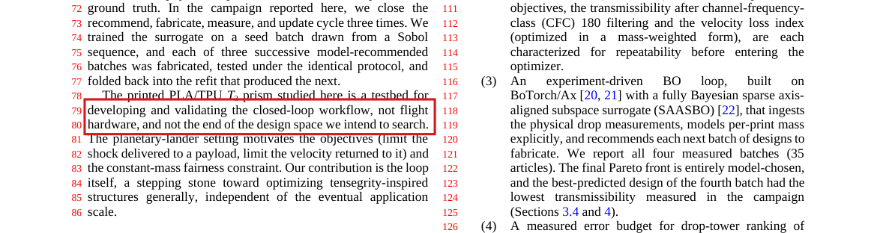

### C26, Jinkwan: "What objectives are you talking about? Need to be specific ..."

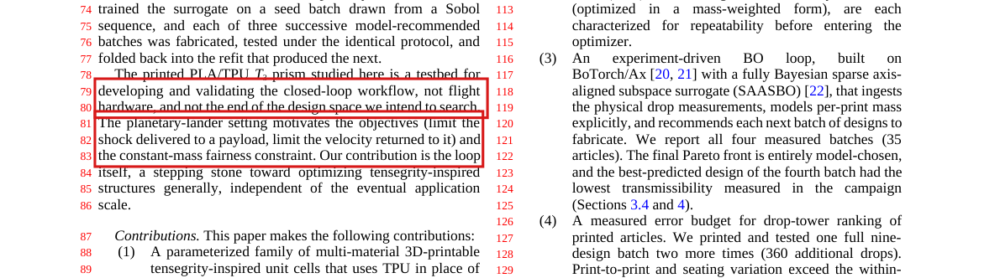

**Applied (C25 and C26 together).** The paragraph now opens with the lander and names both objectives:

> Our motivating application is protecting the payload of a planetary lander, where added mass is costly.
> An absorber there should limit the peak shock delivered to the payload during touchdown and the motion it
> sends back into the payload afterward. These two needs set the two objectives of this paper. The
> transmissibility t₁₈₀ compares the peak acceleration at the top of the structure with the peak at its base.
> The mass-weighted rebound index I_reb grows with the specimen's mass and with the share of the impact
> velocity it returns (Section 3.3). The mass budget sets a third condition, that we print every candidate at
> a common mass. The printed PLA/TPU T₃ prism studied here is a testbed for developing and validating the
> closed-loop workflow. It is not flight hardware, and it is not the end of the design space we intend to
> search. ...

### C27, Jinkwan: "Grammar error: impact -> impact,"

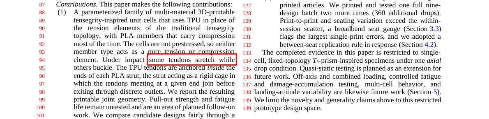

**Applied** ("Under impact, some tendons stretch while others buckle.").

### C28, Jinkwan: "Weren't those 100 stabilized captures? Also, keep consistency in the number expression (twenty to 20)"

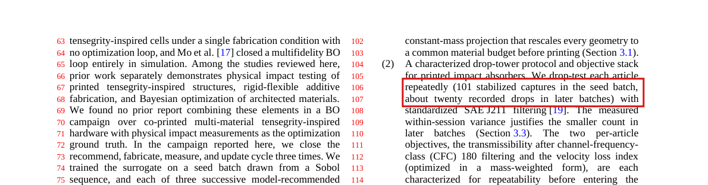

**Neither 100 nor 101: 99. Corrected everywhere.** See [Report R4](#r4-drop-counts-c28). Numbers of 10 or more
are now numerals throughout the body and SI ("about 20 drops", "about 90 minutes", "15 co-located drops",
"10 percent").

### C30, Jinkwan: "Maybe 'Section 6 presents the conclusion' or 'Section 6 concludes the paper'"

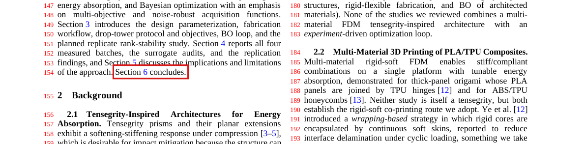

**Applied** ("Section 6 concludes the paper.").

### C41, Marcus: "Our optimized units won't be in energy but in mass (m·e²) so we don't need to include this in here."

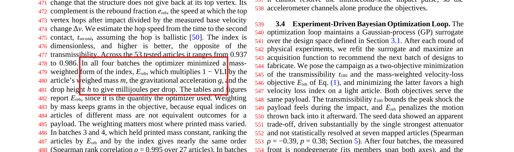

**Applied.** With the merge in Section 1 the objective is I_reb in milligrams. E_reb is no longer in Eq. (1);
one inline sentence keeps it, because the optimizer chose batches 2 to 4 with it and the batch-4
predictions and the cross-validation are in it:

> We adopted I_reb after the final batch, and any later batch minimizes it. The optimizer that recommended
> batches 2 to 4 used the first power of the rebound fraction instead, E_reb = e_reb·m·g·h ...

### C42, Marcus: "What does this mean to check hop time against synchronized video?"

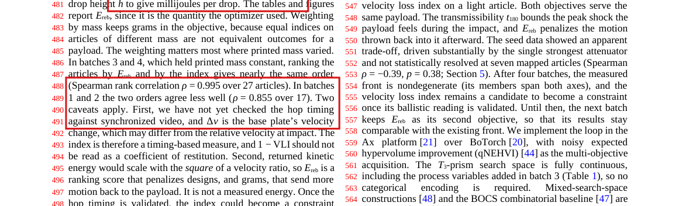

### C43, Marcus (reply): "The velocity measured by the accelerometer at the base should not be different from the initial velocity of the top of the structure at impact? It's moving as one unit as it descends."

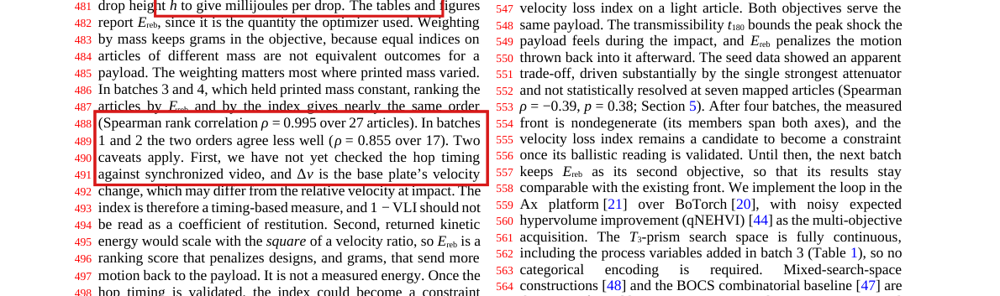

**Answered, and the caveat rewritten.** See [Report R3](#r3-methods-33-in-plain-terms-c41-to-c47), parts
"Checking hop timing against video" and "Δv". In short: the hop speed comes from a clock reading on the top
accelerometer, and video is the independent check that the second burst really is the top landing again.
You are right that the top and the base arrive at the same speed. But Δv is not the arrival speed: it is the
base plate's total velocity change through the impact, and the carriage bounces back off the mat, so
Δv is the arrival speed plus that bounce. A video check on 2026-10-29 also found two designs whose second
burst is not a hop at all. The caveat now says both, with a `\todo` asking the lab to confirm the video
observations.

### C44, Marcus: "Probably don't need to be included in anything but the supplementary information if they're not related to the results we're presenting."

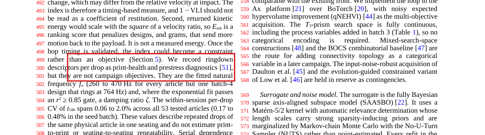

**Applied.** The ringdown paragraph moved to the SI (drop-tower section, "Ringdown diagnostics"), and the
f_n column left the seed-results table, which now fits in one column. Moving it exposed an error: the old
text said f_n was 260 to 470 Hz "for every specimen but one batch-4 design that rang at 764 Hz", but r2d2c7
(batch 2) rang at 682 Hz. The SI now names both.

### C45 and C46, Marcus: "What is a re-seat candidate?" and "Let's have a report about what this is talking about generated."

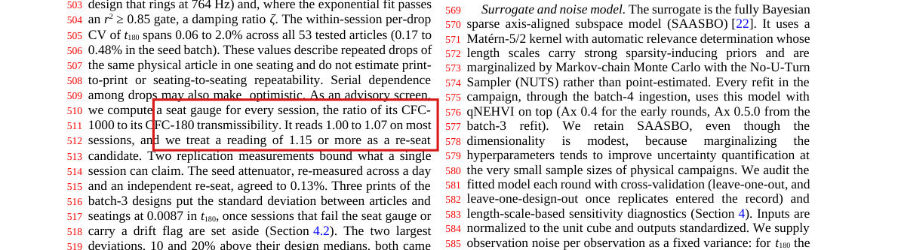

**Report written:** [Report R1](#r1-the-seat-gauge-and-re-seat-candidates-c45-c46). The Methods sentence is
also rewritten in plain terms:

> As an advisory check on how well a specimen is seated on the carriage, we computed a seat gauge for every
> session, the ratio of its CFC-1000 to its CFC-180 transmissibility. The CFC-180 filter keeps the slower
> part of the response (its corner is near 300 Hz). CFC-1000 (corner near 1.65 kHz) also keeps short, sharp
> spikes, such as a loosely seated specimen or top sensor knocking against its seat. A well-seated
> session gives nearly the same ratio at both filter classes, and the gauge read 1.00 to 1.07 on most
> sessions. We call a session that reads 1.15 or more a re-seat candidate: we should take its specimen off
> the carriage, mount it again, and re-test it before using its value for a decision.

### C47, Marcus: "Really don't understand most of this section from line 457 ... to here."

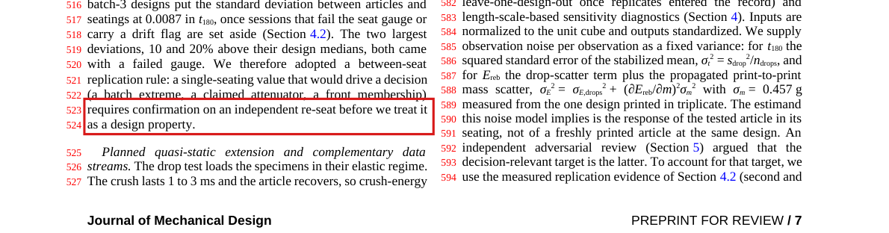

In a rendering of the group's file, line 457 is the sentence just before Eq. (1), so the note covers the whole
objectives discussion through the replication rule. In the `ce6c4ec` build most of it was one paragraph of about
700 words. **Explained** in [Report R3](#r3-methods-33-in-plain-terms-c41-to-c47).
In the manuscript it is now split into headed paragraphs (the transmissibility definition right after
Eq. (1), then "Mass-weighted rebound index", "Limits of the rebound measurement", "Square of the rebound
fraction", and "Session diagnostics and replication"), the energy form is out of the
equation (C41), the video caveat is rewritten (C42, C43), and the seat gauge is explained (C45).

### C49, Marcus: "Not sure this is necessary to include"

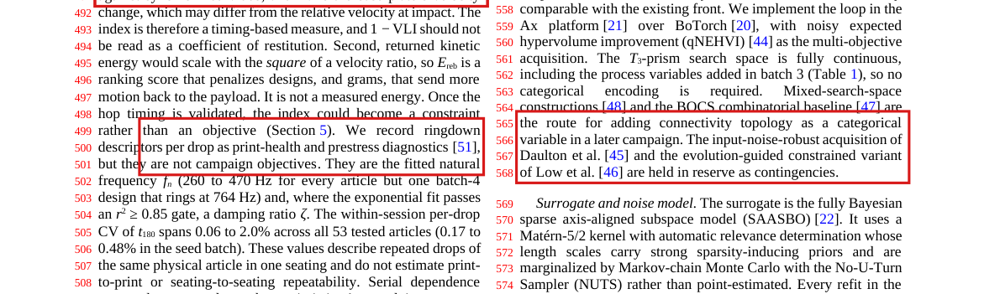

**Applied.** Both sentences are gone from Methods 3.4 (the categorical-variable route for connectivity and
the two contingency acquisition functions). The Background still cites those methods.

### C50, Marcus: "Not 100% certain about this math, let's get a report written up for what this is referring to."

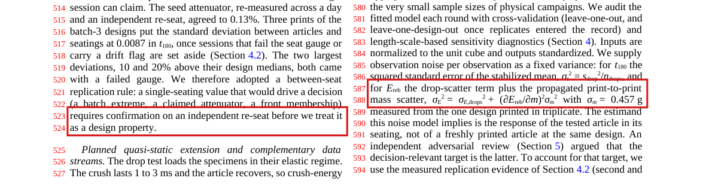

**Report written:** [Report R2](#r2-the-noise-model-math-c50). The sentence is also rewritten as relative
errors with the source of the 0.457 g stated.

## 5. Reports requested

Every number below comes from the committed snapshots in `manuscript/data/` via
[`analysis/group_review_reports.py`](analysis/group_review_reports.py), which writes
[`report-numbers.json`](analysis/report-numbers.json),
[`seat-gauge-sessions.csv`](analysis/seat-gauge-sessions.csv) and
[`noise-model-terms.csv`](analysis/noise-model-terms.csv).

### R1. The seat gauge and re-seat candidates (C45, C46)

**What it is.** Every drop is filtered at two SAE J211 channel frequency classes: CFC-180 (corner near 300 Hz),
the class the paper reports, and CFC-1000 (corner near 1.65 kHz), a wider band kept as a diagnostic.
The transmissibility is computed at both classes, and the seat gauge is their ratio:

seat gauge = t₁₀₀₀ / t₁₈₀ = (top peak / base peak at CFC-1000) / (top peak / base peak at CFC-180)

**Why it says something about seating.** A specimen that sits firmly on the carriage, with the top sensor
firm in its pocket, responds smoothly, and widening the filter band changes the top and base peaks in roughly
the same proportion, so the gauge stays near 1. If something is loose, it knocks at impact: a short, sharp
spike on the top channel. CFC-180 smooths that spike away, CFC-1000 keeps it, so the top's CFC-1000 peak
grows and the gauge rises. The plate-1 replicate session of 2026-10-17 is the clearest case on record: the
top accelerometer knocked in its seat on every corny7 and corny8 copy, and every one of those sessions failed
the gauge.

**What "re-seat candidate" means.** "Seat" is how the specimen sits on the carriage (and the sensor in its
pocket); a "re-seat" is taking the specimen off, mounting it again, and testing again. A session reading 1.15
or more is a candidate for that: its value might reflect the mounting rather than the design. The gauge is
advisory. It does not delete data; it says which values need a second seating before anyone acts on them
(the between-seat replication rule).

**Where the numbers came from.** The lab defined the gauge on 2026-09-12, after the first two prints of
batch 3 had been tested. In the three prints of batch 3, the four sessions at 1.15 or more were each
their design's highest reading, 4.5 to 19.8% above the design median, while the other 23 sat a median 0.2% from it (Spearman ρ = 0.52, p = 0.006
between gauge and deviation). The analysis code applies the 1.15 cutoff at two decimals, so a gauge of
1.145 counts.

**Every session, applied retrospectively:**

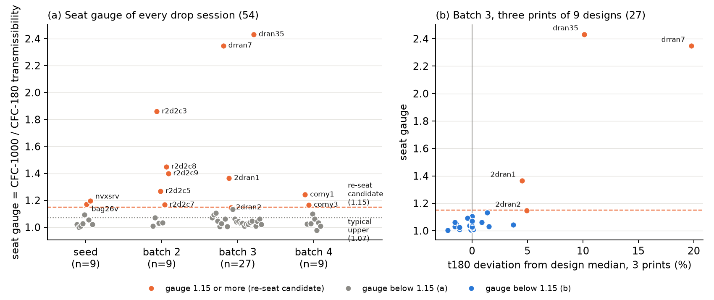

| Batch | Sessions | Gauge ≥ 1.15 |
|---|--:|---|
| Seed | 9 | bag26v 1.17, nvxsrv 1.20 |
| Batch 2 | 9 | r2d2c3 1.86, r2d2c8 1.45, r2d2c9 1.40, r2d2c5 1.27, r2d2c7 1.17 |
| Batch 3, three prints | 27 | dran35 2.43, drran7 2.35, 2dran1 1.37, 2dran2 1.15 |
| Batch 4 | 9 | corny1 1.24, corny3 1.17 |
| **All** | **54** | **13** (36 read 1.07 or less, median 1.045) |

**What it means for the paper.**

- The four batch-4 attenuators (corny6, corny7, corny8, corny9) pass (0.98 to 1.06), which the Results
  already state.
- Batch 2 is the weak spot: five of nine sessions would be re-seat candidates, including r2d2c3, the
  campaign's highest transmissibility (1.334) at a gauge of 1.86. The gauge did not exist when batch 2 was
  tested, so none of those were re-seated. The paper does not currently say this; worth a sentence if the
  team agrees.
- Caveat from 2026-10-27 (Request D): the campaign pipeline may still use the older single-pass CFC filter.
  On the trace drop that leaves t₁₈₀ unchanged but moves the CFC-1000 ratio from 1.204 to 1.287, so every
  gauge value depends on which filter ran. The pipeline owner should check before the gauge numbers are final.

### R2. The noise model math (C50)

**What the sentence describes.** BO needs to know how uncertain each measured objective value is. The
campaign gives the model a fixed standard error per specimen instead of letting it infer one. For the
rebound objective, that standard error combines two sources:

1. **Drop-to-drop scatter within the session.** Each drop gives a slightly different rebound fraction e. The
   standard error of the session mean is σ_e = sd(e)/√n.
2. **Print-to-print variation, through mass.** The objective is proportional to the specimen's mass. Its own
   mass is weighed to 0.01 g, so this is not weighing error. It stands in for "if we printed this design again,
   it would weigh a little differently": σ_m = 0.457 g is the sample standard deviation of the three prints of
   seed design spec 08 (22.29, 21.42 and 22.10 g, all on plate 1), about 2.3% of a 20 g specimen.

**The formula.** First-order error propagation: for y = f(e, m), σ_y² = (∂y/∂e)²σ_e² + (∂y/∂m)²σ_m².

- For E_reb = e·m·g·h (batches 2 to 4): ∂E/∂e = m·g·h = E/e and ∂E/∂m = e·g·h = E/m, so
  (σ_E/E)² = (σ_e/e)² + (σ_m/m)². The `ce6c4ec` sentence wrote the same thing as
  σ_E² = σ_E,drops² + (∂E/∂m)²σ_m², with σ_E,drops = (E/e)·σ_e.
- For I_reb = m·e² (from now on): ∂I/∂e = 2·m·e = 2I/e and ∂I/∂m = e² = I/m, so
  (σ_I/I)² = (2σ_e/e)² + (σ_m/m)². The square doubles the drop term.

This is exactly what the code computes (`e_reb_sem = e_reb * hypot(e_sem/e_mean, 0.457/mass_g)` in
`bo/t3_prism_bo_campaign.py` on the campaign branch, with the factor 2 added for I_reb on PR #128).

**How big the terms are** (53 specimens with a weighed mass):

| | Drop term (median) | Mass term (median) | Total (median) | Mass term larger |
|---|--:|--:|--:|--:|
| E_reb | 0.5% | 2.3% | 2.4% | 42 of 53 |
| I_reb | 1.0% | 2.3% | 2.5% | 37 of 53 |

**What it does not capture.** The real print-to-print scatter of the rebound objective is far larger than 2.5%.
Across the three prints of batch 3, the largest print of a design is 1.35 to 2.9 times its smallest under E_reb
(1.9 to 8.3 under I_reb), and the between-print standard deviation is 3.4 mJ against design means of a few
to 15 mJ. So the model is told each value is about ten times more certain than a re-print would show. The
paper states this as the estimand caveat (the noise model describes "the tested specimen in its seating, not a
freshly printed specimen"), and it is one reason the rebound cross-validation is poor. Two small points: σ_m
comes from one design and three prints, and σ_e divides by all valid captures including the two warm-up
drops, which understates it by 1 to 5%. Neither changes the picture.

### R3. Methods 3.3 in plain terms (C41 to C47)

**One drop.** The specimen rides upright on the Lansmont carriage, which falls 60 in and lands on a
polyurethane mat. An accelerometer on the carriage plate records the base input; a triaxial accelerometer in
a pocket at the specimen's top vertex records what reaches the top.

**Transmissibility, t₁₈₀.** Peak top acceleration over peak base acceleration, both after CFC-180 filtering.
Above 1, the structure amplifies the shock at the top; below 1, it attenuates it. "Transmissibility" is used
in the shock-testing sense (a ratio of filtered peaks for one transient), not the vibration-isolation
frequency response.

**Rebound fraction, e_reb, and the index.** After impact the top vertex rises and comes back down, which
shows up as a second burst on the top channel at time t_second. If that motion is a free (ballistic) hop, the
top left at speed v₂ = g·t_second/2. Dividing by v₁ = Δv gives e_reb = v₂/v₁, the share of the impact
velocity returned at the top. VLI = 1 − e_reb is just its complement, used only when quoting values (higher
is better). The optimized quantity is I_reb = m·e_reb² in mg (lower is better); batches 2 to 4 were chosen
with E_reb = e_reb·m·g·h in mJ.

**Checking hop timing against video (C42).** The hop speed is inferred from a clock reading, not measured.
"Checking against synchronized video" means filming the drop at high speed (959 fps), lining the video up with
the accelerometer record, and confirming that (a) the top really leaves and lands again, and (b) the landing
in the video happens at the accelerometer's t_second. On 2026-10-29 a session did a first version of that
check with the corny videos from #114 and the replicate-study video (PR #97 comment
[6510919667](https://github.com/vertical-cloud-lab/tensegrity-optimization/pull/97#issuecomment-6510919667),
commit `79d21d0`):

- On corny1 to corny5, a hop of the size the timing implies (about 1 mm) is within the video's tracking noise,
  so the video neither confirms nor rules it out.
- Replicate prints of corny7 and corny8 never leave the plate. They fold at impact and snap upright 40 to
  55 ms later, so their second burst is the tendons pulling taut, not a landing.
- The 15 to 70 ms search window clips the burst on five of the nine batch-4 designs.

**Δv (C43).** You are right that the top and the base fall together and arrive at the same speed. But Δv is
not that arrival speed. It is the base plate's total velocity change during the impact pulse, from the
integrated base acceleration. The carriage bounces back off the mat, so Δv = arrival speed + bounce speed. In
the seven filmed batch-4 drops the carriage arrived at 4.62 to 4.78 m/s and bounced back at 0.56 to 0.64 m/s,
and Δv was 5.1 to 5.4 m/s. That makes e_reb about 11% smaller than "return speed over arrival speed" would be
(about 21% for e²). Because the bounce is a property of the mat and the carriage, not the 20 g specimen, the
factor is nearly the same for every design and does not change their order.

**What the manuscript says now.** The caveat is rewritten with these findings and a `\todo` for the lab to
confirm them (they come from an AI session's video analysis that nobody has checked by hand yet).

**Session diagnostics.** The within-session CV says how repeatable one specimen is in one seating; it says
nothing about a re-print or re-seat. The seat gauge (R1) flags sessions whose value may be a seating
artifact, and the between-seat rule says that any value that would drive a decision needs a second seating
first.

### R4. Drop counts (C28)

Jinkwan's question exposed an error that had been flagged twice (2026-09-02, 2026-09-15) and never settled.
The archived summaries' `n_valid` column counts every valid capture, **including** the two warm-up drops
(`analyze_specimen` in `scripts/analysis/drop_test_campaign_analysis.py` on the drop-test branch sets
`n_valid = len(valid)` and computes the means over `rows[warmup:]`). The raw TP4 series tables agree: the
6lhxfy seed session holds events 2 to 102, which is 101 drops, and the folder is named "101drops".

| Batch | Specified | Recorded per specimen | Stabilized (after 2 warm-up drops) | Paper said |
|---|---|---|---|---|
| Seed | 100 | 101 (103 for autv5r) | **99** (101) | "recorded 103, 101 stabilized" |
| Batch 2 | about 20 | 21 or 22 | **19 or 20** | "21 to 22 valid captures" |
| Batches 3 and 4 | 20 | 20 | **18** | "20 recorded drops" |

The body (Contributions, Methods 3.3, seed and batch table captions, Conclusions) and the SI (protocol
paragraph and settings table) now give recorded and stabilized counts separately. The SI's "should be
re-verified by a person" sentence became a `% TODO (lab)` comment, since Marcus's request for a human check
still stands. No result changes: the means were always computed over the stabilized drops; only the quoted
counts were off.

### R5. Length (C1)

No, it does not need to be. The PDF is now 18 pages (17 of text plus the list of figures and tables, which
the typeset paper drops). JMD's FAQ allows 12 typeset pages, about 10,000 words plus 5 to 8 figures or
tables, with a charge per page beyond that; its submission instructions say 9,000 words; ASME's general
guideline is 12,000 word-equivalents, with each figure or table counted by the space it takes. By any of
these the draft is 4 to 6 pages over. Sterling said a separate length pass follows the request merges.
Candidates that lose little:

- The simulation-only campaign (Methods 3.5, Results 4.4, contribution 5): about a column, and Sterling asked
  for it to stay; it could move to the SI with two sentences left.
- The replicate-specimen photo panel and Section 3.6 detail, since no replicate result is reported.
- Fig. 4 (the commissioning trace) to the SI.
- The "Square of the rebound fraction" paragraph, which now argues a decision the team has made, to the SI.
- The Discussion's crutch-tip and simulation-role paragraphs.

### R6. Active-voice pass (C0)

**Applied to the main text** (abstract through Data Availability Statement). Five passes ran in parallel, one per
part, each limited to grammatical voice. A script then checked every part against its input: no number,
citation, cross-reference, label, equation, `\todo`, comment line or `\begin`/`\end` changed, and no dash was
added. All five passed.

| Part | Passive constructions converted |
|---|--:|
| Abstract, Introduction, Background | 18 |
| Methods 3.1 and 3.2 | 29 |
| Methods 3.3 to 3.7 | 40 |
| Results | 40 |
| Discussion, Conclusions, back matter | 17 |
| **Total** | **144** |

Typical edits: "Each candidate is scaled to a common mass target" → "We scale each candidate to a common mass
target"; "Signals were captured at 1.25 MHz" → "We captured signals at 1.25 MHz"; "Batches 2 to 4 were
recommended under ..." → "The optimizer recommended batches 2 to 4 under ..."; "This work was supported by the
BYU Mentored Research Grant program" → "The Brigham Young University Mentored Research Grant program supported
this work".

**Left passive on purpose:**

- **Your three hand-edited Introduction paragraphs**, exactly as you wrote them. They contain passives ("can be
  used to pair", "It has been used to fabricate", "has to be estimated", "BO is widely used"); say if you want
  those converted too.
- **States and technical terms**, where the active form changes the meaning: "dominated" and "non-dominated"
  (Pareto), "confounded with", "not pretensioned", "how well a specimen is seated".
- **Participle modifiers** that describe a noun rather than form a clause ("prisms printed in one piece",
  "supports painted by hand", "specimens drawn to one scale"). Converting all of them would add a "we" to
  nearly every sentence.
- **Fragments with no agent** in the abstract ("both minimized", "until replicated"). The abstract is at
  exactly 200 words, JMD's limit.
- **`\todo` text and ASME template sentences.**

**Three edits changed a word as well as the voice** (Discussion): "is driven substantially by the single
strongest attenuator" → "depends substantially on" (the Results still say "driven"); "Printed mass is itself
induced by the geometry" → "The geometry induces printed mass"; "used in place of" → "taking the place of".

**Not done:** the Supplementary Information. Audrey's note was on the manuscript; the SI can get the same pass
on request.

## 6. Still open

- **Sterling:** the m·e² reversal (Section 1).
- **Lab:** confirm the video observations behind the new hop-timing caveat (`\todo` in Methods 3.3), and the
  per-session drop counts (SI `% TODO (lab)`).
- **Team:** whether to add a sentence on batch 2's seat-gauge failures (R1), and the length cuts (R5).
- **Unchanged from earlier sheets:** BYU e-mail addresses for Marcus, Audrey and Jinkwan; the captive-core
  joint confirmation; the carriage-photo specimen; the CFC filter version in the campaign pipeline.
- **The review itself is not finished.** It stops at Methods 3.4. The rest of Methods, Results, Discussion
  and the SI have not been through the group yet.
